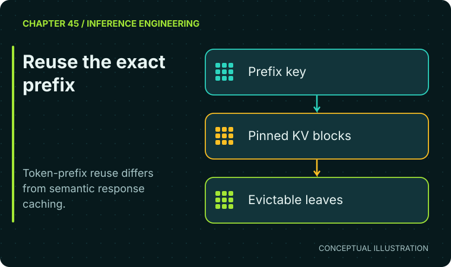
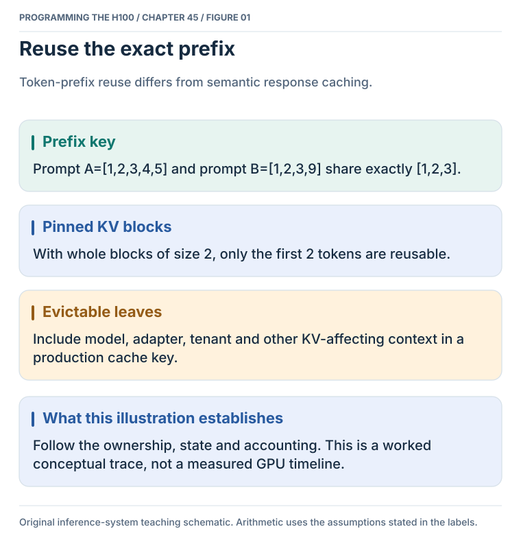

# Chapter 45 — A Radix-Tree Prefix Cache

[](images/chapter-openers/45-inference.svg)


!!! warning "Evidence status"
    **Run on CPU:** a radix-tree prefix cache with pinning and LRU/FIFO eviction, a block-hash cache for comparison, 14 self-tests (including comparisons with brute-force references), and seven experiments (`ch45_radix_prefix_cache.py`). Experiment cells show the mean and, in brackets, the minimum–maximum over 3 seeds of 1500 requests.
    **Nothing here touches a GPU or real KV tensors.** The cache stores *token ids and counts*, not KV blocks; joining the tree to Chapter 43's block pool is left to the capstone. Token ids are random integers and the workloads (system prompts, multi-turn chat, RAG, exact repeats) are **assumed shapes**, not traces. Statements about how SGLang and vLLM organise their caches (token-granular radix tree and full-block hashing respectively) are from memory of their designs; check the current documentation.

Chapter 44's scheduler made every request pay for its whole prompt. Most prompts share a beginning: the same system prompt, the same few-shot examples, the same chat history. A **prefix cache** keeps the KV of past prompts and lets a new request skip the prefill for the part it shares.

## Worked system map

[](images/worked/ch45-inference.svg)


## 45.1 What can be reused

For a fixed causal model, weights, adapter, positional convention and other KV-affecting inputs, the KV entries of token `i` depend only on tokens `0..i`, so two requests with the same first `m` tokens have identical KV for those `m` tokens, and only the first `m`. That is why the unit is the **prefix**: sharing stops at the first token that differs, even if the rest is identical.

```
request 1:  [ system prompt (1000 tokens) ][ user A ]
request 2:  [ system prompt (1000 tokens) ][ user B ]    reuse the first 1000, compute user B
request 3:  [ user B' ][ system prompt (1000 tokens) ]   reuse nothing, different first token
```

This has a practical consequence for how prompts are built (Experiment 1: RAG).

## 45.2 The radix tree

A **radix tree** (a compressed trie) stores each cached sequence as a path from the root. Each edge holds a *run* of tokens, and a node exists only where paths branch or end.

```
cached:  [1 2 3 4 5]   [1 2 3 9]   [1 2 7]

            root
             |
          [1 2]            node A (2 tokens)
          /    \
      [3]       [7]        node B (1), node D (1)
      /  \
  [4 5]  [9]               node C (2), node E (1)

stored tokens: 2 + 1 + 1 + 2 + 1 = 7 = the number of distinct prefixes of the three sequences
```

Matching walks from the root; if the match ends inside an edge, the edge is **split** there, so that a request can pin exactly the prefix it uses. Because every token on a shared path is stored once, the tree holds **exactly one token per distinct prefix** (test 3).

### Pinning

A running request needs its prefix to stay in memory while it decodes. `acquire(tokens)` matches, **pins** every node on the path (a reference count per node) and inserts the new suffix; `release(handle)` unpins. Only unpinned leaves can be evicted, so a pinned path is safe, and a node is never evicted while a descendant exists (evicting the middle of a path would orphan the rest).

### Eviction

When the cache is over capacity, the tree evicts the **least recently used unpinned leaf**, which may expose its parent as a new leaf. A heap with lazy validation finds the victim without scanning the tree: an entry is discarded if the node died, grew a child or was pinned, and re-pushed with its fresh key if it was touched. A hit updates the access time of every node on the matched path.

### Failure

If the new suffix does not fit even after evicting everything evictable (the rest is pinned), `acquire` raises `CacheFull` carrying the length it did match. In this token-count-only simulator, the caller records the matched length as hypothetical saved work and does not cache the new suffix. The exception does **not** return a pinned KV handle: `acquire` has already released its temporary pin. A real engine must retain or reacquire protected ownership before reading that prefix, or recompute it; the length alone is not safe permission to reuse KV.

## 45.3 Block-hash caching, for comparison

The other common design hashes each **full block** of `B` tokens together with the hash of the previous block (a chain), and keeps a table from chain hash to a cached block. A lookup follows the chain block by block until it misses. Two consequences:

- **Granularity.** Only whole blocks are shared: the usable prefix is the shared length rounded down to a multiple of `B`.
- **Correctness depends on the hash.** A collision makes the engine reuse the wrong KV, silently. The radix tree compares token ids and cannot do that.

## 45.4 Self-tests (14, all pass)

| # | What is checked |
|---|---|
| 1 | the fast longest-common-prefix helper equals a naive loop on 300 random pairs |
| 2 | a hand example: insert, match, split (5 tokens, then 1 new token = 6 stored) |
| 3 | the tree stores exactly one token per distinct prefix, for 20 random sets of 40 sequences, with invariants checked after every insert |
| 4 | **match length equals the brute-force maximum common prefix** over all stored sequences, 20 sessions × 60 queries |
| 5 | a pinned sequence survives memory pressure; the least recently used unpinned leaf is the one evicted |
| 6 | the eviction victim always has the minimum last-access time among evictable leaves, checked against a scan of all leaves, 15 sessions |
| 7 | when everything is pinned, `acquire` raises `CacheFull` and the cache is unchanged |
| 8 | pin counts equal the number of live handles through each node under random acquire/release, 15 sessions |
| 9 | ten requests sharing a 100-token prefix store it once (300 tokens, not 1200) |
| 10 | block-hash match never exceeds the radix match and is within one block of it |
| 11 | an 8-bit block hash returned wrong matches 373 times in 400 requests; a 64-bit hash, 0 times |
| 12 | prefixing a per-tenant salt token prevents any cross-tenant match |
| 13 | on exactly repeated prompts, LRU beats FIFO (0.693 vs 0.649) |
| 14 | same seed, same hit rate |

`check_invariants` verifies after each step that every child is keyed by its edge's first token, parent links are consistent, the token count equals the sum of edge lengths and stays within capacity, and each node's pin count equals the number of live handles passing through it.

Test 11 uses a deliberately tiny hash to show the mechanism (a table of a few hundred blocks fills a 256-value hash space almost completely). It says nothing about the hash used by any real engine; it shows why the width matters (Exercise 7).

## 45.5 Experiment 1 — hit rate against cache size

*Hit rate* is the fraction of prompt tokens served from the cache. Cache size is in tokens.

| workload | 4k | 16k | 64k | 256k | 1M |
|---|---|---|---|---|---|
| system prompts (20 × 1000 tokens, Zipf popularity, 100–300 unique tokens) | 0.297 | 0.627 | 0.807 | 0.822 | 0.822 |
| multi-turn chat (40 conversations; each turn's prompt = the whole history + a new message) | 0.050 | 0.234 | 0.735 | **0.928** | 0.928 |
| RAG, 3 of 200 documents in random order | 0.002 | 0.009 | 0.035 | 0.125 | 0.262 |
| RAG, the same documents sorted by id | 0.003 | 0.018 | 0.064 | 0.188 | 0.285 |
| popular exact-repeat prompts (300, Zipf) | 0.121 | 0.357 | 0.614 | 0.822 | 0.841 |
| no sharing (control) | 0.000 | 0.000 | 0.000 | 0.000 | 0.000 |

(seed ranges are within ±0.01 everywhere; see the script output.)

- **System prompts** saturate at 0.822 once all 20 prompts fit (20 000 tokens plus tails): the ceiling is the shared fraction, 1000 of a mean 1199 tokens (0.834), minus first-time misses.
- **Multi-turn chat** needs far more memory (the whole conversation history is the prefix) but reaches the highest hit rate, 0.928, once the histories fit.
- **RAG**: the prefix is shared only while documents appear in the same order. Sorting the documents lifted the hit rate from 0.125 to 0.188 at 256k tokens, and from 0.262 to 0.285 at 1M. The effect is modest here (3 documents from 200), but it is free to try. With a *fixed* first document (a common pattern) the whole first document is a shared prefix.
- The **control** confirms the cache does not invent hits.

## 45.6 Experiment 2 — radix versus block hashing

System-prompt workload, 64 000-token cache.

| scheme | hit rate |
|---|---|
| radix (token granularity) | 0.807 [0.804–0.808] |
| block-hash, B = 16 | 0.801 [0.798–0.803] |
| block-hash, B = 64 | 0.775 [0.772–0.776] |
| block-hash, B = 256 | 0.615 [0.613–0.618] |

**Hand check.** The shared prefix is 1000 tokens and the mean prompt 1199. A block cache can only reuse `⌊1000/B⌋ × B` of it, losing `1000 mod B` tokens per hit: 8 (B = 16), 40 (B = 64), 232 (B = 256). As a fraction of the mean prompt: 0.007, 0.033, 0.194. The measured losses against radix: 0.006, 0.032, 0.192. They match. **Granularity costs `(shared length mod B) / prompt length`**, so a big block size is cheap for long shared prefixes that happen to be multiples of it and expensive otherwise.

## 45.7 Experiment 3 — LRU versus FIFO

| workload (cache tokens) | LRU | FIFO |
|---|---|---|
| system prompts (10 000) | 0.513 | 0.513 |
| multi-turn chat (40 000) | 0.523 | 0.523 |
| popular exact-repeat prompts (100 000, outputs not cached) | **0.721** [0.715–0.725] | 0.677 [0.666–0.685] |

LRU beat FIFO by 0.044 on exactly repeated prompts but made **no difference at all** on the first two workloads. The reason is a property of the tree: only *leaves* are evicted, and in those workloads the leaves are the per-request tails (a unique user message, or a conversation's newest turn), each created once and not hit again while it is a leaf. For a leaf, "least recently used" and "oldest" are the same thing. The two policies differ only when a *hot leaf is old*, as with an exactly repeated prompt.

## 45.8 Experiment 4 — pinned sequences under concurrency

Multi-turn chat, 40 000-token cache; "in flight" is the number of requests holding their prefix pinned at once.

| in flight | hit rate | requests that could not be cached (of 1500) |
|---|---|---|
| 1 | 0.523 [0.519–0.531] | 0 |
| 4 | 0.523 [0.519–0.531] | 0 |
| 16 | 0.522 [0.516–0.531] | 17 |
| 32 | 0.303 [0.297–0.309] | 1303 |
| 64 | 0.356 [0.352–0.362] | 1370 |

Pinning is the limit on how many requests can be served with caching at once: at 32 in flight, `32 × 2051 ≈ 65 600` tokens of pinned prompts exceed the 40 000-token cache, and 87% of requests are refused caching. The hit rate then falls from 0.52 to 0.30.

The hit rate at 64 is slightly *higher* than at 32 (0.356 against 0.303). This is not investigated here. A plausible explanation (untested) is that when almost every request is refused, the cache stays frozen with whatever was pinned, including the 20 system prompts that every conversation starts with (600 of a 2051-token mean prompt, 29%), and the refused requests still match against that content.

## 45.9 Experiment 5 — prefill work saved

Using the assumed prefill cost of 0.05 ms per token, and a 256 000-token cache:

| workload | mean prompt (tokens) | hit rate | prefill ms/request, no cache | with cache |
|---|---|---|---|---|
| system prompts | 1199 | 0.823 | 60.0 | 10.6 |
| multi-turn chat | 2051 | 0.928 | 102.6 | 7.4 |
| RAG, random order | 2520 | 0.122 | 126.0 | 110.6 |
| RAG, sorted | 2520 | 0.188 | 126.0 | 102.3 |
| popular exact repeats | 1069 | 0.823 | 53.5 | 9.5 |
| no sharing | 995 | 0.000 | 49.8 | 49.8 |

(the per-request cost is `mean prompt × (1 − hit rate) × 0.05 ms`; e.g. 2051 × 0.072 × 0.05 = 7.4 ms.) Because the assumed cost of one iteration has a 15 ms fixed part (Chapter 44), the saving on the *latency of one request* is smaller than the saving in *prefill tokens*; the larger effect is on throughput, because prefill work competes with decoding in the same iterations.

## 45.10 Experiment 6 — tree shape

256 000-token cache:

| workload | nodes | tokens | mean edge length |
|---|---|---|---|
| system prompts | 1503 | 255 918 | 170.3 |
| multi-turn chat | 1693 | 255 938 | 151.2 |
| RAG, random order | 237 | 254 660 | 1074.5 |
| RAG, sorted | 257 | 255 180 | 992.9 |
| popular exact repeats | 885 | 255 914 | 289.2 |
| no sharing | 463 | 255 907 | 552.7 |

A node per 150–1000 tokens: the bookkeeping is small next to the KV it indexes. Per-node metadata matters only if edges become very short (page size 1 and heavy branching).

## 45.11 Experiment 7 — a scan of unique prompts

System-prompt workload, 64 000-token cache, warmed with 600 requests; then `k` unique 2000-token prompts are inserted; then the hit rate on the next 300 requests is measured.

| unique prompts injected | hit rate on the next 300 requests |
|---|---|
| 0 | 0.810 |
| 10 | 0.796 |
| 30 | 0.767 |
| 100 | 0.765 |

One hundred unique prompts (200 000 tokens, over three times the cache) lowered the hit rate by 0.045, not to zero: the system prompts are re-cached by the first few probe requests, so the cost is a short burst of misses. The effect is measured over only 300 requests; a longer-running burst of unique traffic would cost more.

## 45.12 Failure modes and edge cases

| Situation | What happens | Handled by |
|---|---|---|
| Everything pinned | `CacheFull` carries a matched length for this count-only simulation; no live KV handle is returned | test 7; real KV reuse requires a retained pin |
| Hash collision (block-hash cache) | wrong KV served silently | wide hash; the radix tree compares tokens (test 11) |
| Cross-tenant sharing | one tenant's prompt is a hit for another, and timing reveals it | per-tenant salt as the first token (test 12); costs sharing across tenants (Exercise 5) |
| Scan of unique prompts | evicts the hot set | LRU recovers quickly (Experiment 7); a scan-resistant policy is an extension |
| Prefix order | a shared document later in the prompt is not shared | build prompts with stable parts first (Experiment 1) |
| Page size above 1 | a node's last block may be partial; extending it needs copy-on-write (Chapter 43) | not modelled |
| Stale or changed model weights, LoRA adapters, sampling-irrelevant settings | KV computed under one model is wrong under another | the cache key must include the model and adapter; not modelled |
| Decoded output tokens | caching generated text helps multi-turn and costs memory otherwise | the `cache_output` switch in the harness |

The salt in the toy cache is a **key namespace**, not an instruction to prepend an artificial vocabulary token to a production model prompt. Carry tenant identity in cache-key metadata or an engine-supported cache-salt field; changing the actual model token sequence can change its answer.

**Not modelled:** KV tensors and the block pool; multi-GPU and cache-aware routing across replicas; eviction cost; speculative or partial-token matching; cache warm-up persistence across restarts.

## 45.13 On real hardware (UNTESTED)

Names are from memory; check them against your version.

1. Turn prefix caching on in your engine (vLLM has an automatic prefix caching option; SGLang's radix cache is on by default) and look for a *prefix cache hit rate* in its logs or metrics.
2. Replay a real prompt trace (the Chapter 36 client can send fixed prompts) twice, with the cache on and off, and compare TTFT and throughput.
3. Compare the engine's reported hit rate with this chapter's simulator run on the *same* token sequences. A large difference means the engine's block size or eviction differs from the model above.
4. Check isolation with repeated, randomized tenant-A/tenant-B trials, controlling warm-up, load and prompt order. Inspect cache-hit counters or tracing as well as TTFT. One faster second request does not prove cross-tenant sharing: kernel/model warm-up and timing noise can cause it too.

<!-- BEGIN COMPLETE INFERENCE SOURCE -->
## Complete runnable code

The complete implementation is shown below, including its checks and entry point. The listing and downloadable `.py` file contain exactly the same source. Copy the file under the displayed filename; keep supporting files in the same directory.

[Download all inference examples and supporting modules](examples/inference-systems/inference-systems.zip) or read the [environment and command guide](examples/inference-systems/README.md).

The [follow-up agent audit](inference-adversarial-review-2026-11-25.md) records the corrections, fresh CPU captures and hardware limits for this source.

Read it in three passes: start with `Node` and `Handle` to identify the state; trace `RadixCache` and `BlockHashCache` for one request or token; then follow `selftests` to see how the result is checked.

From the repository root:

```bash
python3 docs/examples/inference-systems/ch45_radix_prefix_cache.py tests
# Run the full chapter demonstrations:
python3 docs/examples/inference-systems/ch45_radix_prefix_cache.py
```

### ch45_radix_prefix_cache.py

[Download ch45_radix_prefix_cache.py](examples/inference-systems/ch45_radix_prefix_cache.py)

```python title="ch45_radix_prefix_cache.py" linenums="1"
#!/usr/bin/env python3
"""Chapter 45 - A radix-tree prefix cache (SGLang style) and a block-hash cache (vLLM style).

Run:  python3 ch45_radix_prefix_cache.py          # self-tests + experiments
      python3 ch45_radix_prefix_cache.py tests    # self-tests only

CPU only. Token ids are synthetic; the workloads are ASSUMED.
"""
import heapq
import sys
import time
from collections import deque

import numpy as np


class CacheFull(Exception):
    def __init__(self, matched):
        super().__init__("cache full: every cached token is pinned")
        self.matched = matched


def lcp(a, b):
    """Length of the longest common prefix of two sequences (slice compares are C-speed)."""
    n = min(len(a), len(b))
    if a[:n] == b[:n]:
        return n
    lo, hi = 0, n          # a[:lo] == b[:lo], a[:hi] != b[:hi]
    while hi - lo > 1:
        mid = (lo + hi) // 2
        if a[:mid] == b[:mid]:
            lo = mid
        else:
            hi = mid
    return lo


# --------------------------------------------------------------------------
# Radix tree: edges hold runs of tokens; one cached token per distinct prefix
# --------------------------------------------------------------------------
class Node:
    __slots__ = ("key", "children", "parent", "last", "born", "ref", "alive", "id")

    def __init__(self, key, parent, nid):
        self.key = key
        self.children = {}
        self.parent = parent
        self.last = 0
        self.born = 0
        self.ref = 0
        self.alive = True
        self.id = nid


class Handle:
    def __init__(self, node, matched, new):
        self.node, self.matched, self.new = node, matched, new
        self.open = True


class RadixCache:
    def __init__(self, capacity, policy="lru"):
        if not isinstance(capacity, (int, np.integer)) or capacity < 0:
            raise ValueError("capacity must be a nonnegative integer")
        if policy not in ("lru", "fifo"):
            raise ValueError("policy must be lru or fifo")
        self.capacity = capacity
        self.policy = policy
        self._ids = 0
        self.root = Node((), None, 0)
        self.tokens = 0
        self.clock = 0
        self.heap = []
        self.handles = set()
        self.evicted_tokens = 0

    # ---- helpers ----
    def _new(self, key, parent):
        self._ids += 1
        return Node(key, parent, self._ids)

    def _key(self, n):
        return n.last if self.policy == "lru" else n.born

    def _push(self, n):
        if n is not self.root and n.alive and not n.children and n.ref == 0:
            heapq.heappush(self.heap, (self._key(n), n.id, n))

    def _split(self, c, j):
        """Split edge c at offset j; returns the new upper node holding c.key[:j]."""
        up = self._new(c.key[:j], c.parent)
        up.last, up.born, up.ref = c.last, c.born, c.ref
        c.parent.children[up.key[0]] = up
        c.key = c.key[j:]
        c.parent = up
        up.children[c.key[0]] = c
        return up

    def _match(self, toks):
        """Walk the tree; split an edge when the match ends inside it. Touches the path."""
        self.clock += 1
        node, i = self.root, 0
        while i < len(toks):
            c = node.children.get(toks[i])
            if c is None:
                break
            j = lcp(c.key, toks[i:])
            if j < len(c.key):
                c = self._split(c, j)
            c.last = self.clock
            i += j
            node = c
            if i < len(toks) and node.children.get(toks[i]) is None:
                break
        return i, node

    def match_length(self, toks):
        """Read-only longest cached prefix (no split, no touch)."""
        node, i = self.root, 0
        while i < len(toks):
            c = node.children.get(toks[i])
            if c is None:
                break
            j = lcp(c.key, toks[i:])
            i += j
            if j < len(c.key):
                break
            node = c
        return i

    def _lock(self, n):
        while n is not self.root:
            n.ref += 1
            n = n.parent

    def _unlock(self, n):
        while n is not self.root:
            n.ref -= 1
            assert n.ref >= 0
            n = n.parent

    # ---- eviction ----
    def _pop_victim(self):
        while self.heap:
            k, _, n = heapq.heappop(self.heap)
            if not (n.alive and not n.children and n.ref == 0):
                continue
            if k != self._key(n):
                heapq.heappush(self.heap, (self._key(n), n.id, n))
                continue
            return n
        return None

    def evict(self, n_tokens):
        freed = 0
        while freed < n_tokens:
            v = self._pop_victim()
            if v is None:
                break
            freed += len(v.key)
            self.tokens -= len(v.key)
            self.evicted_tokens += len(v.key)
            v.alive = False
            del v.parent.children[v.key[0]]
            self._push(v.parent)
        return freed

    # ---- request interface ----
    def acquire(self, toks):
        """Match, pin and insert `toks`. Returns a Handle; raises CacheFull (state unchanged except evictions)."""
        toks = tuple(toks)
        m, node = self._match(toks)
        self._lock(node)
        need = len(toks) - m
        if need > self.capacity - self.tokens:
            self.evict(need - (self.capacity - self.tokens))
        if need > self.capacity - self.tokens:
            self._unlock(node)
            self._push(node)
            raise CacheFull(m)
        if need:
            leaf = self._new(toks[m:], node)
            leaf.last = leaf.born = self.clock
            leaf.ref = 1
            node.children[leaf.key[0]] = leaf
            self.tokens += need
            node = leaf
        h = Handle(node, m, need)
        self.handles.add(h)
        return h

    def release(self, h):
        assert h.open
        h.open = False
        self.handles.discard(h)
        self._unlock(h.node)
        self._push(h.node)

    def insert(self, toks):
        """Cache a finished sequence (no pin kept)."""
        h = self.acquire(toks)
        self.release(h)
        return h.new

    # ---- inspection ----
    def nodes(self):
        out, stack = [], [self.root]
        while stack:
            n = stack.pop()
            out.append(n)
            stack.extend(n.children.values())
        return out

    def check_invariants(self):
        total = 0
        expect = {}
        for h in self.handles:
            n = h.node
            while n is not self.root:
                expect[n.id] = expect.get(n.id, 0) + 1
                n = n.parent
        for n in self.nodes():
            for k, c in n.children.items():
                assert c.parent is n and c.key[0] == k and len(c.key) > 0 and c.alive
            if n is not self.root:
                total += len(n.key)
                assert n.ref == expect.get(n.id, 0), "pin count mismatch"
        assert total == self.tokens, "token accounting mismatch"
        assert self.tokens <= self.capacity

    def stats(self):
        ns = [n for n in self.nodes() if n is not self.root]
        return {"nodes": len(ns), "tokens": self.tokens,
                "mean_edge": self.tokens / max(1, len(ns))}


# --------------------------------------------------------------------------
# Block-hash cache (vLLM style): a chained hash of each FULL block
# --------------------------------------------------------------------------
class BlockHashCache:
    def __init__(self, capacity_tokens, B=16, hash_bits=64):
        if not isinstance(B, (int, np.integer)) or B <= 0:
            raise ValueError("B must be a positive integer")
        if not isinstance(capacity_tokens, (int, np.integer)) or capacity_tokens < B:
            raise ValueError("capacity_tokens must hold at least one full block")
        if not isinstance(hash_bits, (int, np.integer)) or hash_bits <= 0:
            raise ValueError("hash_bits must be a positive integer")
        self.B, self.cap = B, capacity_tokens // B
        self.mask = (1 << hash_bits) - 1
        self.table = {}      # chain hash -> (last, depth)
        self.clock = 0
        self.false_hits = 0

    def _chain(self, toks):
        h, out = 0, []
        for i in range(0, len(toks) - len(toks) % self.B, self.B):
            h = hash((h, toks[i:i + self.B])) & self.mask
            out.append(h)
        return out

    def match_length(self, toks, touch=False):
        self.clock += 1
        n = 0
        for h in self._chain(toks):
            if h not in self.table:
                break
            if touch:
                self.table[h] = (self.clock, self.table[h][1])
            n += 1
        return n * self.B

    def insert(self, toks):
        self.clock += 1
        for d, h in enumerate(self._chain(toks)):
            if h in self.table:
                self.table[h] = (self.clock, d)
                continue
            while len(self.table) >= self.cap:
                victim = min(self.table, key=lambda k: (self.table[k][0], -self.table[k][1]))
                del self.table[victim]
            self.table[h] = (self.clock, d)


# --------------------------------------------------------------------------
# Workloads (ASSUMED shapes). Token ids are random integers.
# --------------------------------------------------------------------------
def rand_tokens(rng, n):
    return tuple(int(x) for x in rng.integers(0, 50000, n))


def wl_system(rng, n, n_sys=20, sys_len=1000, ulo=100, uhi=300, zipf=1.1):
    sys_prompts = [rand_tokens(rng, sys_len) for _ in range(n_sys)]
    p = 1.0 / np.arange(1, n_sys + 1) ** zipf
    p /= p.sum()
    return [(sys_prompts[int(rng.choice(n_sys, p=p))] + rand_tokens(rng, int(rng.integers(ulo, uhi))),
             rand_tokens(rng, 120)) for _ in range(n)]


def wl_multiturn(rng, n, convs=40, n_sys=20, sys_len=600, turn=(80, 200), out=(100, 200), max_len=3500):
    sys_prompts = [rand_tokens(rng, sys_len) for _ in range(n_sys)]
    hist = [sys_prompts[i % n_sys] for i in range(convs)]
    reqs = []
    for _ in range(n):
        c = int(rng.integers(convs))
        if len(hist[c]) > max_len:
            hist[c] = sys_prompts[int(rng.integers(n_sys))]
        prompt = hist[c] + rand_tokens(rng, int(rng.integers(*turn)))
        output = rand_tokens(rng, int(rng.integers(*out)))
        reqs.append((prompt, output))
        hist[c] = prompt + output
    return reqs


def wl_rag(rng, n, n_docs=200, doc_len=800, k=3, ordered=False):
    docs = [rand_tokens(rng, doc_len) for _ in range(n_docs)]
    reqs = []
    for _ in range(n):
        ids = rng.choice(n_docs, k, replace=False)
        if ordered:
            ids = sorted(ids)
        reqs.append((tuple(t for i in ids for t in docs[int(i)]) + rand_tokens(rng, 120), rand_tokens(rng, 100)))
    return reqs


def wl_popular(rng, n, n_prompts=300, lo=600, hi=1500, zipf=1.0):
    """Complete prompts that repeat exactly (FAQ-style or agent loops), popularity Zipf."""
    prompts = [rand_tokens(rng, int(rng.integers(lo, hi))) for _ in range(n_prompts)]
    p = 1.0 / np.arange(1, n_prompts + 1) ** zipf
    p /= p.sum()
    return [(prompts[int(rng.choice(n_prompts, p=p))], rand_tokens(rng, 100)) for _ in range(n)]


def wl_random(rng, n):
    return [(rand_tokens(rng, int(rng.integers(500, 1500))), rand_tokens(rng, 100)) for _ in range(n)]


# --------------------------------------------------------------------------
# Hit-rate harness (sequential requests; each finished sequence is cached)
# --------------------------------------------------------------------------
def run_radix(reqs, capacity, policy="lru", conc=1, cache_output=True):
    c = RadixCache(capacity, policy)
    hit = tot = fails = 0
    active = deque()
    for prompt, out in reqs:
        tot += len(prompt)
        try:
            h = c.acquire(prompt)
            hit += h.matched
            active.append(h)
        except CacheFull as e:
            hit += e.matched
            fails += 1
        while len(active) >= conc:
            c.release(active.popleft())
        if cache_output:
            try:
                c.insert(prompt + out)
            except CacheFull:
                pass
    while active:
        c.release(active.popleft())
    return hit / tot, fails, c


def run_hash(reqs, capacity, B=16, bits=64):
    c = BlockHashCache(capacity, B, bits)
    hit = tot = 0
    for prompt, out in reqs:
        tot += len(prompt)
        hit += c.match_length(prompt, touch=True)
        c.insert(prompt + out)
    return hit / tot


# --------------------------------------------------------------------------
# Self-tests
# --------------------------------------------------------------------------
def prefixes(seqs):
    s = set()
    for q in seqs:
        for i in range(1, len(q) + 1):
            s.add(q[:i])
    return s


def brute_lcp(stored, q):
    return max((lcp(s, q) for s in stored), default=0)


def selftests():
    t0 = time.time()
    n_ok = 0

    def ok(name):
        nonlocal n_ok
        n_ok += 1
        print(f"  PASS {n_ok:2d}  {name}")

    # 1 lcp
    for _ in range(300):
        r = np.random.default_rng(_)
        a = tuple(int(x) for x in r.integers(0, 3, int(r.integers(0, 30))))
        b = tuple(int(x) for x in r.integers(0, 3, int(r.integers(0, 30))))
        e = 0
        while e < min(len(a), len(b)) and a[e] == b[e]:
            e += 1
        assert lcp(a, b) == e
    ok("fast lcp equals the naive loop on 300 random pairs")

    # 2 basic insert / match / split
    c = RadixCache(10 ** 6)
    c.insert((1, 2, 3, 4, 5))
    assert c.match_length((1, 2, 3, 4, 5, 6)) == 5
    assert c.match_length((1, 2, 3, 9)) == 3 and c.tokens == 5
    c.insert((1, 2, 3, 9))
    assert c.tokens == 6 and c.match_length((1, 2, 3, 9)) == 4 and c.match_length((1, 2, 3, 4, 5)) == 5
    assert c.match_length((7,)) == 0
    c.check_invariants()
    ok("insert, match and edge split behave on a hand example (5 + 1 new token = 6 stored)")

    # 3 one stored token per distinct prefix (no eviction)
    for seed in range(20):
        r = np.random.default_rng(seed)
        c = RadixCache(10 ** 9)
        seqs = []
        for _ in range(40):
            q = tuple(int(x) for x in r.integers(0, 3, int(r.integers(1, 25))))
            seqs.append(q)
            c.insert(q)
            c.check_invariants()
        assert c.tokens == len(prefixes(seqs))
    ok("tree stores exactly one token per distinct prefix (20 random sets of 40 sequences)")

    # 4 match length equals brute-force longest common prefix
    for seed in range(20):
        r = np.random.default_rng(100 + seed)
        c = RadixCache(10 ** 9)
        stored = []
        for _ in range(60):
            q = tuple(int(x) for x in r.integers(0, 3, int(r.integers(1, 20))))
            assert c.match_length(q) == brute_lcp(stored, q)
            m, _n = c._match(q)
            assert m == brute_lcp(stored, q)
            c.insert(q)
            stored.append(q)
    ok("match length equals the brute-force maximum common prefix (20 sessions x 60 queries)")

    # 5 pinned paths survive eviction; unpinned LRU leaf goes first
    c = RadixCache(12)
    ha = c.acquire((1, 1, 1, 1))
    c.insert((2, 2, 2, 2))
    c.insert((3, 3, 3, 3))
    assert c.tokens == 12
    c.match_length((2, 2, 2, 2))
    c._match((2, 2, 2, 2))                       # touch 2222: now 3333 is least recently used
    c.insert((4, 4, 4, 4))
    assert c.match_length((1, 1, 1, 1)) == 4     # pinned, kept
    assert c.match_length((3, 3, 3, 3)) == 0     # LRU victim
    assert c.match_length((2, 2, 2, 2)) == 4
    c.release(ha)
    c.check_invariants()
    ok("a pinned sequence survives pressure; the least recently used unpinned leaf is evicted")

    # 6 eviction order equals a brute-force scan of all evictable leaves
    for seed in range(15):
        r = np.random.default_rng(200 + seed)
        c = RadixCache(60)
        for _ in range(150):
            q = tuple(int(x) for x in r.integers(0, 3, int(r.integers(1, 12))))
            try:
                h = c.acquire(q)
                c.release(h)
            except CacheFull:
                pass
            leaves = [n for n in c.nodes() if n is not c.root and not n.children and n.ref == 0]
            if leaves and r.random() < 0.3:
                want = min(n.last for n in leaves)
                v = c._pop_victim()
                assert v is not None and v.last == want
                heapq.heappush(c.heap, (c._key(v), v.id, v))
            c.check_invariants()
    ok("the eviction victim always has the minimum last-access among evictable leaves (15 sessions)")

    # 7 capacity never exceeded; CacheFull is raised when everything is pinned, state intact
    c = RadixCache(8)
    h1 = c.acquire((1, 1, 1, 1, 1))
    h2 = c.acquire((2, 2, 2))
    before = c.tokens
    try:
        c.acquire((3, 3, 3))
        raise AssertionError
    except CacheFull as e:
        assert e.matched == 0
    assert c.tokens == before == 8
    c.check_invariants()
    c.release(h1)
    h3 = c.acquire((3, 3, 3))
    c.check_invariants()
    c.release(h2)
    c.release(h3)
    ok("when every token is pinned the request fails with CacheFull and the cache is unchanged")

    # 8 pin counts are exact under random concurrent use
    for seed in range(15):
        r = np.random.default_rng(300 + seed)
        c = RadixCache(80)
        live = []
        for _ in range(250):
            if live and r.random() < 0.45:
                c.release(live.pop(int(r.integers(len(live)))))
            else:
                q = tuple(int(x) for x in r.integers(0, 3, int(r.integers(1, 15))))
                try:
                    live.append(c.acquire(q))
                except CacheFull:
                    pass
            c.check_invariants()
        for h in live:
            c.release(h)
        c.check_invariants()
        assert all(n.ref == 0 for n in c.nodes())
    ok("pin counts equal the number of live handles through each node (15 random sessions)")

    # 9 shared prefix stored once
    c = RadixCache(10 ** 6)
    sysp = tuple(range(100))
    for i in range(10):
        c.insert(sysp + (1000 + i,) * 20)
    assert c.tokens == 100 + 10 * 20
    ok("ten requests sharing a 100-token prefix store it once (300 tokens, not 1200)")

    # 10 radix == block-hash rounded down to a block (no eviction, full-block hash)
    for seed in range(5):
        r = np.random.default_rng(400 + seed)
        reqs = wl_system(r, 60, n_sys=4, sys_len=200, ulo=10, uhi=60)
        rc, hc = RadixCache(10 ** 9), BlockHashCache(10 ** 9, 16)
        for p, o in reqs:
            m1 = rc.match_length(p)
            m2 = hc.match_length(p)
            assert m2 == (m1 // 16) * 16 or m2 <= m1
            rc.insert(p + o)
            hc.insert(p + o)
            assert m2 >= (m1 // 16) * 16 - 16
            assert m2 <= m1
    ok("block-hash match never exceeds the radix match and is within one block of it")

    # 11 truncated hashes cause false hits; full hashes do not (correctness hazard)
    r = np.random.default_rng(7)
    rc = RadixCache(10 ** 9)
    h8, h64 = BlockHashCache(10 ** 9, 4, 8), BlockHashCache(10 ** 9, 4, 64)
    false8 = false64 = 0
    for _ in range(400):
        q = rand_tokens(r, 40)
        t = rc.match_length(q)
        false8 += h8.match_length(q) > t
        false64 += h64.match_length(q) > t
        rc.insert(q)
        h8.insert(q)
        h64.insert(q)
    assert false8 > 0 and false64 == 0
    ok(f"an 8-bit block hash served wrong KV {false8} times in 400 requests; the 64-bit hash 0 times (the radix tree compares tokens)")

    # 12 salting isolates tenants
    c = RadixCache(10 ** 6)
    sysp = tuple(range(50))
    c.insert((-1,) + sysp)
    assert c.match_length((-2,) + sysp) == 0 and c.match_length((-1,) + sysp) == 51
    ok("a per-tenant salt as the first token prevents any cross-tenant match")

    # 13 FIFO and LRU differ only when a hot leaf is old: exact-repeat prompts
    reqs = wl_popular(np.random.default_rng(9), 800)
    a = run_radix(reqs, 100000, "lru", cache_output=False)[0]
    b = run_radix(reqs, 100000, "fifo", cache_output=False)[0]
    assert a > b + 0.02
    ok(f"with exactly repeated prompts LRU beats FIFO ({a:.3f} vs {b:.3f} hit rate)")

    # 14 determinism
    r1 = run_radix(wl_system(np.random.default_rng(3), 200), 20000)[0]
    r2 = run_radix(wl_system(np.random.default_rng(3), 200), 20000)[0]
    assert r1 == r2
    ok("same seed, same hit rate")

    print(f"ALL PASS   ({time.time() - t0:.0f} s)  [{n_ok} tests]")


# --------------------------------------------------------------------------
# Experiments
# --------------------------------------------------------------------------
def agg(v):
    v = np.array(v, dtype=float)
    return f"{v.mean():.3f} [{v.min():.3f}-{v.max():.3f}]"


def experiments():
    SEEDS = (0, 1, 2)
    N = 1500
    CP = 0.00005
    wls = {
        "system prompts (20 x 1000 tok, Zipf)": lambda r: wl_system(r, N),
        "multi-turn chat (40 conversations)": lambda r: wl_multiturn(r, N),
        "RAG, documents in random order": lambda r: wl_rag(r, N, ordered=False),
        "RAG, documents sorted by id": lambda r: wl_rag(r, N, ordered=True),
        "popular exact-repeat prompts (300, Zipf)": lambda r: wl_popular(r, N),
        "no sharing (control)": lambda r: wl_random(r, N),
    }
    print("hit rate = prompt tokens served from cache / prompt tokens; 3 seeds x %d requests" % N)

    print("\n=== Experiment 1: hit rate versus cache size, radix (token granularity) ===")
    caps = (4000, 16000, 64000, 256000, 1000000)
    print(f"{'workload':>40} " + " ".join(f"{c:>22}" for c in caps))
    for name, fn in wls.items():
        row = []
        for cap in caps:
            row.append(agg([run_radix(fn(np.random.default_rng(s)), cap)[0] for s in SEEDS]))
        print(f"{name:>40} " + " ".join(f"{x:>22}" for x in row))

    print("\n=== Experiment 2: radix versus block-hash, system-prompt workload, cache 64000 tokens ===")
    reqs_all = [wl_system(np.random.default_rng(s), N, sys_len=1000) for s in SEEDS]
    print(f"{'scheme':>22} {'hit rate':>24}")
    print(f"{'radix (token)':>22} {agg([run_radix(r, 64000)[0] for r in reqs_all]):>24}")
    for B in (16, 64, 256):
        print(f"{'block-hash B=%d' % B:>22} {agg([run_hash(r, 64000, B) for r in reqs_all]):>24}")
    odd = [wl_system(np.random.default_rng(s), N, sys_len=1000, ulo=100, uhi=300) for s in SEEDS]
    print("shared prefix is 1000 tokens: 1000 mod 16 = %d, mod 64 = %d, mod 256 = %d" % (1000 % 16, 1000 % 64, 1000 % 256))

    print("\n=== Experiment 3: LRU versus FIFO eviction ===")
    print(f"{'workload (cache tokens)':>46} {'LRU':>24} {'FIFO':>24}")
    for name, cap in (("system prompts (20 x 1000 tok, Zipf)", 10000), ("multi-turn chat (40 conversations)", 40000),
                      ("popular exact-repeat prompts (300, Zipf)", 100000)):
        r3 = [wls[name](np.random.default_rng(s)) for s in SEEDS]
        co = "popular" not in name      # for the exact-repeat workload the output is not cached
        print(f"{name + ' (%d)' % cap:>46} {agg([run_radix(r, cap, 'lru', cache_output=co)[0] for r in r3]):>24} {agg([run_radix(r, cap, 'fifo', cache_output=co)[0] for r in r3]):>24}")

    print("\n=== Experiment 4: pinned sequences under concurrency (multi-turn chat, cache 40000 tokens) ===")
    print(f"{'in flight':>10} {'hit rate':>24} {'requests refused caching':>26}")
    r4 = [wl_multiturn(np.random.default_rng(s), N) for s in SEEDS]
    for conc in (1, 4, 16, 32, 64):
        out = [run_radix(r, 40000, "lru", conc)[:2] for r in r4]
        print(f"{conc:10d} {agg([o[0] for o in out]):>24} {np.mean([o[1] for o in out]):>26.1f}")

    print("\n=== Experiment 5: prefill work saved (prefill cost %.2f ms per 1000 tokens, assumed) ===" % (CP * 1e6))
    print(f"{'workload':>40} {'mean prompt':>12} {'hit rate':>9} {'prefill ms/req, no cache':>25} {'with cache':>11}")
    for name, fn in wls.items():
        reqs = fn(np.random.default_rng(0))
        mp = np.mean([len(p) for p, _ in reqs])
        hr = run_radix(reqs, 256000)[0]
        print(f"{name:>40} {mp:12.0f} {hr:9.3f} {mp * CP * 1000:25.1f} {mp * (1 - hr) * CP * 1000:11.1f}")

    print("\n=== Experiment 6: tree shape (cache 256000 tokens) ===")
    print(f"{'workload':>40} {'nodes':>7} {'tokens':>8} {'mean edge length':>17}")
    for name, fn in wls.items():
        st = run_radix(fn(np.random.default_rng(0)), 256000)[2].stats()
        print(f"{name:>40} {st['nodes']:7d} {st['tokens']:8d} {st['mean_edge']:17.1f}")

    print("\n=== Experiment 7: a scan of unique long prompts (cache 64000 tokens, system-prompt workload) ===")
    print(f"{'unique prompts injected':>24} {'hit rate on the next 300 requests':>36}")
    for k in (0, 10, 30, 100):
        vals = []
        for s in SEEDS:
            r = np.random.default_rng(s)
            reqs = wl_system(r, 900)
            warm, probe = reqs[:600], reqs[600:]
            c = RadixCache(64000)
            for pr, out in warm:
                c.insert(pr + out)
            for _ in range(k):
                c.insert(rand_tokens(r, 2000))
            hit = tot = 0
            for pr, out in probe:
                hit += c.match_length(pr)
                tot += len(pr)
                c.insert(pr + out)
            vals.append(hit / tot)
        print(f"{k:24d} {agg(vals):>36}")


if __name__ == "__main__":
    if len(sys.argv) > 1 and sys.argv[1] == "tests":
        selftests()
    else:
        selftests()
        experiments()
```

<!-- END COMPLETE INFERENCE SOURCE -->

## 45.14 Exercises

1. For the sequences `(1,2,3,4,5)`, `(1,2,3,9)`, `(1,2,7)`, how many nodes does the tree have and how many tokens does it store?
2. Why does the tree store exactly one token per distinct prefix?
3. The shared prefix is 1500 tokens and the mean prompt is 1800. Predict the loss in hit rate from `B = 64` blocks compared with a token-granular cache.
4. Multi-turn requests average 2051 tokens and each pins its prompt. How many requests can be in flight with a 40 000-token cache before pinned tokens exceed it, ignoring sharing?
5. A service has 10 tenants, each with its own salt and the 20 × 1000-token system prompts. How many cached tokens do the system prompts need compared with a shared cache? What does the salt buy?
6. Why were LRU and FIFO identical on the first two workloads of Experiment 3?
7. A chain hash has `b` bits. For a lookup of a block that is *not* cached against a table of `M` entries, the chance of a false match is about `M / 2^b` (for a well-mixed hash). Compute it for `b = 8, M = 4000`, and for `b = 64, M = 10^6` and 10^9 lookups.
8. A scan of 100 unique 2000-token prompts lowered the hit rate by only 0.045. Name two properties of the workload that made it cheap, and one workload in which it would be costly.

### Solutions

1. Nodes `[1 2]`, `[3]`, `[4 5]`, `[9]`, `[7]` = 5 nodes; tokens 2 + 1 + 2 + 1 + 1 = 7, the number of distinct prefixes: 1, 12, 123, 1234, 12345, 1239, 127.
2. Each token on an edge corresponds to exactly one prefix (the path to it), and two sequences that share a prefix share the path, so a prefix appears once. Counting distinct prefixes and counting stored tokens are the same count (test 3 checks it on random sets).
3. The loss per hit is `1500 mod 64 = 28` tokens (`1500 = 23 × 64 + 28`). As a fraction of the mean prompt: `28 / 1800 = 0.0156`, multiplied by the fraction of requests that hit the full prefix (close to 1 once the cache is warm). Expect about 0.015 lower.
4. `40 000 / 2051 ≈ 19.5`, so about 19 requests with no sharing between them. With sharing among conversations (the system prompt) somewhat more fit; in the experiment 16 in flight were fine (17 refusals) and 32 were not.
5. 10 × 20 000 = 200 000 tokens, against 20 000 shared: ten times as much. The salt stops one tenant's cache hit from being observed by another (timing) and from mixing KV between them, at the cost of that memory and of every tenant paying its own first miss.
6. Only leaves are evicted. In those workloads the leaves are the unique tails, which are created once and never hit again as leaves, so ordering by last use and ordering by age give the same order. They differ only when an old leaf is hit repeatedly (exact repeats).
7. `b = 8, M = 4000`: the formula gives `4000/256 = 15.6`, which exceeds 1: the table has more entries than hash values, so almost every lookup finds a collision (the formula is only valid for `M ≪ 2^b`). `b = 64, M = 10^6`: `10^6 / 1.84 × 10^19 ≈ 5.4 × 10^-14` per lookup, so about `5.4 × 10^-5` over 10^9 lookups (roughly one in twenty thousand that a single false hit occurs in a billion lookups).
8. The unique prompts displaced system prompts, which are small (20 000 tokens) and refill from the first few requests; and the probe had 300 requests, which dilutes a short loss. It would be costly where the hot set is large and slow to rebuild (long multi-turn histories that each take many turns to accumulate) or where scans repeat continually.

## 45.15 Summary

- A prefix cache reuses KV for the leading tokens two prompts share. A radix tree stores each distinct prefix once, finds the longest match exactly (checked against brute force), and pins the paths of running requests.
- Hit rates here ranged from 0.82 (system prompts) to 0.93 (multi-turn chat) once the cache could hold the working set, 0.12–0.19 for RAG in random or sorted order, and 0 with no sharing.
- Block hashing loses `(shared length mod B) / prompt length`; the measured losses matched the hand calculation (0.006, 0.032, 0.192).
- Pinned prefixes bound concurrency: at 32 requests in flight the 40 000-token cache could no longer hold them, and 87% of requests were refused caching.
- LRU and FIFO were equal wherever leaves are one-time tails; LRU won only with exactly repeated prompts.
- Isolation is a real concern: salt per tenant, and make the cache key include the model and adapter.
- Everything here uses token counts and synthetic workloads. Replay your own prompt trace before relying on any hit rate.

## Files and sources

- Code: `docs/examples/inference-systems/ch45_radix_prefix_cache.py`
- Radix-tree prefix caching ("RadixAttention"): Zheng et al., "SGLang: Efficient Execution of Structured Language Model Programs" (2023). Block-level prefix caching: the automatic prefix caching feature of vLLM. This chapter implements its own simplified versions and makes no claim about their internals.
