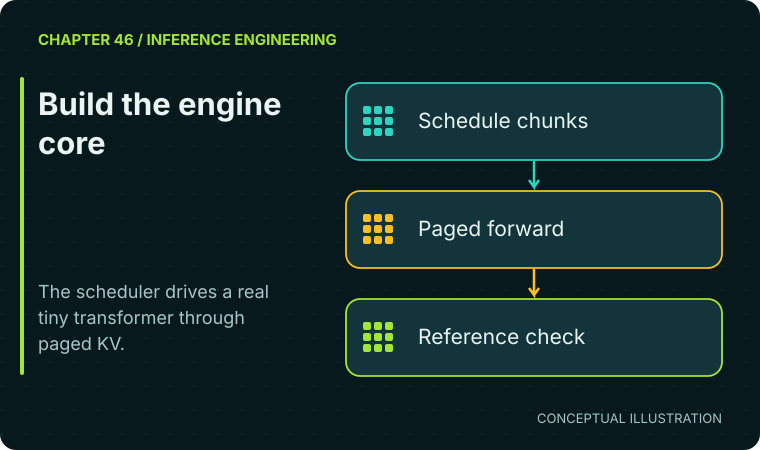
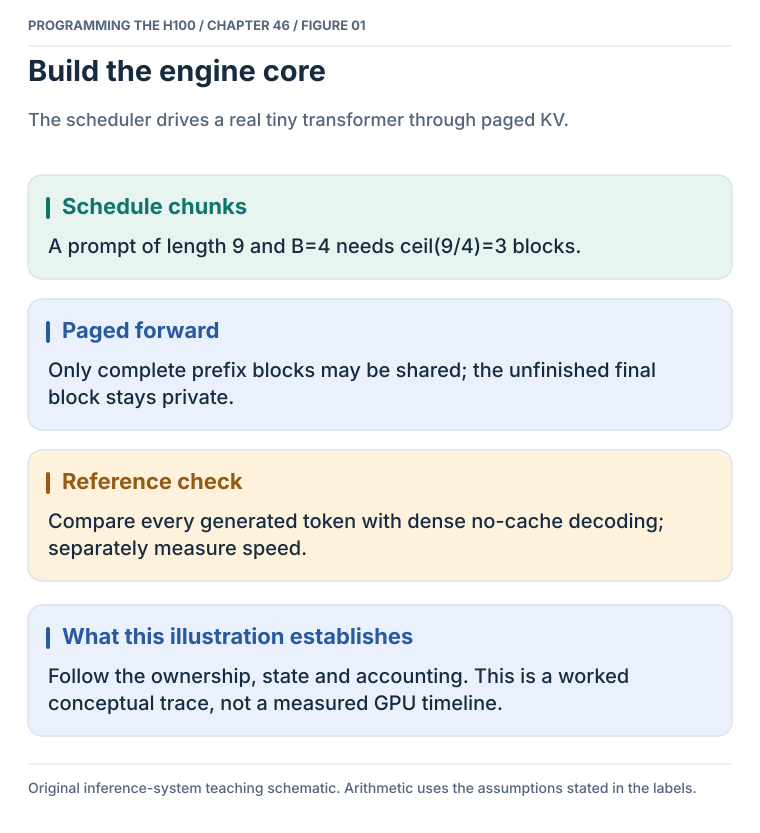

# Chapter 46 — Capstone: A Mini Inference Engine

[](images/chapter-openers/46-inference.svg)


!!! warning "Evidence status"
    **Run on CPU:** a tiny real transformer (2 layers, 32-dimensional, 2 heads, vocabulary 96, random weights, float64) served by an engine that joins the paged KV cache (Chapter 43), the continuous-batching scheduler with preemption and chunked prefill (Chapter 44) and a block-level prefix cache (Chapter 45); 15 self-tests; four experiments (`ch46_mini_engine.py`).
    **What "correct" means here:** every generated token is compared with a *reference* that recomputes the whole sequence with dense causal attention and no cache at every step. All captured float64 greedy runs produced exactly matching token ids. Their logits need not be bit-identical, and float64 alone does not guarantee matching argmax choices for nearly tied scores.
    **What this does not show:** nothing runs on a GPU, the weights are random so the text is meaningless, sampling is greedy only, and the engine computes one sequence at a time (the "batch" is a scheduling decision; its cost uses the assumed per-iteration model of Chapter 44). It checks that the *machinery* is correct, not that it is fast. The comparison with vLLM and SGLang in 46.10 is **UNTESTED**.

This chapter closes Part XIV. The earlier chapters each tested one piece in isolation. Here the pieces share one set of blocks, and the property to check is the one that matters in production: **sharing, preempting, chunking and caching must never change an answer.**

## Worked system map

[](images/worked/ch46-inference.svg)


## 46.1 What is joined

```
 requests ──► scheduler (Ch 44) ──► per-iteration plan: decode set + prefill chunks
                 │  admit / preempt / chunk                │
                 ▼                                          ▼
        block allocator + refcounts (Ch 43) ◄── prefix cache (this chapter, block-level trie;
                 │                                   same semantics as Ch 45 rounded to blocks)
                 ▼
        KV pool [layers, blocks, B, heads, dim]  ◄── model forward (tiny transformer)
                                                         prefill chunk: gather + causal attention
                                                         decode: walk the block table, online softmax
```

| Component | Source | What the engine adds |
|---|---|---|
| Block allocator with reference counts | Chapter 43 | one allocator shared by sequences *and* the cache |
| Block tables, paged attention | Chapter 43 | real K/V for every layer, written and read through the tables |
| Admission, preemption, watermark, chunked prefill | Chapter 44 | the same decisions, now driving real computation |
| Prefix reuse | Chapter 45 | exact block-level trie holding references to physical blocks |

## 46.2 The model and the reference

`TinyLM` is a decoder-only transformer: token embedding plus fixed sinusoidal positions, then per layer an RMS norm, multi-head causal attention and a ReLU feed-forward block with residual connections, and a final norm with logits through the transposed embedding matrix. The weights are random. That is deliberate: the aim is to test the machinery, and incorrect cached keys or positions can still change a random model’s output. Test 13 demonstrates that the chosen model and workload detect a deliberate KV corruption; it does not establish equal sensitivity to every trained model.

The **reference** is `ref_generate`: at every step it runs `forward_full` over the entire sequence (prompt plus the tokens so far) with a dense causal mask and takes the argmax of the last position. It uses no cache, no blocks and no batching, so it does not share their block-table or cache-management path. It still shares model weights and basic model helpers; this is an independent cache-path reference, not a proof that every transformer formula is correct.

Requests must have a finite, nonnegative arrival time, a nonempty prompt of in-vocabulary integer token ids, a positive integer output limit, and enough positional capacity for `prompt length + output limit - 1` inputs. Invalid batches are rejected before allocation or cache mutation. Scheduler block counts, sequence limits and optional token budgets must also be positive integers.

## 46.3 Running the model over paged memory

`forward_chunk(tokens, start, block table)` runs tokens at positions `start …` and does the following per layer:

1. compute `q, k, v` for the chunk;
2. write `k, v` into the pool at `table[pos // B]`, slot `pos % B`;
3. attend:
   - **a prefill chunk (several tokens)** gathers the sequence's K/V through the table and applies dense attention with a causal mask offset by `start`;
   - **a decode step (one token)** walks the block table with an online softmax, never gathering.

Both paths exist in real engines (different kernels for prefill and decode). Test 2 checks them against the full forward pass for `B = 1, 4, 8, 16` using mixed chunk sizes (5, 1, 1, 12, 1, 17 tokens), and test 3 checks the block walk against gathering on a table whose blocks are scattered.

## 46.4 The engine loop

The loop is Chapter 44's, with the simulated token counts replaced by real computation. The points where the pieces interact:

- **Admission.** For a waiting sequence the engine takes `tokens = prompt + generated so far`, asks the prefix cache for the longest run of cached whole blocks, and **pins** them with `incref` before deciding anything, so they cannot be evicted while the decision is made. It then needs `⌈target / B⌉ − matched` fresh blocks, evicting cache entries if necessary. If they cannot be found, the pins are undone and the head of the queue waits (strict first-come-first-served).
- **At least one token is always computed.** The match is capped at `(len − 1) // B` blocks. If the whole prompt were cached there would be nothing to run and no logits to pick the next token from.
- **Shared blocks are read-only.** Only *full* blocks are shared, and a sequence's own writes always land in a later block, so no copy-on-write is needed here. (Sharing a partial block would need Chapter 43's copy-on-write; Exercise 6.)
- **Registration.** When a sequence finishes its prefill, and again when it finishes generating, its full blocks are added to the trie; the cache takes one reference to each block it adds. Two sequences that compute the same prefix at the same time each keep their own blocks; the second one's blocks are simply not registered.
- **Eviction.** A cache entry may be evicted only if it is a leaf of the trie and the cache holds the only reference to its block. Evicted blocks go back to the allocator. The engine evicts when it needs a block for admission or for a decoding sequence, before it considers preempting anyone.
- **Preemption.** As in Chapter 44, the youngest running sequence loses its blocks and goes to the front of the queue with `target = prompt + tokens generated`. If the cache is on, a preempted sequence that had already finished its prefill finds its own prompt blocks in the cache when it is readmitted.
- **Reference counts as the invariant.** After every iteration (with `debug=True`) the engine checks that each block's reference count equals the number of running sequences whose tables contain it plus the number of cache entries pointing to it. A leak, a double free or a missing pin shows up here.

## 46.5 Self-tests (15, all pass)

| # | What is checked |
|---|---|
| 1 | the reference model is causal: changing later tokens leaves earlier logits bit-identical |
| 2 | paged chunked forward equals the full forward for B = 1, 4, 8, 16 with mixed chunk sizes (max abs diff 6.2e-15) |
| 3 | decode attention walking scattered blocks equals gathered attention |
| 4 | one request equals the reference for B ∈ {2, 5, 8, 16} and chunk budgets (none, 3, 16) |
| 5 | 24 concurrent requests, roomy pool: every output equals the reference |
| 6 | tiny pool forcing preemption and recomputation: outputs still equal the reference |
| 7 | chunked prefill with a 12-token budget: outputs equal the reference |
| 8 | prefix cache: outputs equal the reference, 600 prompt tokens served from cache, and `prefill tokens + cache hits = prefill tokens without the cache` exactly |
| 9 | cache + memory pressure + chunking in three configurations (B = 8, 4, 16): outputs equal the reference and reference counts are exact after every iteration |
| 10 | after the run and a full cache flush, every block is back on the free list |
| 11 | **with the cache off, the engine's first-token times, finish times, iteration counts and preemption counts equal the Chapter 44 simulator exactly**, request by request, in four configurations |
| 12 | the engine's block trie equals the Chapter 45 radix tree's match rounded down to whole blocks (10 sessions × 40 sequences) |
| 13 | a check of the test itself: corrupting the cached K/V blocks makes later outputs disagree with the reference |
| 14 | a request larger than the whole pool is rejected; the other still equals the reference |
| 15 | compressing the arrival times (a different batch composition) changes no output |

Test 11 matters more than it looks. It shows that the Chapter 44 simulator, whose numbers filled five tables, makes the same scheduling decisions as a real engine implementation. It does not validate the assumed cost constants; those still need hardware.

## 46.6 Experiment 1 — correctness matrix

48 requests; 60% start with one of three shared 40-token prompts. Prompt tokens in total: 2925; output tokens: 546. Every row is compared with the no-cache reference.

| configuration | mismatches | iterations | preemptions | prefill tokens | cache-hit tokens | simulated end (s) |
|---|---|---|---|---|---|---|
| B=8, roomy pool, no cache | **0** | 97 | 0 | 2925 | 0 | 1.71 |
| B=8, tiny pool (26 blocks), no cache | **0** | 228 | 4 | 3224 | 0 | 3.69 |
| B=8, chunked prefill (budget 12) | **0** | 299 | 0 | 2925 | 0 | 4.74 |
| B=8, roomy, prefix cache | **0** | 101 | 0 | 1685 | 1240 | 1.71 |
| B=8, tiny pool, prefix cache | **0** | 211 | 7 | 2338 | 1104 | 3.39 |
| B=4, 60 blocks, budget 10, prefix cache | **0** | 317 | 5 | 2276 | 940 | 4.98 |
| B=16, 14 blocks, budget 20, prefix cache | **0** | 269 | 6 | 2486 | 880 | 4.27 |

All seven give the same answers as the reference. **Hand check:** with the cache on and a roomy pool, `1685 + 1240 = 2925`: the cache removes exactly the tokens it served. The 1240 hits are 31 requests × 40 tokens (the shared prompt is 5 blocks of 8).

## 46.7 Experiment 2 — what the prefix cache buys

| configuration | prefill tokens | preemptions | TTFT p50 (ms) | TTFT p99 (ms) | e2e p50 (s) |
|---|---|---|---|---|---|
| roomy, no cache | 2925 | 0 | 31.6 | 46.6 | 0.220 |
| roomy, cache | 1685 | 0 | 30.3 | 38.7 | 0.208 |
| tiny pool, no cache | 3224 | 4 | 1136 | 2070 | 1.295 |
| tiny pool, cache | 2338 | 7 | 991 | 1770 | 1.144 |

- With room to spare the cache removes 42% of the prefill tokens but moves the latency little (TTFT p50 31.6 → 30.3 ms): at this load the system is not saturated and, in the assumed cost model, an iteration has a large fixed cost.
- **With a tiny pool, the cache increased preemptions (4 → 7) and still helped.** It holds blocks that running sequences could otherwise use, so running sequences are preempted more often. But prefill work fell from 3224 to 2338 tokens (−27%), because a preempted sequence that was readmitted found its own prompt blocks in the cache instead of recomputing them, and TTFT p50 fell from 1136 to 991 ms. The preemption count alone would have suggested the opposite conclusion.

## 46.8 Experiments 3 and 4

**Block size and hits.** The shared prompt is 40 tokens; roomy pool.

| B | cache-hit tokens | prefill tokens | `⌊40/B⌋ × B` |
|---|---|---|---|
| 4 | 1240 | 1685 | 40 |
| 8 | 1240 | 1685 | 40 |
| 16 | 992 | 1933 | 32 |
| 32 | 992 | 1933 | 32 |

Each hit saves `⌊40/B⌋ × B` tokens, 40, 40, 32 and 32. This is the alignment loss of Chapter 45 on real data: 8 tokens per hit at `B = 16`, and 31 hits × 8 = 248 more prefill tokens, as the table shows (1933 − 1685).

**Mutation check.** After the first iteration in which the cache is non-empty, the script corrupts every cached K/V block (K × −3, V + 5). Output differs from the reference for **11 of 48 requests**. A test that always passed would prove nothing; this one fails when a block is wrong.

## 46.9 Failure modes and edge cases

| Situation | Handled by |
|---|---|
| Wrong position for a recomputed sequence | outputs differ from the reference (tests 6, 9) |
| Whole prompt cached, nothing left to compute | match capped at `(len − 1) // B` blocks |
| Cache evicts a block a sequence is about to use | matched blocks pinned with `incref` before the admission decision |
| Cache entry evicted while a descendant exists | only trie leaves are evicted |
| Leaked or double-freed block | per-iteration reference-count audit; flush test (10) |
| Two sequences compute the same prefix concurrently | both keep private blocks; only the first is registered |
| Request that can never fit | rejected on arrival (test 14) |
| Cache holding blocks starves running sequences | evict before preempting; Experiment 2 shows the cost |

**Not modelled:**
- **Batched computation.** Sequences are computed one at a time in Python; a real engine batches the matrix multiplies of all decoding sequences into one kernel.
- **Numerics.** Float64 and greedy decoding make exact equality testable. In BF16 on a GPU, batched kernels round differently from sequential ones, and a near-tie can flip an argmax. A GPU version of these tests would compare log-probabilities within a tolerance and report the rate of token agreement (Exercise 7).
- **Sampling, stop tokens, speculative decoding, LoRA adapters, multi-GPU parallelism, quantised KV.**
- **Quality.** The weights are random.

## 46.10 Comparing with vLLM and SGLang on a real GPU (UNTESTED)

Command-line options are from memory; check them with `--help` for the versions you install.

1. **Pick a small model** that fits one GPU, and fix a set of prompts (use the Chapter 36 client's prompt files) with a shared system prompt for half of them.
2. **Start each engine on the same model and GPU, one at a time.**
   `vllm serve MODEL --port 8000 --enable-prefix-caching --max-num-seqs 128 --max-num-batched-tokens 2048`
   `python -m sglang.launch_server --model-path MODEL --port 8001`
3. **Agreement check** at temperature 0: send each prompt to both engines and to the reference implementation in `transformers` (single sequence, no batching). Record the fraction of prompts whose first 64 tokens agree, and the maximum log-probability difference at the first divergence. Expect a few divergences from rounding, not from sharing logic; a large number of them points at a bug or a configuration difference (a different chat template or a different default for sampling).
4. **Performance:** run the open-loop client at 2, 5, 8 and 12 req/s against each engine; record TTFT, TPOT, throughput and, from the engines' own metrics, the prefix-cache hit rate and the preemption count. Compare the shape of the curves with Experiments 1 and 5 of Chapter 44 and Experiment 1 of Chapter 45. The absolute numbers are not comparable with this chapter's.
5. **Replace the assumed constants** (`T0`, `CP`, `CD`) in the Chapter 44 simulator with values fitted from a short profile on your GPU, and check whether the simulator reproduces the engines' *relative* behaviour (the rate where TTFT turns up, the effect of the block size).

<!-- BEGIN COMPLETE INFERENCE SOURCE -->
## Complete runnable code

The complete implementation is shown below, including its checks and entry point. The listing and downloadable `.py` file contain exactly the same source. Copy the file under the displayed filename; keep supporting files in the same directory.

[Download all inference examples and supporting modules](examples/inference-systems/inference-systems.zip) or read the [environment and command guide](examples/inference-systems/README.md).

The [follow-up agent audit](inference-adversarial-review-2026-11-25.md) records the corrections, fresh CPU captures and hardware limits for this source.

Supporting modules: [ch43_paged_kv_cache.py](examples/inference-systems/ch43_paged_kv_cache.py), [ch44_continuous_batching.py](examples/inference-systems/ch44_continuous_batching.py), [ch45_radix_prefix_cache.py](examples/inference-systems/ch45_radix_prefix_cache.py).

Read it in three passes: start with `TinyLM` and `KVPool` to identify the state; trace `PrefixCache` and `Engine` for one request or token; then follow `reference` and `selftests` to see how the result is checked.

From the repository root:

```bash
python3 docs/examples/inference-systems/ch46_mini_engine.py tests
# Run the full chapter demonstrations:
python3 docs/examples/inference-systems/ch46_mini_engine.py
```

### ch46_mini_engine.py

[Download ch46_mini_engine.py](examples/inference-systems/ch46_mini_engine.py)

```python title="ch46_mini_engine.py" linenums="1"
#!/usr/bin/env python3
"""Chapter 46 - Capstone: a mini inference engine that joins Chapters 43, 44 and 45.

A tiny real transformer (NumPy, float64) is served by an engine with a paged KV cache, a
continuous-batching scheduler with preemption and chunked prefill, and a block-level prefix
cache. Every output is checked against a naive reference that recomputes everything.

Run:  python3 ch46_mini_engine.py          # self-tests + experiments
      python3 ch46_mini_engine.py tests    # self-tests only
Needs ch43_paged_kv_cache.py, ch44_continuous_batching.py, ch45_radix_prefix_cache.py alongside.
"""
import math
import os
import sys
import time
from collections import deque

import numpy as np

sys.path.insert(0, os.path.dirname(os.path.abspath(__file__)))
from ch43_paged_kv_cache import BlockAllocator            # noqa: E402
import ch44_continuous_batching as c44                    # noqa: E402
import ch45_radix_prefix_cache as c45                     # noqa: E402

T0, CP, CD = c44.T0, c44.CP, c44.CD


# --------------------------------------------------------------------------
# A tiny decoder-only transformer (random weights; the point is the machinery)
# --------------------------------------------------------------------------
class TinyLM:
    def __init__(self, V=96, d=32, H=2, L=2, ff=64, max_pos=1024, seed=0):
        if any(not isinstance(x, (int, np.integer)) or x <= 0 for x in (V, d, H, L, ff, max_pos)):
            raise ValueError("model dimensions must be positive integers")
        if d % H or d % 2:
            raise ValueError("model width must be even and divisible by the head count")
        r = np.random.default_rng(seed)
        self.V, self.d, self.H, self.L, self.D = V, d, H, L, d // H
        sc = lambda n, m: r.standard_normal((n, m)) / math.sqrt(n)
        self.E = r.standard_normal((V, d)) * 0.7
        self.layers = [dict(Wq=sc(d, d), Wk=sc(d, d), Wv=sc(d, d), Wo=sc(d, d), W1=sc(d, ff), W2=sc(ff, d))
                       for _ in range(L)]
        pos = np.arange(max_pos)[:, None]
        i = np.arange(d // 2)[None, :]
        ang = pos / (10000 ** (2 * i / d))
        self.P = np.concatenate([np.sin(ang), np.cos(ang)], axis=1)

    @staticmethod
    def rms(x):
        return x / np.sqrt((x ** 2).mean(-1, keepdims=True) + 1e-6)

    def embed(self, tokens, start):
        return self.E[tokens] + self.P[start:start + len(tokens)]

    def qkv(self, l, x):
        h = self.rms(x)
        c = len(x)
        W = self.layers[l]
        return ((h @ W["Wq"]).reshape(c, self.H, self.D), (h @ W["Wk"]).reshape(c, self.H, self.D),
                (h @ W["Wv"]).reshape(c, self.H, self.D))

    def finish_layer(self, l, x, attn):
        W = self.layers[l]
        x = x + attn.reshape(len(x), -1) @ W["Wo"]
        h = self.rms(x)
        return x + np.maximum(h @ W["W1"], 0) @ W["W2"]

    def logits(self, x):
        return self.rms(x) @ self.E.T

    # ---- reference: dense causal attention over the whole sequence, no cache ----
    def forward_full(self, tokens):
        x = self.embed(np.asarray(tokens), 0)
        T = len(x)
        mask = np.tril(np.ones((T, T), bool))
        for l in range(self.L):
            q, k, v = self.qkv(l, x)
            s = np.einsum("qhd,khd->hqk", q, k) / math.sqrt(self.D)
            s = np.where(mask[None], s, -np.inf)
            s -= s.max(-1, keepdims=True)
            p = np.exp(s)
            p /= p.sum(-1, keepdims=True)
            x = self.finish_layer(l, x, np.einsum("hqk,khd->qhd", p, v))
        return self.logits(x)

    def ref_generate(self, prompt, n_new):
        toks = list(prompt)
        out = []
        for _ in range(n_new):
            nxt = int(np.argmax(self.forward_full(toks)[-1]))
            toks.append(nxt)
            out.append(nxt)
        return out


# --------------------------------------------------------------------------
# KV pool for all layers + attention kernels over block tables
# --------------------------------------------------------------------------
class KVPool:
    def __init__(self, model, n_blocks, B):
        self.B = B
        self.K = np.zeros((model.L, n_blocks, B, model.H, model.D))
        self.V = np.zeros_like(self.K)


def attn_gather_chunk(q, pool, l, table, start):
    """Chunk prefill: gather the sequence's K/V, dense causal attention for c queries."""
    c, H, D = q.shape
    end = start + c
    Kall = pool.K[l, table].reshape(-1, H, D)[:end]
    Vall = pool.V[l, table].reshape(-1, H, D)[:end]
    s = np.einsum("qhd,khd->hqk", q, Kall) / math.sqrt(D)
    mask = np.arange(end)[None, :] <= (start + np.arange(c))[:, None]
    s = np.where(mask[None], s, -np.inf)
    s -= s.max(-1, keepdims=True)
    p = np.exp(s)
    p /= p.sum(-1, keepdims=True)
    return np.einsum("hqk,khd->qhd", p, Vall)


def attn_paged_decode(q, pool, l, table, length):
    """Decode: one query walks the block table with an online softmax; no gather."""
    H, D = q.shape
    m = np.full(H, -np.inf)
    s_ = np.zeros(H)
    acc = np.zeros((H, D))
    remaining = length
    for b in table:
        n = min(pool.B, remaining)
        if n <= 0:
            break
        remaining -= n
        sc = np.einsum("hd,thd->ht", q, pool.K[l, b, :n]) / math.sqrt(D)
        mn = np.maximum(m, sc.max(1))
        scale = np.exp(m - mn)
        p = np.exp(sc - mn[:, None])
        s_ = s_ * scale + p.sum(1)
        acc = acc * scale[:, None] + np.einsum("ht,thd->hd", p, pool.V[l, b, :n])
        m = mn
    return acc / s_[:, None]


def forward_chunk(model, pool, table, tokens, start):
    """Run `tokens` at positions start.. through the model, writing K/V into the sequence's blocks.
    Returns the logits of the last token."""
    B = pool.B
    x = model.embed(np.asarray(tokens), start)
    c = len(tokens)
    pos = start + np.arange(c)
    blk = np.asarray(table)[pos // B]
    off = pos % B
    for l in range(model.L):
        q, k, v = model.qkv(l, x)
        pool.K[l, blk, off] = k
        pool.V[l, blk, off] = v
        if c == 1:
            a = attn_paged_decode(q[0], pool, l, table, start + 1)[None]
        else:
            a = attn_gather_chunk(q, pool, l, table, start)
        x = model.finish_layer(l, x, a)
    return model.logits(x[-1:])[0]


# --------------------------------------------------------------------------
# Block-level prefix cache (exact keys: parent node + the block's tokens)
# --------------------------------------------------------------------------
class PrefixCache:
    class N:
        __slots__ = ("id", "block", "parent", "last", "children")

    def __init__(self, B, alloc):
        self.B, self.alloc = B, alloc
        self.nodes = {}           # (parent_id, block tokens) -> N
        self.by_id = {0: None}
        self.clock = 0
        self._id = 0

    def match(self, toks, max_blocks):
        self.clock += 1
        pid, out = 0, []
        for i in range(max_blocks):
            n = self.nodes.get((pid, tuple(toks[i * self.B:(i + 1) * self.B])))
            if n is None:
                break
            n.last = self.clock
            out.append(n.block)
            pid = n.id
        return out

    def register(self, toks, table):
        self.clock += 1
        pid = 0
        for i in range(len(toks) // self.B):
            key = (pid, tuple(toks[i * self.B:(i + 1) * self.B]))
            n = self.nodes.get(key)
            if n is None:
                n = PrefixCache.N()
                self._id += 1
                n.id, n.block, n.parent, n.last, n.children = self._id, table[i], pid, self.clock, 0
                self.nodes[key] = n
                self.by_id[n.id] = n
                if pid:
                    self.by_id[pid].children += 1
                self.alloc.incref(n.block)
            else:
                n.last = self.clock
            pid = n.id

    def evict_one(self):
        best = None
        for key, n in self.nodes.items():
            if n.children == 0 and self.alloc.ref[n.block] == 1 and (best is None or n.last < best[1].last):
                best = (key, n)
        if best is None:
            return False
        key, n = best
        del self.nodes[key]
        del self.by_id[n.id]
        if n.parent:
            self.by_id[n.parent].children -= 1
        self.alloc.decref(n.block)
        return True

    def block_refs(self):
        refs = {}
        for n in self.nodes.values():
            refs[n.block] = refs.get(n.block, 0) + 1
        return refs


# --------------------------------------------------------------------------
# The engine
# --------------------------------------------------------------------------
class Seq:
    __slots__ = ("id", "arrival", "prompt", "max_new", "out", "computed", "target", "table",
                 "first_token", "done", "preempts", "rejected", "cached_tokens")

    def __init__(self, id, arrival, prompt, max_new):
        prompt = list(prompt)
        if not math.isfinite(arrival) or arrival < 0:
            raise ValueError("arrival must be finite and nonnegative")
        if not prompt or not isinstance(max_new, (int, np.integer)) or max_new <= 0:
            raise ValueError("a request needs a nonempty prompt and positive integer max_new")
        self.id, self.arrival, self.prompt, self.max_new = id, arrival, prompt, max_new
        self.out, self.computed, self.target = [], 0, len(prompt)
        self.table = []
        self.first_token = self.done = None
        self.preempts = 0
        self.rejected = False
        self.cached_tokens = 0


class Engine:
    def __init__(self, model, n_blocks=256, B=8, max_seqs=16, budget=None, watermark=0.0,
                 prefix_cache=False, hook=None, debug=False):
        if any(not isinstance(x, (int, np.integer)) or x <= 0 for x in (n_blocks, B, max_seqs)):
            raise ValueError("n_blocks, B and max_seqs must be positive integers")
        if budget is not None and (not isinstance(budget, (int, np.integer)) or budget <= 0):
            raise ValueError("budget must be None or a positive integer")
        if not math.isfinite(watermark) or not 0 <= watermark < 1:
            raise ValueError("watermark must be finite and in [0, 1)")
        self.m, self.n_blocks, self.B = model, n_blocks, B
        self.max_seqs = max_seqs
        self.budget_cap = budget if budget else 10 ** 12
        self.wm = int(math.ceil(watermark * n_blocks))
        self.alloc = BlockAllocator(n_blocks)
        self.pool = KVPool(model, n_blocks, B)
        self.cache = PrefixCache(B, self.alloc) if prefix_cache else None
        self.hook, self.debug = hook, debug
        self.stats = {"iters": 0, "prefill_tokens": 0, "preemptions": 0, "hit_tokens": 0}

    def need(self, tokens):
        return -(-tokens // self.B)

    def _free_blocks(self, table):
        for b in table:
            self.alloc.decref(b)

    def _ensure_free(self, n):
        while self.alloc.num_free() < n:
            if self.cache is None or not self.cache.evict_one():
                return False
        return True

    def check_invariants(self, running):
        refs = {}
        for s in running:
            for b in s.table:
                refs[b] = refs.get(b, 0) + 1
        for b, c in (self.cache.block_refs().items() if self.cache else []):
            refs[b] = refs.get(b, 0) + c
        for b in range(self.n_blocks):
            assert self.alloc.ref[b] == refs.get(b, 0), f"block {b}: ref {self.alloc.ref[b]} vs holders {refs.get(b, 0)}"

    def run(self, reqs):
        """reqs: list of (id, arrival, prompt tokens, max_new). Returns the list of Seq."""
        seqs = [Seq(*r) for r in reqs]
        # Reject the whole input batch before allocating or mutating the prefix cache.
        for seq in seqs:
            if any(not isinstance(t, (int, np.integer)) or not 0 <= t < self.m.V for t in seq.prompt):
                raise ValueError("prompt token ids must be integers in the model vocabulary")
            if len(seq.prompt) + seq.max_new - 1 > len(self.m.P):
                raise ValueError("request exceeds the model's positional capacity")
        pending = sorted(seqs, key=lambda s: s.arrival)
        waiting, running = deque(), []
        ip, t, finished, rejected, n = 0, 0.0, 0, 0, len(seqs)
        B, st = self.B, self.stats

        def finish(s):
            nonlocal finished
            s.done = t
            running.remove(s)
            if self.cache:
                self.cache.register((s.prompt + s.out)[:s.computed], s.table)
            self._free_blocks(s.table)
            s.table = []
            finished += 1

        def preempt(v):
            running.remove(v)
            self._free_blocks(v.table)
            v.table, v.computed = [], 0
            v.target = len(v.prompt) + len(v.out)
            v.preempts += 1
            st["preemptions"] += 1
            waiting.appendleft(v)

        while finished + rejected < n:
            if not running and not waiting and ip < n and pending[ip].arrival > t:
                t = pending[ip].arrival
            while ip < n and pending[ip].arrival <= t:
                s = pending[ip]
                ip += 1
                if self.need(len(s.prompt) + s.max_new) > self.n_blocks - self.wm:
                    s.rejected = True
                    rejected += 1
                else:
                    waiting.append(s)
            if not running and not waiting:
                continue

            preempted_now = False
            decoders = []
            for s in list(running):
                if s not in running or s.computed < s.target:
                    continue
                if s.computed % B == 0:
                    while not self._ensure_free(1) and s in running:
                        preempt(running[-1])
                        preempted_now = True
                    if s not in running:
                        continue
                    s.table.append(self.alloc.alloc())
                decoders.append(s)
            budget = self.budget_cap - len(decoders)
            chunks = []
            for s in running:
                if s.computed < s.target and budget > 0:
                    c = min(s.target - s.computed, budget)
                    chunks.append((s, c))
                    budget -= c
            if not preempted_now:
                while waiting and len(running) < self.max_seqs and budget > 0:
                    s = waiting[0]
                    toks = s.prompt + s.out
                    matched = self.cache.match(toks, (len(toks) - 1) // B) if self.cache else []
                    for b in matched:
                        self.alloc.incref(b)                      # pin while we decide
                    new_needed = self.need(s.target) - len(matched)
                    if not self._ensure_free(new_needed + self.wm):
                        self._free_blocks(matched)
                        break                                     # strict FCFS: head blocks the queue
                    waiting.popleft()
                    s.table = matched + [self.alloc.alloc() for _ in range(new_needed)]
                    s.computed = len(matched) * B
                    s.cached_tokens += s.computed
                    st["hit_tokens"] += s.computed
                    running.append(s)
                    c = min(s.target - s.computed, budget)
                    chunks.append((s, c))
                    budget -= c
            pf = sum(c for _, c in chunks)
            assert pf + len(decoders) > 0, "engine made no progress"
            t += T0 + CP * pf + CD * len(decoders)
            st["iters"] += 1
            st["prefill_tokens"] += pf

            # ---- execute the model ----
            for s in decoders:
                logits = forward_chunk(self.m, self.pool, s.table, [s.out[-1]], s.computed)
                s.computed += 1
                s.out.append(int(np.argmax(logits)))
                if len(s.out) == s.max_new:
                    finish(s)
            for s, c in chunks:
                toks = s.prompt + s.out
                logits = forward_chunk(self.m, self.pool, s.table, toks[s.computed:s.computed + c], s.computed)
                s.computed += c
                if s.computed == s.target:
                    s.out.append(int(np.argmax(logits)))
                    if s.first_token is None:
                        s.first_token = t
                    if self.cache:
                        self.cache.register(toks[:s.target], s.table)
                    if len(s.out) == s.max_new:
                        finish(s)
            if self.debug:
                self.check_invariants(running)
            if self.hook:
                self.hook(self)
        self.end = t
        return seqs


# --------------------------------------------------------------------------
# Workloads
# --------------------------------------------------------------------------
def make_requests(seed, n, V=96, rate=30.0, sys_len=40, n_sys=3, share=0.6, ulo=8, uhi=60, nlo=4, nhi=20):
    r = np.random.default_rng(seed)
    sys_prompts = [list(map(int, r.integers(0, V, sys_len))) for _ in range(n_sys)]
    t = 0.0
    out = []
    for i in range(n):
        t += r.exponential(1 / rate)
        user = list(map(int, r.integers(0, V, int(r.integers(ulo, uhi)))))
        prompt = (sys_prompts[int(r.integers(n_sys))] + user) if r.random() < share else user
        out.append((i, t, prompt, int(r.integers(nlo, nhi))))
    return out


_REF = {}


def reference(model, reqs):
    res = {}
    for (i, _, prompt, k) in reqs:
        key = (id(model), tuple(prompt), k)
        if key not in _REF:
            _REF[key] = model.ref_generate(prompt, k)
        res[i] = _REF[key]
    return res


def mismatches(model, reqs, seqs):
    ref = reference(model, reqs)
    return sum(1 for s in seqs if not s.rejected and s.out != ref[s.id])


# --------------------------------------------------------------------------
# Self-tests
# --------------------------------------------------------------------------
def selftests():
    t0 = time.time()
    n_ok = 0

    def ok(name):
        nonlocal n_ok
        n_ok += 1
        print(f"  PASS {n_ok:2d}  {name}")

    M = TinyLM()
    r = np.random.default_rng(0)

    # 1 causality of the reference model
    a = list(map(int, r.integers(0, 96, 30)))
    b = a[:20] + list(map(int, r.integers(0, 96, 10)))
    assert np.array_equal(M.forward_full(a)[:20], M.forward_full(b)[:20])
    ok("reference model is causal: changing later tokens leaves earlier logits bit-identical")

    # 2 KV-cached incremental forward == full forward
    worst = 0.0
    for B in (1, 4, 8, 16):
        toks = list(map(int, r.integers(0, 96, 37)))
        pool = KVPool(M, 64, B)
        table = list(range(-(-len(toks) // B)))
        full = M.forward_full(toks)
        pos = 0
        for c in (5, 1, 1, 12, 1, 17):                       # mixed chunk sizes incl. single-token decode
            lg = forward_chunk(M, pool, table, toks[pos:pos + c], pos)
            worst = max(worst, float(np.abs(lg - full[pos + c - 1]).max()))
            pos += c
        assert pos == len(toks)
    assert worst < 1e-10, worst
    ok(f"paged chunked forward equals the full forward for B = 1, 4, 8, 16 (max |diff| {worst:.1e})")

    # 3 decode attention (block walk) equals gather attention
    pool = KVPool(M, 32, 4)
    table = [5, 2, 9, 0, 7]
    toks = list(map(int, r.integers(0, 96, 18)))
    forward_chunk(M, pool, table, toks, 0)
    q = r.standard_normal((M.H, M.D))
    w1 = attn_paged_decode(q, pool, 0, table, 18)
    w2 = attn_gather_chunk(q[None], pool, 0, table, 17)[0]
    assert np.abs(w1 - w2).max() < 1e-12
    ok("decode attention that walks scattered blocks equals gathered attention")

    reqs = make_requests(1, 24)
    ref = reference(M, reqs)

    # 4 single request, several block sizes and chunk budgets
    for B in (2, 5, 8, 16):
        for bud in (None, 3, 16):
            eng = Engine(M, n_blocks=400, B=B, budget=bud, debug=True)
            s = eng.run([reqs[3]])[0]
            assert s.out == ref[3], (B, bud)
    ok("one request matches the reference for B in (2, 5, 8, 16) and chunk budgets (none, 3, 16)")

    # 5 many concurrent requests, roomy pool
    eng = Engine(M, n_blocks=2000, B=8, debug=True)
    seqs = eng.run(reqs)
    assert mismatches(M, reqs, seqs) == 0 and eng.stats["preemptions"] == 0
    ok("24 concurrent requests, continuous batching: every output equals the reference")

    # 6 tiny pool forces preemption by recomputation; outputs unchanged
    eng = Engine(M, n_blocks=26, B=8, debug=True)
    seqs = eng.run(reqs)
    assert eng.stats["preemptions"] > 0 and mismatches(M, reqs, seqs) == 0
    ok(f"tiny pool: {eng.stats['preemptions']} preemptions with recomputation, outputs still equal the reference")

    # 7 chunked prefill with a small budget
    eng = Engine(M, n_blocks=2000, B=8, budget=12, debug=True)
    assert mismatches(M, reqs, eng.run(reqs)) == 0
    ok("chunked prefill (budget 12 tokens per iteration): outputs equal the reference")

    # 8 prefix cache on
    eng = Engine(M, n_blocks=2000, B=8, prefix_cache=True, debug=True)
    seqs = eng.run(reqs)
    assert mismatches(M, reqs, seqs) == 0 and eng.stats["hit_tokens"] > 0
    base = Engine(M, n_blocks=2000, B=8)
    base.run(reqs)
    assert eng.stats["prefill_tokens"] < base.stats["prefill_tokens"]
    assert eng.stats["prefill_tokens"] + eng.stats["hit_tokens"] == base.stats["prefill_tokens"]
    ok(f"prefix cache: outputs equal the reference; {eng.stats['hit_tokens']} prompt tokens served from cached blocks")

    # 9 prefix cache + tiny pool + chunking, reference reference-equal, invariants each iteration
    for B, nb, bud in ((8, 30, None), (4, 60, 10), (16, 14, 20)):
        eng = Engine(M, n_blocks=nb, B=B, budget=bud, prefix_cache=True, debug=True)
        seqs = eng.run(reqs)
        assert mismatches(M, reqs, seqs) == 0
    ok("cache + pressure + chunking in three configurations: outputs equal the reference, refcounts exact every iteration")

    # 10 no leaks: after clearing the cache every block is free
    eng = Engine(M, n_blocks=40, B=8, prefix_cache=True)
    eng.run(reqs)
    while eng.cache.evict_one():
        pass
    assert eng.alloc.num_free() == 40 and not eng.cache.nodes
    ok("after the run and a full cache flush every block is back on the free list")

    # 11 engine timing equals the Chapter 44 simulator (cache off) request by request
    for B, nb, bud in ((8, 2000, None), (8, 26, None), (8, 2000, 12), (16, 30, 24)):
        eng = Engine(M, n_blocks=nb, B=B, budget=bud, watermark=0.0)
        seqs = {s.id: s for s in eng.run(reqs)}
        sim = [c44.Req(i, a, len(p), k) for (i, a, p, k) in reqs]
        st = c44.simulate_continuous(sim, n_blocks=nb, B=B, max_seqs=16, max_batched_tokens=bud, watermark=0.0)
        for q in sim:
            s = seqs[q.id]
            assert q.rejected == s.rejected
            if not q.rejected:
                assert abs(q.first_token - s.first_token) < 1e-9 and abs(q.done - s.done) < 1e-9, (B, nb, bud, q.id)
        assert st["preemptions"] == eng.stats["preemptions"] and st["iters"] == eng.stats["iters"]
    ok("with the cache off, first-token and finish times, iterations and preemptions equal the Chapter 44 simulator exactly (4 configurations)")

    # 12 block-trie match equals the Chapter 45 radix match rounded down to a block
    for seed in range(10):
        rr = np.random.default_rng(seed)
        B = int(rr.choice([2, 4, 8]))
        alloc = BlockAllocator(500)
        pc = PrefixCache(B, alloc)
        rc = c45.RadixCache(10 ** 9)
        for _ in range(40):
            q = tuple(int(x) for x in rr.integers(0, 3, int(rr.integers(1, 40))))
            m_trie = len(pc.match(q, len(q) // B)) * B
            m_rad = rc.match_length(q)
            assert m_trie == (m_rad // B) * B, (m_trie, m_rad, B)
            table = [alloc.alloc() for _ in range(-(-len(q) // B))]
            pc.register(q, table)
            rc.insert(q)
            for b in table:
                alloc.decref(b)
    ok("the engine's block trie matches the Chapter 45 radix tree rounded down to whole blocks (10 sessions x 40 sequences)")

    # 13 the equality check has teeth: corrupting one cached block is detected
    corrupted = []

    def hook(e):
        if e.cache and e.cache.nodes and not corrupted:
            for n in e.cache.nodes.values():
                e.pool.K[:, n.block] *= -3.0
                e.pool.V[:, n.block] += 5.0
                corrupted.append(n.block)

    shared = list(map(int, np.random.default_rng(5).integers(0, 96, 40)))
    rq = [(0, 0.0, shared + [1, 2, 3, 4, 5], 10), (1, 5.0, shared + [9, 8, 7, 6, 5], 10)]
    eng = Engine(M, n_blocks=200, B=8, prefix_cache=True, hook=hook)
    seqs = eng.run(rq)
    assert corrupted and mismatches(M, rq, seqs) >= 1
    ok("sanity check of the test itself: corrupting the cached KV blocks makes outputs disagree with the reference")

    # 14 an oversized request is rejected; the others complete correctly
    eng = Engine(M, n_blocks=20, B=8)
    seqs = eng.run([(0, 0.0, list(map(int, r.integers(0, 96, 150))), 50), (1, 0.0, reqs[1][2], reqs[1][3])])
    assert seqs[0].rejected and seqs[1].out == ref[1]
    ok("a request larger than the pool is rejected; the other one still matches the reference")

    # 15 outputs do not depend on arrival times (batch composition)
    shifted = [(i, a * 0.1, p, k) for (i, a, p, k) in reqs]
    s1 = {s.id: s.out for s in Engine(M, n_blocks=60, B=8, prefix_cache=True).run(reqs)}
    s2 = {s.id: s.out for s in Engine(M, n_blocks=60, B=8, prefix_cache=True).run(shifted)}
    assert s1 == s2
    ok("compressing arrival times (a different batch composition) changes no output")

    print(f"ALL PASS   ({time.time() - t0:.0f} s)  [{n_ok} tests]")


# --------------------------------------------------------------------------
# Experiments
# --------------------------------------------------------------------------
def experiments():
    M = TinyLM()
    print("model: %d layers, d_model %d, %d heads, vocab %d (random weights, float64)" % (M.L, M.d, M.H, M.V))
    reqs = make_requests(1, 48)
    ref = reference(M, reqs)
    print("workload: 48 requests, 60%% start with one of 3 shared 40-token prompts; prompt tokens %d, output tokens %d" %
          (sum(len(p) for _, _, p, _ in reqs), sum(k for *_, k in reqs)))

    print("\n=== Experiment 1: correctness matrix (every row is checked against the no-cache reference) ===")
    print(f"{'configuration':>44} {'mismatches':>10} {'iters':>6} {'preempt':>8} {'prefill tok':>12} {'cache hit tok':>14} {'sim end (s)':>11}")
    cfgs = [
        ("B=8, roomy pool, no cache", dict(n_blocks=2000, B=8)),
        ("B=8, tiny pool (26 blocks), no cache", dict(n_blocks=26, B=8)),
        ("B=8, chunked prefill (budget 12)", dict(n_blocks=2000, B=8, budget=12)),
        ("B=8, roomy, prefix cache", dict(n_blocks=2000, B=8, prefix_cache=True)),
        ("B=8, tiny pool, prefix cache", dict(n_blocks=26, B=8, prefix_cache=True)),
        ("B=4, 60 blocks, budget 10, prefix cache", dict(n_blocks=60, B=4, budget=10, prefix_cache=True)),
        ("B=16, 14 blocks, budget 20, prefix cache", dict(n_blocks=14, B=16, budget=20, prefix_cache=True)),
    ]
    for name, kw in cfgs:
        eng = Engine(M, **kw)
        seqs = eng.run(reqs)
        print(f"{name:>44} {mismatches(M, reqs, seqs):10d} {eng.stats['iters']:6d} {eng.stats['preemptions']:8d} "
              f"{eng.stats['prefill_tokens']:12d} {eng.stats['hit_tokens']:14d} {eng.end:11.2f}")

    print("\n=== Experiment 2: what the prefix cache buys (roomy pool and tiny pool) ===")
    print(f"{'configuration':>30} {'prefill tok':>12} {'preempt':>8} {'TTFT p50 (ms)':>14} {'TTFT p99 (ms)':>14} {'e2e p50 (s)':>12}")
    for name, kw in (("roomy, no cache", dict(n_blocks=2000, B=8)), ("roomy, cache", dict(n_blocks=2000, B=8, prefix_cache=True)),
                     ("tiny pool, no cache", dict(n_blocks=26, B=8)), ("tiny pool, cache", dict(n_blocks=26, B=8, prefix_cache=True))):
        eng = Engine(M, **kw)
        seqs = eng.run(reqs)
        tt = np.array([s.first_token - s.arrival for s in seqs]) * 1000
        e2 = np.array([s.done - s.arrival for s in seqs])
        print(f"{name:>30} {eng.stats['prefill_tokens']:12d} {eng.stats['preemptions']:8d} {np.percentile(tt, 50):14.1f} {np.percentile(tt, 99):14.1f} {np.percentile(e2, 50):12.3f}")

    print("\n=== Experiment 3: block size and cache hits (roomy pool, 40-token shared prompts) ===")
    print(f"{'B':>4} {'hit tokens':>11} {'prefill tokens':>15} {'floor(40/B)*B':>14}")
    for B in (4, 8, 16, 32):
        eng = Engine(M, n_blocks=4000, B=B, prefix_cache=True)
        eng.run(reqs)
        print(f"{B:4d} {eng.stats['hit_tokens']:11d} {eng.stats['prefill_tokens']:15d} {(40 // B) * B:14d}")

    print("\n=== Experiment 4: mutation check (a corrupted cached block must be caught) ===")
    done = []

    def hook(e):
        if e.cache and e.cache.nodes and not done:
            for n in e.cache.nodes.values():
                e.pool.K[:, n.block] *= -3.0
                e.pool.V[:, n.block] += 5.0
                done.append(n.block)
    eng = Engine(M, n_blocks=2000, B=8, prefix_cache=True, hook=hook)
    seqs = eng.run(reqs)
    print(f"corrupted {len(done)} cached blocks (K x -3, V + 5) the first time the cache is non-empty; requests whose output differs from the reference: {mismatches(M, reqs, seqs)} of {len(seqs)}")


if __name__ == "__main__":
    if len(sys.argv) > 1 and sys.argv[1] == "tests":
        selftests()
    else:
        selftests()
        experiments()
```

<!-- END COMPLETE INFERENCE SOURCE -->

## 46.11 Exercises

1. Why is the prefix match capped at `(len − 1) // B` blocks? What happens for a 16-token prompt with `B = 8` that is entirely cached?
2. In Experiment 1, row 4, explain why `1685 + 1240 = 2925`.
3. With a tiny pool, the cache raised preemptions from 4 to 7 yet lowered prefill work by 27%. Explain both.
4. Test 11 requires exact equality of times with the Chapter 44 simulator. What does passing show, and what does it not show?
5. Predict which tests would fail if, after a preemption, `target` were set to `len(prompt)` instead of `len(prompt) + len(out)`. Then say how you would check the prediction.
6. Sharing is limited here to full blocks. Describe what would be needed to share a partially filled last block between two sequences, and what it costs.
7. Propose a tolerance-based version of test 5 for a BF16 GPU engine.

### Solutions

1. The engine must run at least one token through the model to get the logits for the next token. If a 16-token prompt with `B = 8` were entirely cached, 2 blocks would match and no token would be left to run. The cap `(16 − 1) // 8 = 1` block leaves 8 tokens to compute. The cost is up to `B` recomputed tokens for a prompt that is a whole number of blocks.
2. Every prompt token is either computed in a prefill iteration or served from a cached block. The cache hits (1240) are tokens that did not need computing, so the computed tokens (1685) plus the hits equal the 2925 prompt tokens that the no-cache run computes. Test 8 asserts it for every run.
3. The cache holds references to blocks, so the pool has fewer blocks for running sequences, which makes running out of blocks (and so preemption) more likely: 7 against 4. But a preempted sequence that had finished its prefill finds its own prompt blocks in the cache when it is readmitted, so recomputation is smaller; prefill tokens fell from 3224 to 2338 (−886 tokens, −27%). More preemptions, cheaper preemptions.
4. It shows that the simulator makes the same admission, preemption, chunking and block-accounting decisions as an engine implementation that really allocates and frees blocks, in four configurations. It does not show that the cost constants are right (they are inputs to both), that the chosen workloads are realistic, or that a GPU engine behaves the same way.
5. The recomputed prefill would drop the tokens generated before the preemption, so the sequence would continue from the wrong context: outputs would differ from the reference in tests 6 and 9 (they have preemptions) and the timing in test 11's preemption configurations would differ too, because the prefill length changes. This is a prediction; to check it, change the line `v.target = len(v.prompt) + len(v.out)` in `preempt` and run the self-tests. Tests with no preemption (4, 5, 7, 8 roomy) would be unaffected.
6. Two sequences can share a partial block as long as neither writes to it. When one appends a token into the shared block, it must first copy the block into a new one and drop its reference to the original (Chapter 43's copy-on-write). The cost is one block copy per sequence that diverges, and the trie needs to key partial blocks by their token count as well as their contents.
7. For each prompt compare, at each generated position, the engine's top-1 token with the reference's. Report (a) the fraction of positions where they agree while following the *reference's* tokens (teacher forcing, so one divergence does not cascade), and (b) the maximum absolute difference in log-probability of the reference's chosen token. Require (a) ≥ 0.99 and (b) below a bound chosen from a run of the reference against itself with a different batch size. Treat a divergence where the reference's top two log-probabilities are within the (b) bound as a numerical tie to report separately. The 0.99 threshold is an illustrative exercise criterion, not a universal correctness allowance; also check finite logits and compare full distributions or relevant task-level behaviour.

## 46.12 Summary

- Part XIV built the core of an inference engine in four chapters: a paged KV cache, a continuous-batching scheduler with preemption, a prefix cache, and this engine joining them.
- Every answer matched the no-cache reference across seven configurations, including a pool small enough to force preemptions, chunked prefill, and a prefix cache all active together, with exact reference counts after every iteration. A deliberate corruption of the cache was caught.
- The Chapter 44 simulator's scheduling decisions matched the real implementation exactly.
- Caching and memory pressure interact: in a tiny pool the cache increased preemptions yet cut recomputation by 27%, so judge it by the work done, not by the preemption count.
- The captured float64 greedy runs matched token ids exactly. This is an observed result, not a guarantee of float64 arithmetic; near-tied logits may choose different argmax tokens after small numerical changes. GPU comparisons need explicit tolerances and tie handling.
- None of it is a measurement of speed on a GPU. The runbook in 46.10 is how to find out.

## Files and sources

- Code: `docs/examples/inference-systems/ch46_mini_engine.py` (needs the Chapter 43, 44 and 45 files in the same folder).
- Background: Kwon et al., "Efficient Memory Management for Large Language Model Serving with PagedAttention" (SOSP 2023); Yu et al., "Orca" (OSDI 2022); Zheng et al., "SGLang" (2023). This chapter implements its own simplified versions and makes no claim about the internals of vLLM or SGLang.
