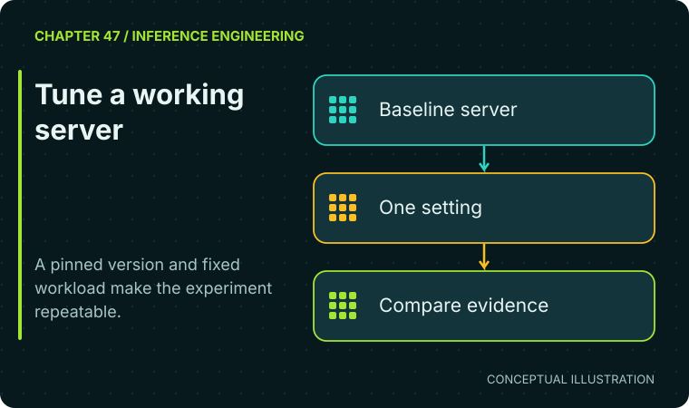
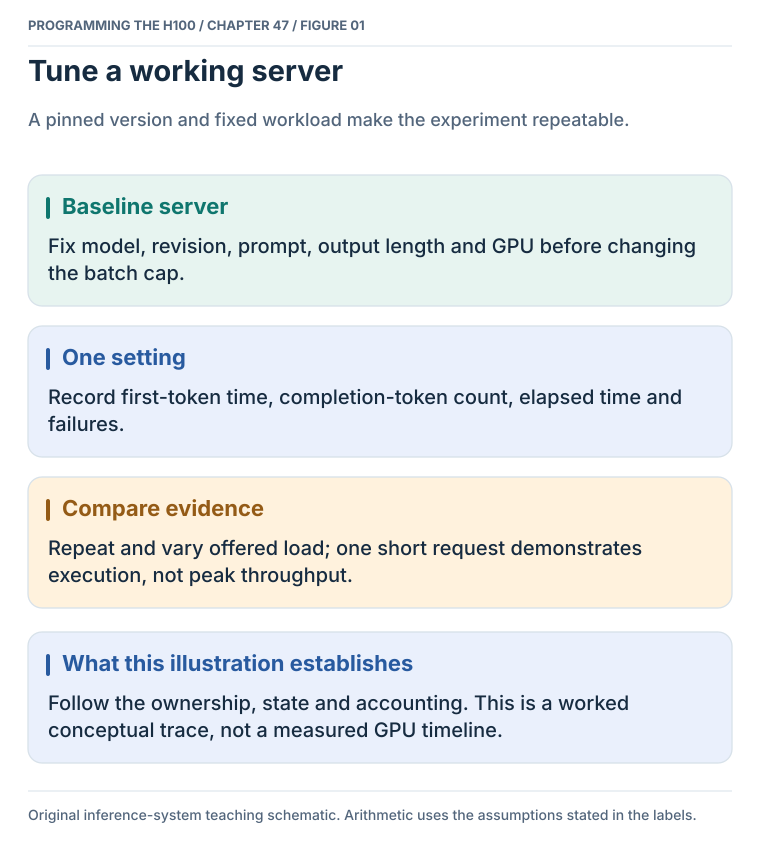

# Chapter 47 — From the Mini Engine to a Working vLLM Server

[](images/chapter-openers/47-inference.svg)

The goal is to build an inference engine whose behaviour we can explain. Chapters 43–46 built its reference memory manager, scheduler and prefix cache. This lab connects those ideas to a real GPU server and tests the measurement client before using it for tuning. It also adds a CUDA block-walk attention implementation that you can inspect completely.

The accompanying [dated execution record](validation-inference-2026-11-25.md) distinguishes CPU reference reruns, CUDA numerical checks and real-model serving. A successful small-model run does not validate a 70B configuration or the simulated performance tables in earlier chapters.

## 47.1 Follow the state before touching flags

[](images/worked/ch47-inference.svg)

1. A request arrives with a prompt and generation parameters.
2. Tokenization determines the actual prompt length; a word count is not a token count.
3. The scheduler admits prompt chunks and decode tokens subject to token, sequence and memory budgets.
4. Attention reads the sequence's block table; exact prefix hits can avoid some prompt computation.
5. The sampler chooses a token. Stop conditions determine whether another iteration is needed.
6. The response stream exposes first-content and completion times to the client.

Map each optimization to one of these steps. A prefix cache changes reusable prefill work; it does not cache arbitrary answers. More concurrent sequences can improve weight reuse while worsening latency or exhausting KV capacity.

## 47.2 Start with an isolated environment

Use Linux x86-64 and a working NVIDIA driver. The tested pod image is recorded with the results. A prebuilt vLLM wheel brings its matching PyTorch/CUDA userspace dependencies; a separately installed system `nvcc` is not what determines the wheel's CUDA runtime. Check the driver and wheel compatibility before installation. The upstream [GPU installation guide](https://docs.vllm.ai/en/v0.11.2/getting_started/installation/gpu/) explains this boundary.

```bash
nvidia-smi
python3 --version
python3 -m venv .venv-vllm
. .venv-vllm/bin/activate
python -m pip install --upgrade pip
python -m pip install 'vllm==0.11.2'
python -m pip check
export HF_HUB_ENABLE_HF_TRANSFER=0
python -c 'import torch, vllm; print(torch.__version__, vllm.__version__); print(torch.cuda.get_device_name(0))'
python -m pip freeze > serving-requirements.lock.txt
vllm serve --help=all > vllm-serve-help.txt
```

This release is the **lab target**, not a claim that it is the newest release. Preserve its dependency lock with the run. Avoid `--system-site-packages`: mixing the pod's existing PyTorch with a different wheel can produce unresolved CUDA shared libraries. The pod also inherited a fast-download setting without its optional `hf_transfer` package; setting `HF_HUB_ENABLE_HF_TRANSFER=0` uses the normal downloader. The failed startups are retained in the execution record, along with the corrected isolated environment.

## 47.3 Start a deliberately small baseline

```bash
vllm serve Qwen/Qwen2.5-0.5B-Instruct \
  --host 127.0.0.1 --port 8000 \
  --dtype bfloat16 --max-model-len 2048 \
  --max-num-seqs 16 --max-num-batched-tokens 512 \
  --gpu-memory-utilization 0.25 \
  --enable-prefix-caching --enable-chunked-prefill \
  --enforce-eager --seed 42
```

Wait for the readiness check in a second terminal:

```bash
curl --fail http://127.0.0.1:8000/health
curl --fail http://127.0.0.1:8000/v1/models
```

`--enforce-eager` keeps this baseline simple by disabling CUDA-graph execution. It is not a performance recommendation. The small memory fraction is sufficient for this small model; it is not suitable for every checkpoint. The command downloads public model weights; retain the resolved model revision from the cache in your run record, then pass `--revision <that-commit>` for an exact repeat.

## 47.4 Run the complete streaming probe

Download [the probe](examples/inference-systems/ch47_vllm_probe.py) and [its Chapter 36 harness dependency](examples/inference-systems/ch36_benchmark_teardown.py) into the same directory, or run from the repository:

```bash
cd docs/examples/inference-systems
python ch47_vllm_probe.py \
  --model Qwen/Qwen2.5-0.5B-Instruct --output probe.json
```

The probe makes two non-streaming greedy completions of the same prompt and requires equality, then warms up the streaming path and records eight serial requests with exactly 32 output tokens each. The JSON includes the generated text, server-reported completion counts, individual timing records and summary metrics. It fails if a request fails, a stream is incomplete, the output count is wrong or the repeated greedy outputs differ.

Step through a timing record by hand. If a request's first content arrives 0.035 seconds after its intended arrival and its final event arrives 0.097 seconds after arrival, TTFT is 35 ms and average TPOT is `(0.097-0.035)/(32-1)=2 ms`. Completion timing includes stream termination overhead; an SSE content event need not contain exactly one token. The harness uses server-reported token usage for counts. These hand numbers are illustrative, not the measured output.

This is a **smoke test**, not an open-loop capacity benchmark, and repeated-output equality is not a model-quality evaluation or a universal determinism guarantee. Use the Chapter 36 open-loop client for a load sweep after this passes.

## 47.5 Walk paged attention on the GPU

The complete [CUDA PyTorch program](examples/inference-systems/ch47_paged_attention_cuda.py) depends on the [Chapter 43 dense reference](examples/inference-systems/ch43_paged_kv_cache.py). Both belong in the same directory.

```bash
python ch47_paged_attention_cuda.py
```

Its tensors use `pool[physical_block, slot, head, dimension]`. Positions are zero-based. For block size 8 and logical position 17 (the eighteenth token), `logical_block=17//8=2`, `slot=17%8=1`. Read `table[2]` to find the physical block. A length-17 sequence instead ends at position 16 and uses only slot 0 of its third block.

For each query head the implementation keeps maximum `m`, denominator `l` and numerator vector `z`. For the next tile's scores `s`:

1. `m_new = max(m, max(s))`.
2. Rescale old state by `a = exp(m-m_new)`.
3. Form `p = exp(s-m_new)`.
4. Set `l = a*l + sum(p)` and `z = a*z + p@V`.
5. After the last block, return `z/l`.

The test covers lengths 1, 3, 17 and 65 in FP32, FP16 and BF16. It converts the already quantized inputs to a float64 NumPy dense reference, so an error reflects the attention calculation rather than comparing different rounded input values. CUDA accumulation is FP32. An empty visible-key set is rejected explicitly. A successful comparison checks numerical output; this sequence of PyTorch operations is **not a fused PagedAttention kernel** and makes no speed claim. The low-level teaching routine assumes finite inputs, matching tensor dimensions, and a block table containing valid nonnegative physical block ids owned by the sequence. Its test constructs those inputs internally. A serving engine must validate ownership and bounds before invoking it; the empty-length and short-table guards are not a complete untrusted-input validator.

## 47.6 Tune server settings in an explicit order

| Control | Engine mechanism | Experiment and failure to watch |
|---|---|---|
| `--max-model-len` | Allowed total sequence length | Fix prompt+output requirements first; lowering it changes the service contract. |
| `--gpu-memory-utilization` | Per-instance memory budget | Raise cautiously; other processes, weights, activations and graphs also need space. |
| `--kv-cache-memory-bytes` | Explicit KV allocation | When set in this release, it overrides automatic KV sizing from the utilization setting; do not treat both as independent knobs. |
| `--max-num-seqs` | Scheduler sequence cap | Sweep at fixed load; report both latency and output tokens/s. |
| `--max-num-batched-tokens` | Scheduled token budget | Compare prefill progress and decode interference; it is not the model context limit. |
| Prefix caching | Exact token-prefix KV reuse | Compare cold and warm prompts separately; measure hit behaviour, not just repetition. |
| Chunked prefill | Split prompt work across iterations | Test long prompts mixed with short decodes; record TTFT and TPOT tails. |
| KV-cache dtype | KV bytes and numerical behaviour | Check backend/model support and scale handling; validate quality before claiming savings. |
| Weight quantization | Weight storage and GEMM path | Use a compatible checkpoint/kernel; changing `dtype` alone does not quantize weights. |
| Tensor/pipeline/data parallelism | Partition work or replicate service | Requires enough GPUs; count communication and all replicas in cost. |
| Speculative decoding | Proposal/verification cycle | Measure acceptance and total cycle cost; do not import a hypothetical 2x speedup. |
| CUDA graphs / compilation | Launch and execution path | Compare after warm-up; include startup time and graph workspace in deployment planning. |

The [versioned engine-argument reference](https://docs.vllm.ai/en/v0.11.2/configuration/engine_args/) defines the exact flag semantics. The [versioned optimization guide](https://docs.vllm.ai/en/v0.11.2/configuration/optimization/) is a starting point for experiments, not a replacement for your workload.

## 47.7 Keep request parameters separate

Temperature, top-p, top-k, seed, stop conditions and maximum output tokens belong to generation requests. They alter generated work or the output distribution. They must remain fixed while comparing server configurations. If you deliberately change them, report a separate experiment.

LoRA rank and adapter count, multimodal processor limits, expert parallelism and KV-transfer connectors introduce additional memory and scheduling constraints. Test the intended adapters, input modality and topology. A text-only single-H100 run cannot validate them. Preserve unsupported flags as explicit failures; do not silently drop a feature to make its test pass.

## 47.8 A tuning matrix with a stop rule

Begin with sequence caps 8, 16 and 32, holding every other setting fixed. At each cap, send the same seeded workload at several offered rates and repeat it. Then restore the baseline and sweep the token budget. Separate cold-start cost from warmed request latency. Publish failures alongside successful samples.

A useful operating point must satisfy an SLO fixed **before** inspecting results. For example, require at least 99% of requests to meet both TTFT and TPOT thresholds. Compare goodput and dollars per successful SLO-compliant request, including replica idle time. The eight serial probe requests cannot establish a reliable p99 or this attainment target.

For exact repeats, preserve source hashes, model/tokenizer revision, full startup command, wheel lock, driver, GPU identity, timestamps, raw response records and metrics. Do not equate CPU simulator time with GPU wall-clock time.

## 47.9 From three books to our own engine

| Stage | H100 book contribution | Next implementation step |
|---|---|---|
| Explain correctness | Allocator, scheduler, prefix cache and dense reference | Define explicit ownership and cancellation contracts. |
| Put computation on CUDA | This block-walk probe and earlier CUDA/CUTLASS chapters | Fuse and batch the attention/data movement path. |
| Build efficient kernels | Triton book | Replace one reference operation at a time; compare numerical output and profile it. |
| Scale across devices | Multi-GPU book | Add tensor/expert parallelism, collective ordering, failure handling and topology tests. |
| Serve reliably | Gateway chapters and this real server baseline | Integrate tokenizer, sampler, streaming, bounded queues, deadlines and observability. |

The CPU mini engine remains a correctness oracle. Do not replace its simple tests with only an end-to-end latency number. Each new fast path must match a reference, conserve memory and survive interrupted requests before it becomes the default.

## 47.10 Captured H100 run — November 25, 2026

!!! note "Archived real-server result and current client scope"

    The H100/vLLM output below belongs to the archived November 25 client revision. The follow-up audit corrected the shared Chapter 36 client's protocol and accounting paths; that current client has fresh CPU/mock regression and full-program reruns, but its exact-current integration with real vLLM has not been repeated. The successful archived serving run remains valid for its captured source. The CUDA attention probe is unchanged by those client corrections.

On one H100 80GB HBM3, driver 595.112.07, the CUDA program completed all 12 numerical comparisons. The real vLLM 0.11.2 server completed both repeated greedy requests, a streaming warm-up and all eight measured 32-token streams without failures. The serial smoke test reported TTFT p50 13.58 ms and TPOT p50 6.72 ms; these are short-run observations, not peak performance or a load-capacity result. See the [complete dated record and raw logs](validation-inference-2026-11-25.md).

Beginning of the CUDA stdout:

```text
PASS torch.float32 length=1 max_abs_error=0
PASS torch.float32 length=3 max_abs_error=1.37e-07
PASS torch.float32 length=17 max_abs_error=1.04e-07
PASS torch.float32 length=65 max_abs_error=9.28e-08
```


<!-- BEGIN COMPLETE INFERENCE SOURCE -->
## Complete runnable code

The complete implementation is shown below, including its checks and entry point. The listing and downloadable `.py` file contain exactly the same source. Copy the file under the displayed filename; keep supporting files in the same directory.

[Download all inference examples and supporting modules](examples/inference-systems/inference-systems.zip) or read the [environment and command guide](examples/inference-systems/README.md).

The [follow-up agent audit](inference-adversarial-review-2026-11-25.md) records the corrections, fresh CPU captures and hardware limits for this source.

Supporting modules: [ch36_benchmark_teardown.py](examples/inference-systems/ch36_benchmark_teardown.py), [ch43_paged_kv_cache.py](examples/inference-systems/ch43_paged_kv_cache.py).

The CUDA program requires a CUDA GPU. Start the Chapter 47 vLLM server before running the HTTP probe; its `--model` and `--output` arguments are required.

```bash
python3 docs/examples/inference-systems/ch47_paged_attention_cuda.py
python3 docs/examples/inference-systems/ch47_vllm_probe.py \
  --model Qwen/Qwen2.5-0.5B-Instruct --output probe.json
```

### ch47_paged_attention_cuda.py

[Download ch47_paged_attention_cuda.py](examples/inference-systems/ch47_paged_attention_cuda.py)

```python title="ch47_paged_attention_cuda.py" linenums="1"
#!/usr/bin/env python3
"""Educational block-walk attention on CUDA via PyTorch (not a fused kernel).

python ch47_paged_attention_cuda.py
The CPU NumPy reference is Chapter 43's dense_attention. Values are quantized
before the reference so the comparison isolates attention, not input rounding.
"""
import json
import math
import numpy as np
import torch
from ch43_paged_kv_cache import dense_attention


def block_walk(q, keys, values, table, length):
    """q[H,D], pools[P,B,H,D], logical block table; return FP32 [H,D]."""
    if length <= 0:
        raise ValueError('attention requires at least one visible key')
    B = keys.shape[1]
    if len(table) < math.ceil(length / B):
        raise ValueError('block table is too short')
    q = q.float()
    m = torch.full((q.shape[0],), -torch.inf, device=q.device)
    denominator = torch.zeros_like(m)
    numerator = torch.zeros_like(q)
    for logical, physical in enumerate(table[:math.ceil(length / B)]):
        count = min(B, length - logical * B)
        k = keys[physical, :count].float()
        v = values[physical, :count].float()
        scores = torch.einsum('hd,thd->ht', q, k) / math.sqrt(q.shape[-1])
        new_m = torch.maximum(m, scores.max(dim=1).values)
        scale = torch.exp(m - new_m)
        p = torch.exp(scores - new_m[:, None])
        numerator = numerator * scale[:, None] + torch.einsum('ht,thd->hd', p, v)
        denominator = denominator * scale + p.sum(dim=1)
        m = new_m
    return numerator / denominator[:, None]


def main():
    if not torch.cuda.is_available():
        raise RuntimeError('CUDA GPU required; no CPU fallback is counted as a pass')
    torch.manual_seed(42)
    torch.backends.cuda.matmul.allow_tf32 = False
    rows = []
    for dtype in (torch.float32, torch.float16, torch.bfloat16):
        for length in (1, 3, 17, 65):
            B, H, D = 8, 2, 32
            n = math.ceil(length / B)
            table = list(reversed(range(n)))
            k = torch.randn(n, B, H, D, device='cuda', dtype=dtype)
            v = torch.randn_like(k)
            q = torch.randn(H, D, device='cuda', dtype=dtype)
            # Gather only for independent reference; implementation never gathers.
            kd = k[table].reshape(-1,H,D)[:length].float().cpu().numpy()
            vd = v[table].reshape(-1,H,D)[:length].float().cpu().numpy()
            ref = dense_attention(q.float().cpu().numpy(), kd, vd)
            got = block_walk(q,k,v,table,length).cpu().numpy()
            error = float(np.max(np.abs(got-ref)))
            np.testing.assert_allclose(got,ref,rtol=3e-5,atol=3e-5)
            rows.append(dict(dtype=str(dtype),length=length,max_abs_error=error))
            print(f'PASS {dtype} length={length} max_abs_error={error:.3g}')
    try:
        block_walk(q,k,v,table,0)
    except ValueError:
        print('PASS empty-visible-key input rejected')
    else:
        raise AssertionError('empty input was not rejected')
    print(json.dumps(dict(device=torch.cuda.get_device_name(0),torch=torch.__version__,
                          cases=rows,scope='12 CUDA PyTorch block-walk comparisons; no fused-kernel speed claim'),indent=2))


if __name__ == '__main__':
    main()
```

### ch47_vllm_probe.py

[Download ch47_vllm_probe.py](examples/inference-systems/ch47_vllm_probe.py)

```python title="ch47_vllm_probe.py" linenums="1"
#!/usr/bin/env python3
"""Run real streaming requests; compare repeated greedy outputs.

python ch47_vllm_probe.py --model Qwen/Qwen2.5-0.5B-Instruct --output probe.json
The server must already be running on loopback port 8000. No simulated output.
"""
import argparse
import asyncio
import dataclasses
import hashlib
import json
import time
import urllib.request
from ch36_benchmark_teardown import Rec, Target, one_request, summarize


def completion(model, prompt):
    payload = json.dumps(dict(model=model, prompt=prompt, max_tokens=32,
                              temperature=0, seed=42, ignore_eos=True)).encode()
    request = urllib.request.Request('http://127.0.0.1:8000/v1/completions',
                                     data=payload, headers={'Content-Type': 'application/json'})
    with urllib.request.urlopen(request, timeout=120) as response:
        result = json.load(response)
    return result['choices'][0]['text'], result['usage']


async def run(model):
    target = Target(model=model)
    # Warm-up is excluded from the measured record list.
    warm = Rec(time.perf_counter())
    await one_request(target, 32, 16, warm, timeout=120)
    if not warm.ok:
        raise RuntimeError('warm-up failed: '+warm.err)
    records = []
    for _ in range(8):
        rec = Rec(time.perf_counter())
        await one_request(target, 128, 32, rec, timeout=120)
        if not rec.ok or rec.ntok != 32:
            raise RuntimeError(f'request failed or wrong token count: {rec}')
        records.append(rec)
    return records


def main():
    ap = argparse.ArgumentParser()
    ap.add_argument('--model', required=True)
    ap.add_argument('--output', required=True)
    args = ap.parse_args()
    prompt = 'Explain why a KV cache saves recomputation in autoregressive decoding. ' * 12
    a, usage_a = completion(args.model, prompt)
    b, usage_b = completion(args.model, prompt)
    if a != b:
        raise RuntimeError('repeated greedy completion differs')
    records = asyncio.run(run(args.model))
    result = dict(model=args.model, scope='Real single-GPU inference; serial short-request smoke test, not a load sweep',
                  repeated_greedy_equal=True, sample_output=a, usage=[usage_a, usage_b],
                  source_sha256=hashlib.sha256(open(__file__, 'rb').read()).hexdigest(),
                  records=[dataclasses.asdict(r) for r in records],
                  summary=summarize(records,warmup=0))
    with open(args.output,'w') as f:
        json.dump(result,f,indent=2,allow_nan=False)
    print(json.dumps({k:v for k,v in result.items() if k!='records'},indent=2,allow_nan=False))


if __name__ == '__main__':
    main()
```

<!-- END COMPLETE INFERENCE SOURCE -->

## Exercises with worked answers

1. Why can a larger token budget make decode latency worse? More prefill work can occupy the next iteration; measure the mixed workload rather than assuming higher throughput means lower TPOT.
2. A request emits 17 tokens from first content at 0.10 s to completion at 0.18 s. What is TPOT? There are 16 intervals: `0.08/16=0.005 s`, or 5 ms.
3. Does two identical greedy completions prove prefix caching worked? No. Output equality checks behaviour; inspect cache metrics and compare cold/warm work to establish reuse.
4. Why compare quantized inputs against the dense reference? Otherwise FP16/BF16 input rounding would be confused with an attention implementation error.
5. What is still needed for an inference engine? Efficient batched kernels, trained-model loading, a tokenizer and sampler, cancellation-safe ownership, streaming and admission control, and eventually distributed execution. This lab validates specific pieces, not the whole production system.

## Chapter Summary

Start with a working, versioned GPU server. Verify its streaming path and numerical primitives, then vary one control under a fixed workload. Keep CPU logic, GPU correctness, serving smoke tests, quality evaluations and capacity benchmarks separate. Those boundaries let us replace a reference engine with faster kernels without losing an explanation of why its answers remain correct.
