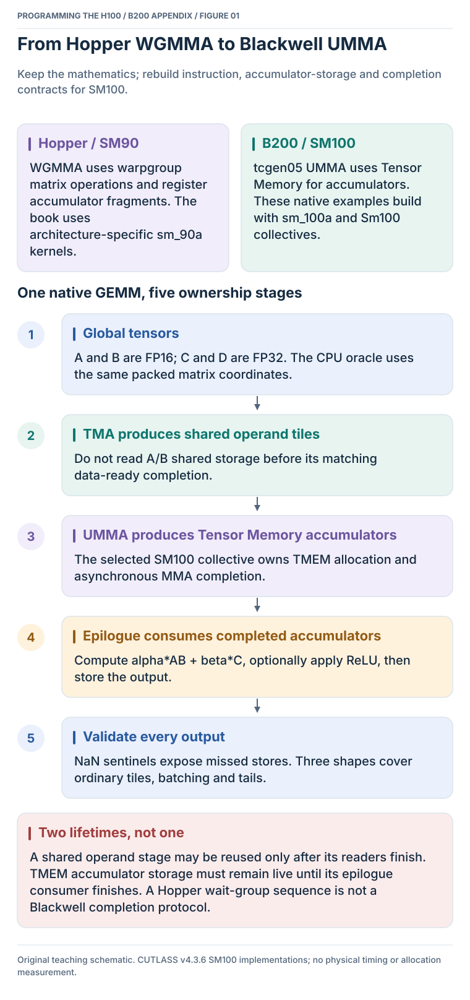
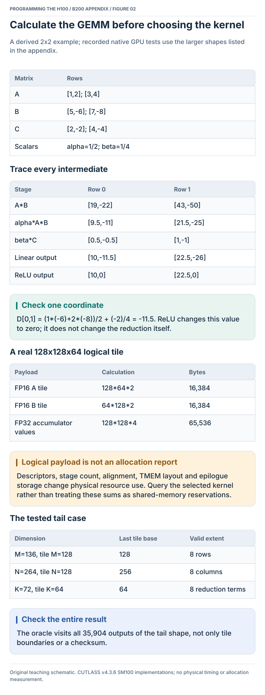
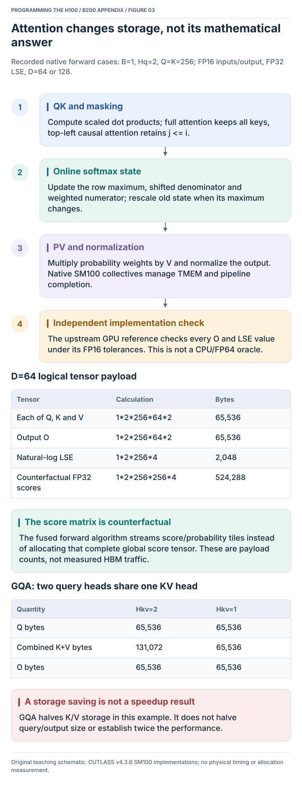

# Appendix — Native B200: UMMA, GEMM and Fused Attention

[](images/worked/blackwell-b200-01.svg)

This appendix continues the book on **B200, compute capability 10.0**. It provides native SM100 CUTLASS kernels rather than trying to execute Hopper WGMMA binaries on Blackwell. The matrix mathematics, CuTe coordinate discipline and readiness/reuse questions remain familiar; the MMA instruction family, accumulator storage and scheduling contracts change.

**Recorded result — November 19, 2026:** both native GEMMs passed three complete CPU-reference cases; native FP16 attention passed four O/LSE-verified cases. The machine had eight B200 GPUs, but **each program here uses one CUDA-visible device**, device 0. The separate eight-device communication tests belong to the multi-GPU companion. These small correctness runs are not performance benchmarks.

The implementation is pinned to **CUTLASS v4.3.6**, commit `1afc6d355b8cb992398f17beb4425702f1d57ddd`. [Download all appendix sources and upstream support files](examples/blackwell/blackwell-appendix-sources.zip). [Inspect the earlier H100-book compatibility pass](validation-b200.md).

## 1 — What changes, and what does not

| Question | Hopper path in the main chapters | Native B200 path here |
| --- | --- | --- |
| Matrix instruction family | WGMMA | `tcgen05.mma`, exposed through SM100 UMMA collectives |
| Accumulator storage | Register accumulator fragments | Tensor Memory (TMEM), managed by the selected collective |
| Library architecture tag | `cutlass::arch::Sm90` | `cutlass::arch::Sm100` |
| Recorded architecture-specific target | `sm_90a` | `sm_100a` |
| Pipeline contract | Hopper operand readiness, asynchronous readers and completion | SM100 operand readiness, TMEM lifetime and completion |
| Mathematical result | `D = alpha*(A*B) + beta*C` | The same equation, with separately validated implementation |

**Step 1: distinguish source, cubin and PTX.** Ordinary forward-compatible PTX is different from architecture-specific `compute_90a` PTX. NVIDIA explicitly excludes Hopper's architecture-specific PTX from Blackwell compatibility. Rebuilding for the actual target matters; retaining a binary named `example` does not make its embedded GPU code compatible. See the [Blackwell compatibility guide](https://docs.nvidia.com/cuda/blackwell-compatibility-guide/index.html).

**Step 2: distinguish the operation from its storage.** WGMMA's register-fragment organization is not a template for TMEM addresses. A native SM100 collective allocates and addresses accumulator storage according to the Blackwell instruction contract. Read the pinned [Blackwell functionality guide](https://github.com/NVIDIA/cutlass/blob/1afc6d355b8cb992398f17beb4425702f1d57ddd/media/docs/cpp/blackwell_functionality.md) and [UMMA wrappers](https://github.com/NVIDIA/cutlass/blob/1afc6d355b8cb992398f17beb4425702f1d57ddd/include/cute/arch/mma_sm100_umma.hpp).

**Step 3: carry the dependency proof across.** TMA must finish producing an operand stage before its MMA consumer reads it. That stage remains live until its readers finish. Separately, an accumulator remains live until its epilogue consumer finishes. CUTLASS implements the matching SM100 completion protocol; substituting a Hopper `wgmma.wait_group` sequence is not a port.

**Step 4: change schedules as well as the architecture tag.** The original Hopper fused example chooses Hopper-specific epilogue and ping-pong schedules. Merely renaming `Sm90` to `Sm100` failed compilation. The tested B200 sources use SM100-capable `EpilogueScheduleAuto` and `KernelScheduleAuto`, with stage capacity reduced by the epilogue's actual shared storage. Auto selection is version-dependent, which is one reason the pin is part of the example.

The programs below demonstrate UMMA through CUTLASS's native SM100 implementation. They are not handwritten `tcgen05` assembly tutorials and do not claim to implement every Blackwell scheduling mode.

## 2 — Build environment, once

Use the [fresh-machine installation guide](getting-started.md) for the host driver, compiler and shell paths. These programs need CUDA development files and CUTLASS headers; **they do not require NCCL, MPI or NVSHMEM**. The recorded environment was Ubuntu 24.04.5, driver **580.105.08**, NVCC **12.8.93**, and GCC **13.3.0**. Native SM100 code generation needs a supporting compiler; CUDA 12.8 is the baseline used here.

Run from this repository's root:

```bash
nvidia-smi --query-gpu=name,compute_cap,driver_version --format=csv
nvcc --version
mkdir -p external build/blackwell
bash tools/fetch_cutlass.sh external/cutlass
export CUTLASS_ROOT="$PWD/external/cutlass"
```

B200's CC 10.0 and GeForce Blackwell's CC 12.x are different targets. Do not infer compatibility from the Blackwell brand alone. `sm_100a` is also not a universal future-GPU binary target. The appendix guards the recorded B200 family; NVIDIA's [tuning guide](https://docs.nvidia.com/cuda/blackwell-tuning-guide/index.html) distinguishes the compute capabilities.

## 3 — Work one GEMM by hand

[](images/worked/blackwell-b200-02.svg)

Use this small **teaching calculation**, not a hardware tile shape:

```text
A = [1  2]       B = [5  -6]       C = [2  -2]
    [3  4]           [7  -8]           [4  -4]
alpha = 1/2, beta = 1/4
```

1. Calculate `AB[0,0] = 1*5 + 2*7 = 19`.
2. Calculate `AB[0,1] = 1*(-6) + 2*(-8) = -22`.
3. Repeat for row 1: `AB[1,0]=43`, `AB[1,1]=-50`.
4. Scale the product: `alpha*AB = [[9.5,-11],[21.5,-25]]`.
5. Scale the old output independently: `beta*C = [[0.5,-0.5],[1,-1]]`.
6. Add once: `D = [[10,-11.5],[22.5,-26]]`.
7. For the fused variant, apply `max(D,0)` **after** this sum: `[[10,0],[22.5,0]]`.

**Check yourself.** Does applying ReLU to each partial K tile give the same answer? No. Cancellation may occur between partial sums; the activation belongs after the intended complete accumulation and linear combination.

The actual source stores A, B, C and D in row-major logical matrices. Its CPU oracle reads `A[(l*M+m)*K+k]`, `B[(l*K+k)*N+n]`, and `C[(l*M+m)*N+n]`. CUTLASS's internal B view uses logical modes `(N,K,L)` with the appropriate stride type; that internal mode order does not turn the host's row-major B into a different mathematical matrix. `make_cute_packed_stride` constructs the expected strides from the kernel's declared types.

## 4 — Trace the native GEMM source

1. `Half` selects FP16 inputs; the output and accumulator types are FP32.
2. `CtaTileShape = (128,128,64)` declares the logical MMA tile. `Cluster = (1,1,1)` selects this example's one-CTA cluster configuration.
3. Build the epilogue first. Its shared-storage size feeds `StageCountAutoCarveout`, so operand staging does not pretend that the epilogue consumes no resources.
4. Build a `Sm100` mainloop and combine it with the epilogue in `GemmUniversal`.
5. Allocate device inputs/output and copy the initialized host inputs. Poison the entire output with NaN bits: a missed store must not accidentally match zero.
6. Construct A/B/C/D strides from the kernel's actual stride types and the batch dimension L.
7. Check `can_implement`, workspace allocation, initialization, launch, synchronization and D2H copy.
8. Visit **every** output coordinate with an independent CPU reduction, then reject nonfinite or unequal values.

The bounded input patterns are binary fractions with small numerators and K at most 128. Their partial sums fit FP32's exact precision, so exact equality is intentional for these particular cases. This is not an equality rule for arbitrary GEMMs, precisions or reductions.

| Case | M,N,K,L | Outputs checked | What changes |
| --- | --- | ---: | --- |
| Ordinary tile | 128,128,64,1 | 16,384 | Basic native GEMM path |
| Batched and scaled | 256,128,128,2 | 65,536 | Batch stride; alpha=0.5 and beta=0.25 |
| Tail case | 136,264,72,1 | 35,904 | Partial M/N/K tiles and complete output coverage |

For the last case, the final logical tile bases are M=128, N=256 and K=64. Only eight rows, eight columns and eight reduction terms remain in their respective dimensions. The inputs still satisfy the declared element-alignment contracts; arbitrary unaligned shapes are not promised by this test.

### Complete native GEMM program

[Download `blackwell_gemm.cu`](examples/blackwell/blackwell_gemm.cu).

<!-- blackwell-source:blackwell_gemm.cu:start -->
```cuda
// A pinned CUTLASS v4.3.6 Blackwell B200 GEMM with an independent full CPU oracle.
#include <cute/tensor.hpp>
#include <cutlass/cutlass.h>
#include <cutlass/epilogue/collective/collective_builder.hpp>
#include <cutlass/gemm/collective/collective_builder.hpp>
#include <cutlass/gemm/device/gemm_universal_adapter.h>
#include <cutlass/gemm/kernel/gemm_universal.hpp>
#include <cutlass/util/device_memory.h>
#include <cutlass/util/packed_stride.hpp>
#include <cuda_runtime.h>
#include <cmath>
#include <cstdio>
#include <stdexcept>
#include <vector>
using namespace cute;
using Half = cutlass::half_t;
using Row = cutlass::layout::RowMajor;
using CtaTileShape = Shape<_128, _128, _64>;
using Cluster = Shape<_1, _1, _1>;
using Epilogue = cutlass::epilogue::collective::CollectiveBuilder<
    cutlass::arch::Sm100, cutlass::arch::OpClassTensorOp,
    CtaTileShape, Cluster, cutlass::epilogue::collective::EpilogueTileAuto,
    float, float, float, Row, 4, float, Row, 4,
    cutlass::epilogue::collective::EpilogueScheduleAuto>::CollectiveOp;
using Mainloop = cutlass::gemm::collective::CollectiveBuilder<
    cutlass::arch::Sm100, cutlass::arch::OpClassTensorOp,
    Half, Row, 8, Half, Row, 8, float, CtaTileShape, Cluster,
    cutlass::gemm::collective::StageCountAutoCarveout<
        static_cast<int>(sizeof(Epilogue::SharedStorage))>,
    cutlass::gemm::collective::KernelScheduleAuto>::CollectiveOp;
using Kernel = cutlass::gemm::kernel::GemmUniversal<
    Shape<int, int, int, int>, Mainloop, Epilogue>;
using Gemm = cutlass::gemm::device::GemmUniversalAdapter<Kernel>;

void cuda_check(cudaError_t s) {
    if (s != cudaSuccess) throw std::runtime_error(cudaGetErrorString(s));
}
void cutlass_check(cutlass::Status s) {
    if (s != cutlass::Status::kSuccess)
        throw std::runtime_error(cutlassGetStatusString(s));
}

bool test(int M, int N, int K, int L, float alpha, float beta,
          cutlass::KernelHardwareInfo hardware) {
    std::vector<Half> A(size_t(L) * M * K), B(size_t(L) * K * N);
    std::vector<float> C(size_t(L) * M * N), D(C.size());
    for (size_t i = 0; i < A.size(); ++i) A[i] = Half(float(int(i % 13) - 6) / 8);
    for (size_t i = 0; i < B.size(); ++i) B[i] = Half(float(int(i % 17) - 8) / 8);
    for (size_t i = 0; i < C.size(); ++i) C[i] = float(int(i % 19) - 9) / 16;
    cutlass::device_memory::allocation<Half> da(A.size()), db(B.size());
    cutlass::device_memory::allocation<float> dc(C.size()), dd(D.size());
    cuda_check(cudaMemcpy(da.get(), A.data(), A.size() * sizeof(Half), cudaMemcpyHostToDevice));
    cuda_check(cudaMemcpy(db.get(), B.data(), B.size() * sizeof(Half), cudaMemcpyHostToDevice));
    cuda_check(cudaMemcpy(dc.get(), C.data(), C.size() * sizeof(float), cudaMemcpyHostToDevice));
    // IEEE FP32 all-one bits are NaN: an omitted output store cannot pass
    // merely because its reference value happens to be zero.
    cuda_check(cudaMemset(dd.get(), 0xff, D.size() * sizeof(float)));
    auto sa = cutlass::make_cute_packed_stride(Kernel::StrideA{}, make_shape(M, K, L));
    auto sb = cutlass::make_cute_packed_stride(Kernel::StrideB{}, make_shape(N, K, L));
    auto sc = cutlass::make_cute_packed_stride(Kernel::StrideC{}, make_shape(M, N, L));
    auto sd = cutlass::make_cute_packed_stride(Kernel::StrideD{}, make_shape(M, N, L));
    Gemm::Arguments args{cutlass::gemm::GemmUniversalMode::kGemm,
                         {M, N, K, L}, {da.get(), sa, db.get(), sb},
                         {{}, dc.get(), sc, dd.get(), sd}, hardware};
    args.epilogue.thread.alpha = alpha;
    args.epilogue.thread.beta = beta;
    Gemm gemm;
    cutlass_check(gemm.can_implement(args));
    cutlass::device_memory::allocation<unsigned char> workspace(Gemm::get_workspace_size(args));
    cutlass_check(gemm.initialize(args, workspace.get()));
    cutlass_check(gemm.run());
    cuda_check(cudaDeviceSynchronize());
    cuda_check(cudaMemcpy(D.data(), dd.get(), D.size() * sizeof(float), cudaMemcpyDeviceToHost));
    size_t errors = 0;
    for (int l = 0; l < L; ++l)
        for (int m = 0; m < M; ++m)
            for (int n = 0; n < N; ++n) {
                double sum = 0;
                for (int k = 0; k < K; ++k)
                    sum += double(float(A[(size_t(l) * M + m) * K + k])) *
                           double(float(B[(size_t(l) * K + k) * N + n]));
                size_t i = (size_t(l) * M + m) * N + n;
                float expected = float(alpha * sum + beta * C[i]);
                // These bounded binary-rational inputs make the sum exact in FP32.
                errors += !std::isfinite(D[i]) || D[i] != expected;
            }
    std::printf("%s M=%d N=%d K=%d L=%d alpha=%.2f beta=%.2f checked=%zu errors=%zu\n",
                errors ? "GEMM FAIL" : "GEMM CASE PASS", M, N, K, L, alpha, beta, D.size(), errors);
    return errors == 0;
}
int main() {
    try {
        cudaDeviceProp p{};
        cuda_check(cudaSetDevice(0));
        cuda_check(cudaGetDeviceProperties(&p, 0));
        if (p.major != 10 || p.minor != 0) {
            std::fprintf(stderr, "Requires Blackwell B200 compute capability 10.0; found %d.%d\n", p.major, p.minor);
            return 2;
        }
        cutlass::KernelHardwareInfo hw{};
        hw.device_id = 0;
        hw.sm_count = p.multiProcessorCount;
        bool ok = test(128, 128, 64, 1, 1, 0, hw);
        ok = test(256, 128, 128, 2, 0.5f, 0.25f, hw) && ok;
        ok = test(136, 264, 72, 1, 0.5f, 0.25f, hw) && ok;
        std::puts(ok ? "GEMM PASS: 3 full CPU-reference cases" : "GEMM FAIL");
        return ok ? 0 : 1;
    } catch (const std::exception& e) {
        std::fprintf(stderr, "GEMM ERROR: %s\n", e.what());
        return 1;
    }
}
```
<!-- blackwell-source:blackwell_gemm.cu:end -->

## 5 — Fuse the activation without changing the reference

The fused source supplies `LinCombEltAct<ReLu,...>` to the SM100 epilogue builder. The mainloop still computes the matrix product; the epilogue performs the linear combination and activation. The CPU oracle applies the same operation order. Reusing the full batched/tail suite checks that fusion did not quietly change strides or leave output elements unwritten.

### Complete fused-ReLU program

[Download `blackwell_gemm_relu.cu`](examples/blackwell/blackwell_gemm_relu.cu).

<!-- blackwell-source:blackwell_gemm_relu.cu:start -->
```cuda
// A complete fused ReLU variant of the pinned Blackwell B200 GEMM with a full CPU oracle.
#include <cute/tensor.hpp>
#include <cutlass/cutlass.h>
#include <cutlass/epilogue/collective/collective_builder.hpp>
#include <cutlass/epilogue/fusion/operations.hpp>
#include <cutlass/epilogue/thread/activation.h>
#include <cutlass/gemm/collective/collective_builder.hpp>
#include <cutlass/gemm/device/gemm_universal_adapter.h>
#include <cutlass/gemm/kernel/gemm_universal.hpp>
#include <cutlass/util/device_memory.h>
#include <cutlass/util/packed_stride.hpp>
#include <cuda_runtime.h>
#include <cmath>
#include <cstdio>
#include <stdexcept>
#include <vector>
using namespace cute;
using Half = cutlass::half_t;
using Row = cutlass::layout::RowMajor;
using CtaTileShape = Shape<_128, _128, _64>;
using Cluster = Shape<_1, _1, _1>;
using Fusion = cutlass::epilogue::fusion::LinCombEltAct<
    cutlass::epilogue::thread::ReLu, float, float, float>;
using Epilogue = cutlass::epilogue::collective::CollectiveBuilder<
    cutlass::arch::Sm100, cutlass::arch::OpClassTensorOp,
    CtaTileShape, Cluster, cutlass::epilogue::collective::EpilogueTileAuto,
    float, float, float, Row, 4, float, Row, 4,
    cutlass::epilogue::collective::EpilogueScheduleAuto, Fusion>::CollectiveOp;
using Mainloop = cutlass::gemm::collective::CollectiveBuilder<
    cutlass::arch::Sm100, cutlass::arch::OpClassTensorOp,
    Half, Row, 8, Half, Row, 8, float, CtaTileShape, Cluster,
    cutlass::gemm::collective::StageCountAutoCarveout<
        static_cast<int>(sizeof(Epilogue::SharedStorage))>,
    cutlass::gemm::collective::KernelScheduleAuto>::CollectiveOp;
using Kernel = cutlass::gemm::kernel::GemmUniversal<
    Shape<int, int, int, int>, Mainloop, Epilogue>;
using Gemm = cutlass::gemm::device::GemmUniversalAdapter<Kernel>;

void cuda_check(cudaError_t s) {
    if (s != cudaSuccess) throw std::runtime_error(cudaGetErrorString(s));
}
void cutlass_check(cutlass::Status s) {
    if (s != cutlass::Status::kSuccess)
        throw std::runtime_error(cutlassGetStatusString(s));
}

bool test(int M, int N, int K, int L, float alpha, float beta,
          cutlass::KernelHardwareInfo hardware) {
    std::vector<Half> A(size_t(L) * M * K), B(size_t(L) * K * N);
    std::vector<float> C(size_t(L) * M * N), D(C.size());
    for (size_t i = 0; i < A.size(); ++i) A[i] = Half(float(int(i % 13) - 6) / 8);
    for (size_t i = 0; i < B.size(); ++i) B[i] = Half(float(int(i % 17) - 8) / 8);
    for (size_t i = 0; i < C.size(); ++i) C[i] = float(int(i % 19) - 9) / 16;
    cutlass::device_memory::allocation<Half> da(A.size()), db(B.size());
    cutlass::device_memory::allocation<float> dc(C.size()), dd(D.size());
    cuda_check(cudaMemcpy(da.get(), A.data(), A.size() * sizeof(Half), cudaMemcpyHostToDevice));
    cuda_check(cudaMemcpy(db.get(), B.data(), B.size() * sizeof(Half), cudaMemcpyHostToDevice));
    cuda_check(cudaMemcpy(dc.get(), C.data(), C.size() * sizeof(float), cudaMemcpyHostToDevice));
    // IEEE FP32 all-one bits are NaN: an omitted output store cannot pass
    // merely because its reference value happens to be zero.
    cuda_check(cudaMemset(dd.get(), 0xff, D.size() * sizeof(float)));
    auto sa = cutlass::make_cute_packed_stride(Kernel::StrideA{}, make_shape(M, K, L));
    auto sb = cutlass::make_cute_packed_stride(Kernel::StrideB{}, make_shape(N, K, L));
    auto sc = cutlass::make_cute_packed_stride(Kernel::StrideC{}, make_shape(M, N, L));
    auto sd = cutlass::make_cute_packed_stride(Kernel::StrideD{}, make_shape(M, N, L));
    Gemm::Arguments args{cutlass::gemm::GemmUniversalMode::kGemm,
                         {M, N, K, L}, {da.get(), sa, db.get(), sb},
                         {{}, dc.get(), sc, dd.get(), sd}, hardware};
    args.epilogue.thread.alpha = alpha;
    args.epilogue.thread.beta = beta;
    Gemm gemm;
    cutlass_check(gemm.can_implement(args));
    cutlass::device_memory::allocation<unsigned char> workspace(Gemm::get_workspace_size(args));
    cutlass_check(gemm.initialize(args, workspace.get()));
    cutlass_check(gemm.run());
    cuda_check(cudaDeviceSynchronize());
    cuda_check(cudaMemcpy(D.data(), dd.get(), D.size() * sizeof(float), cudaMemcpyDeviceToHost));
    size_t errors = 0;
    for (int l = 0; l < L; ++l)
        for (int m = 0; m < M; ++m)
            for (int n = 0; n < N; ++n) {
                double sum = 0;
                for (int k = 0; k < K; ++k)
                    sum += double(float(A[(size_t(l) * M + m) * K + k])) *
                           double(float(B[(size_t(l) * K + k) * N + n]));
                size_t i = (size_t(l) * M + m) * N + n;
                float expected = float(alpha * sum + beta * C[i]);
                expected = expected < 0.0f ? 0.0f : expected;
                // These bounded binary-rational inputs make the sum exact in FP32.
                errors += !std::isfinite(D[i]) || D[i] != expected;
            }
    std::printf("%s M=%d N=%d K=%d L=%d alpha=%.2f beta=%.2f checked=%zu errors=%zu\n",
                errors ? "FUSED GEMM FAIL" : "FUSED GEMM CASE PASS", M, N, K, L, alpha, beta, D.size(), errors);
    return errors == 0;
}
int main() {
    try {
        cudaDeviceProp p{};
        cuda_check(cudaSetDevice(0));
        cuda_check(cudaGetDeviceProperties(&p, 0));
        if (p.major != 10 || p.minor != 0) {
            std::fprintf(stderr, "Requires Blackwell B200 compute capability 10.0; found %d.%d\n", p.major, p.minor);
            return 2;
        }
        cutlass::KernelHardwareInfo hw{};
        hw.device_id = 0;
        hw.sm_count = p.multiProcessorCount;
        bool ok = test(128, 128, 64, 1, 1, 0, hw);
        ok = test(256, 128, 128, 2, 0.5f, 0.25f, hw) && ok;
        ok = test(136, 264, 72, 1, 0.5f, 0.25f, hw) && ok;
        std::puts(ok ? "FUSED GEMM PASS: 3 full CPU-reference cases" : "FUSED GEMM FAIL");
        return ok ? 0 : 1;
    } catch (const std::exception& e) {
        std::fprintf(stderr, "FUSED GEMM ERROR: %s\n", e.what());
        return 1;
    }
}
```
<!-- blackwell-source:blackwell_gemm_relu.cu:end -->

## 6 — Compile and run both GEMMs

```bash
nvcc -std=c++17 -O2 -arch=sm_100a --expt-relaxed-constexpr \
    -I"$CUTLASS_ROOT/include" -I"$CUTLASS_ROOT/tools/util/include" \
    docs/examples/blackwell/blackwell_gemm.cu \
    -o build/blackwell/gemm -lcuda
./build/blackwell/gemm

nvcc -std=c++17 -O2 -arch=sm_100a --expt-relaxed-constexpr \
    -I"$CUTLASS_ROOT/include" -I"$CUTLASS_ROOT/tools/util/include" \
    docs/examples/blackwell/blackwell_gemm_relu.cu \
    -o build/blackwell/gemm-relu -lcuda
./build/blackwell/gemm-relu
```

These checkout-relative paths correspond to the recorded build flags; the raw logs retain their original host paths. Do not reuse a binary after changing the architecture or source.

## 7 — Native attention: preserve the equation, change its implementation

[](images/worked/blackwell-b200-03.svg)

The equation remains `O = softmax(Q*K^T/sqrt(D))*V`. [Chapter 30](30-cutlass-attention-foundations.md) derives the online maximum/denominator/numerator recurrence, and [Chapter 31](31-cutlass-hopper-fmha.md) follows its Hopper implementation. Here the native SM100 collectives own the UMMA/TMEM pipeline.

Walk through one row using Chapter 30's exact-real teaching inputs:

1. Scaled scores `[ln(2),0,ln(2)]` produce exponential weights `[2,1,2]`.
2. With V rows `[1,0]`, `[0,2]`, `[3,4]`, the numerator is `[8,10]` and denominator is 5.
3. The full-attention output is `[1.6,2]`; natural-log LSE is `ln(5)`.
4. Top-left causal row 0 permits only key 0, so its output becomes `[1,0]` and its LSE becomes `ln(2)`.
5. Storage changes do not change these mathematical answers. They change where intermediate values live and which completion events protect their consumers.

That tiny derivation is not an extra native GPU execution. The recorded native cases use **Q=K=256**, B=1, Hq=2 and D=64 or 128.

For D=64, each FP16 Q/K/V tensor with two heads holds `2*256*64=32768` elements, or **65,536 bytes**. FP16 O has the same payload; FP32 LSE has `2*256=512` elements, or **2,048 bytes**. A complete global FP32 score tensor would occupy `2*256*256*4=524288` bytes; the fused algorithm streams tiles rather than materializing that complete tensor globally. These are logical payload counts, not measured traffic or kernel resource reservations.

For the recorded GQA case, Hq=2 and Hkv=1. K and V each halve to 32,768 bytes, while Q, O and LSE retain their sizes. Sharing a KV head does not mean combining the two query heads' output rows.

## 8 — Precisely what the attention adaptation supports

The full upstream [CUTLASS example 77](https://github.com/NVIDIA/cutlass/tree/1afc6d355b8cb992398f17beb4425702f1d57ddd/examples/77_blackwell_fmha) compiles many attention modes. Its unrestricted build exceeded the bounded compile window on this rented host. The appendix therefore **narrows its dispatcher**, while retaining its kernel implementations and reference verifier:

- FP16 fixed-length **forward** attention; D is exactly 64 or 128.
- Full attention or explicitly **top-left causal** attention, `j <= i`.
- MHA or grouped-query attention with positive Hq/Hkv and an integral grouping ratio.
- An individual tile scheduler; no variable-length, persistent, residual-mask or kernel-filter dispatch.
- Positive Q/K multiples of 128, verification enabled, and at least one timing iteration.

The recorded cases exercise Q=K=256. Accepting another shape through these guards is not a claim that it has a captured execution record. The appendix does not establish FP8, NVFP4, MLA, backward gradients, end-aligned rectangular causal masking or other scheduling modes. The downloaded upstream files contain additional implementations; their presence is not a test result.

### How the reference check works

`--verify` runs the upstream **separate GPU reference**, then compares all O and LSE values. For FP16 it requires maximum absolute difference **less than 0.01** and mean absolute difference **less than 0.001**, for each output tensor. This is different from the independent CPU/binary64 oracle in the teaching reference, and different from the exact-equality GEMM suite above. A successful exit without a verified `[OK]` result is not accepted as attention validation.

The adaptation also propagates `main_single` failures to the process exit status and rejects unsupported dispatcher options. The supplied collector/evidence checker requires the verification marker; it does not count an architecture-prerequisite exit as a completed kernel.

### Complete native forward-attention program

[Download `blackwell_fmha_forward.cu`](examples/blackwell/blackwell_fmha_forward.cu). The [source archive](examples/blackwell/blackwell-appendix-sources.zip) includes its pinned upstream support files and license. Build against the same CUTLASS revision, not an unrelated installed header tree.

<!-- blackwell-source:blackwell_fmha_forward.cu:start -->
```cuda
/***************************************************************************************************
 * Copyright (c) 2024 - 2026 NVIDIA CORPORATION & AFFILIATES. All rights reserved.
 * SPDX-License-Identifier: BSD-3-Clause
 *
 * Redistribution and use in source and binary forms, with or without
 * modification, are permitted provided that the following conditions are met:
 *
 * 1. Redistributions of source code must retain the above copyright notice, this
 * list of conditions and the following disclaimer.
 *
 * 2. Redistributions in binary form must reproduce the above copyright notice,
 * this list of conditions and the following disclaimer in the documentation
 * and/or other materials provided with the distribution.
 *
 * 3. Neither the name of the copyright holder nor the names of its
 * contributors may be used to endorse or promote products derived from
 * this software without specific prior written permission.
 *
 * THIS SOFTWARE IS PROVIDED BY THE COPYRIGHT HOLDERS AND CONTRIBUTORS "AS IS"
 * AND ANY EXPRESS OR IMPLIED WARRANTIES, INCLUDING, BUT NOT LIMITED TO, THE
 * IMPLIED WARRANTIES OF MERCHANTABILITY AND FITNESS FOR A PARTICULAR PURPOSE ARE
 * DISCLAIMED. IN NO EVENT SHALL THE COPYRIGHT HOLDER OR CONTRIBUTORS BE LIABLE
 * FOR ANY DIRECT, INDIRECT, INCIDENTAL, SPECIAL, EXEMPLARY, OR CONSEQUENTIAL
 * DAMAGES (INCLUDING, BUT NOT LIMITED TO, PROCUREMENT OF SUBSTITUTE GOODS OR
 * SERVICES; LOSS OF USE, DATA, OR PROFITS; OR BUSINESS INTERRUPTION) HOWEVER
 * CAUSED AND ON ANY THEORY OF LIABILITY, WHETHER IN CONTRACT, STRICT LIABILITY,
 * OR TORT (INCLUDING NEGLIGENCE OR OTHERWISE) ARISING IN ANY WAY OUT OF THE USE
 * OF THIS SOFTWARE, EVEN IF ADVISED OF THE POSSIBILITY OF SUCH DAMAGE.
 *
 **************************************************************************************************/
/*! \file
    \brief Example implementation of fused multi-head attention for the NVIDIA Blackwell SM100
    architecture using CUTLASS 3.

    MQA/GQA
    -------

    The head dimension can be represented as a tuple, where the K/V strides in the
    first dimension is zero. This has the effect of MQA or GQA.
    * MHA is (head_size:head_stride).
    * MQA is (head_size:head_stride) in Q and (head_size:_0) in K and V.
    * GQA is (grouped_heads,heads_kv):(head_stride,grouped_heads*head_stride) in Q
      and (grouped_heads,heads_kv):(0,head_stride) in K and V

    Output Scale
    ------------

    The output scale gets passed to the collective mainloop, and is applied
    using FP32 compute pre-quantization

    Variable Sequence Length
    ------------------------

    For variable sequence length, pass in VariableLength objects
    (max_seqlen, cumulative_seqlen_ptr) in the problem shape for
    seqlen Q and KV.

    Support
    ---------

    Right now e4m3 with fp32 compute is using a 256x256 tiling and a head dimension
    of 128 is supported.


    Example usage:
      $ ./examples/77_blackell_fmha/77_blackell_fmha_fp8 \
            --b=2048 --h=2048 --d=2048 --q=2048 --k=2048
*/

#include <iostream>
#include <random>
#include <regex>

#include "cute/tensor.hpp"

#include "cutlass/cutlass.h"
#include "cutlass/kernel_hardware_info.h"

#include "cutlass/util/command_line.h"
#include "cutlass/util/distribution.h"
#include "cutlass/util/reference/device/tensor_fill.h"
#include "reference/fmha_fwd_reference.hpp"
#include "reference/reference_abs_error.hpp"

#include "device/fmha.hpp"
#include "collective/fmha_fusion.hpp"
#include "collective/sm100_fmha_fwd_mainloop_tma_warpspecialized.hpp"
#include "collective/sm100_fmha_fwd_epilogue_tma_warpspecialized.hpp"
#include "kernel/fmha_options.hpp"
#include "kernel/fmha_tile_scheduler.hpp"
#include "kernel/sm100_fmha_fwd_kernel_tma_warpspecialized.hpp"

///////////////////////////////////////////////////////////////////////////////////////////////////

using namespace cute;
using namespace cutlass::fmha::kernel;
using namespace cutlass::fmha::collective;
using namespace cutlass::fmha;

///////////////////////////////////////////////////////////////////////////////////////////////////

enum class InitStyle {
  kOne, kLinearStride128, kLinearStride1, kRandom, kNone
};

///////////////////////////////////////////////////////////////////////////////////////////////////

/// Command line options parsing
struct Options {

  bool help = false;
  bool error = false;

  int b = 1;
  int h = 1;
  int h_k = 1;
  int q = 256;
  int k = 256;
  std::vector<int> varlen_q;
  std::vector<int> varlen_k;
  int d = 128;
  int warmup_iterations = 1;
  int iterations = 3;
  int tensor_ring_buffers = 1;
  bool verify = false;
  bool verbose = false;

  bool causal = false;
  bool causal_q_begin = true;
  bool residual = false;
  bool varlen = false;
  bool persistent = false;
  int sm_count = 0;
  std::string kernel_filter;

  InitStyle init_style_q = InitStyle::kRandom;
  InitStyle init_style_k = InitStyle::kRandom;
  InitStyle init_style_v = InitStyle::kRandom;

  static void get_init_style_argument(cutlass::CommandLine& cmd, const char* name, InitStyle& dst, InitStyle const& src) {
    std::string s;
    cmd.get_cmd_line_argument(name, s, s);
    if (s.empty()) {
      dst = src;
    }
    else {
      if (s == "r") {
        dst = InitStyle::kRandom;
      }
      else if (s == "1") {
        dst = InitStyle::kOne;
      }
      else if (s == "d") {
        dst = InitStyle::kLinearStride1;
      }
      else if (s == "s") {
        dst = InitStyle::kLinearStride128;
      }
      else if (s == "n") {
        dst = InitStyle::kNone;
      }
      else {
        std::cout << "Error: " << s << " is not a valid input type.\n";
        std::exit(-1);
      }
    }
  }

  // Parses the command line
  void parse(int argc, char const **args) {
    cutlass::CommandLine cmd(argc, args);

    Options defaults;

    if (cmd.check_cmd_line_flag("help")) {
      help = true;
      return;
    }

    cmd.get_cmd_line_argument("d", d, defaults.d);
    cmd.get_cmd_line_argument("h", h, -1);
    if (h == -1) h = 2048 / d;

    cmd.get_cmd_line_argument("h_k", h_k, -1);
    if (h_k == -1) h_k = h;

    varlen = cmd.check_cmd_line_flag("varlen");

    cmd.get_cmd_line_argument("q", q, -1);
    cmd.get_cmd_line_argument("k", k, -1);
    cmd.get_cmd_line_argument("b", b, -1);

    std::string varlen_q_str;
    cmd.get_cmd_line_argument("varlen-q", varlen_q_str);
    std::string varlen_k_str;
    cmd.get_cmd_line_argument("varlen-k", varlen_k_str);

    if (varlen && ! varlen_q_str.empty()) {
      varlen_q.clear();
      while (! varlen_q_str.empty()) {
        size_t pos = varlen_q_str.find(':');
        varlen_q.push_back(std::stoi(varlen_q_str.substr(0, pos)));
        if (pos == std::string::npos) {
          break;
        }
        varlen_q_str = varlen_q_str.substr(pos + 1);
      }
      if (b == -1) {
        b = static_cast<int>(varlen_q.size());
      }
      if (b != static_cast<int>(varlen_q.size())) {
        std::cout << "Error: Invalid --varlen-q length\n";
        std::exit(-1);
      }
      int new_q = 0;
      for (auto elem : varlen_q) {
        new_q += elem;
      }
      if (q != -1) {
        std::cout << "Error: Can't provide --q and --varlen-q\n";
        std::exit(-1);
      }
      q = new_q;
    }

    if (varlen && ! varlen_k_str.empty()) {
      varlen_k.clear();
      while (! varlen_k_str.empty()) {
        size_t pos = varlen_k_str.find(':');
        varlen_k.push_back(std::stoi(varlen_k_str.substr(0, pos)));
        if (pos == std::string::npos) {
          break;
        }
        varlen_k_str = varlen_k_str.substr(pos + 1);
      }
      if (b == -1) {
        b = static_cast<int>(varlen_k.size());
      }
      if (b != static_cast<int>(varlen_k.size())) {
        std::cout << " Error: Invalid --varlen-k length\n";
        std::exit(-1);
      }
      int new_k = 0;
      for (auto elem : varlen_k) {
        new_k += elem;
      }
      if (k != -1) {
        std::cout << "Error: Can't provide --k and --varlen-k\n";
        std::exit(-1);
      }
      k = new_k;
    }

    if (q == -1) q = k;
    if (k == -1) k = q;
    if (q == -1 && k == -1) q = k = defaults.q;
    if (b == -1) b = 16384 / k;
    if (b == 0) b = 1;

    cmd.get_cmd_line_argument("warmup_iterations", warmup_iterations, defaults.warmup_iterations);
    cmd.get_cmd_line_argument("iterations", iterations, defaults.iterations);
    cmd.get_cmd_line_argument("tensor_ring_buffers", tensor_ring_buffers, defaults.tensor_ring_buffers);

    verify = cmd.check_cmd_line_flag("verify");
    verbose = cmd.check_cmd_line_flag("verbose");
    persistent = cmd.check_cmd_line_flag("persistent");

    std::string mask;
    cmd.get_cmd_line_argument<std::string>("mask", mask, "");
    std::string causal_type;
    cmd.get_cmd_line_argument<std::string>("causal-type", causal_type, "");
    if (mask == "no" || mask == "") {
      causal = residual = false;
      if (varlen) {
        residual = true;
      }
    }
    else if (mask == "causal") {
      residual = false;
      causal = true;
      if(causal_type == "qend") {
        causal_q_begin = false;
      } else {
        causal_q_begin = true;
      }
    }
    else if (mask == "residual") {
      residual = true;
      causal = false;
    }
    cmd.get_cmd_line_argument("sm-count", sm_count, defaults.sm_count);
    get_init_style_argument(cmd, "init-style", init_style_q, defaults.init_style_q);
    get_init_style_argument(cmd, "init-style", init_style_k, defaults.init_style_q);
    get_init_style_argument(cmd, "init-style", init_style_v, defaults.init_style_q);
    get_init_style_argument(cmd, "init-style-q", init_style_q, init_style_q);
    get_init_style_argument(cmd, "init-style-k", init_style_k, init_style_k);
    get_init_style_argument(cmd, "init-style-v", init_style_v, init_style_v);

    cmd.get_cmd_line_argument("kernel-filter", kernel_filter, defaults.kernel_filter);
  }

  /// Prints the usage statement.
  std::ostream & print_usage(std::ostream &out) const {

    out << "77_blackwell_fmha\n\n"
      << "  This example showcases the use of CUTLASS's collective operation builders to easily construct\n"
      << "  fused multi-head attention forward-passkernels targeting NVIDIA's Blackwell architecture.\n\n"
      << "Options:\n\n"
      << "  --help                      If specified, displays this usage statement\n\n"
      << "  --b=<int>                   Sets the B extent\n"
      << "  --h=<int>                   Sets the H extent\n"
      << "  --h_k=<int>                 Sets the H_K/V extent (for GQA/MQA)\n"
      << "  --q=<int>                   Sets the Q extent\n"
      << "  --k=<int>                   Sets the K extent\n"
      << "  --varlen-q=<int>:<int...>   Sets the variable Q extent per batch (colon separated)\n"
      << "  --varlen-k=<int>:<int...>   Sets the variable K extent per batch (colon separated)\n"
      << "  --d=<int>                   Sets the D extent\n"
      << "  --tensor_ring_buffers=<int> Sets the number of tensor ring buffers\n"
      << "  --warmup_iterations=<int>   Sets the warmup iterations\n"
      << "  --iterations=<int>          Benchmarking iterations\n"
      << "  --verify                    Verify results\n"
      << "  --verbose                   Print smem and execution time per kernel\n"
      << "  --mask=<no|residual|causal> Enables masking\n"
      << "  --causal-type=<qbegin|qend> Causal mask type\n"
      << "  --persistent                Enables persistent scheduler\n"
      << "  --varlen                    Enables variable sequence length\n"
      << "                              B*Q and B*K become the total sequence length\n"
      << "                              and are split B-ways, alternatingly +10% and -10%\n"
      << "                              with the last batch sized to make it fit\n"
      << "                              implies at least residual masking for correctness\n"
      << "  --sm-count                  Sets SM count rather than querying it\n"
      << "  --kernel-filter=<filter>    Sets regexp to match kernel against\n"
      << "\n";

    return out;
  }
};


///////////////////////////////////////////////////////////////////////////////////////////////////

/// Helper to initialize a block of device data
template <class Element>
void initialize_block(
    DeviceAllocation<Element>& block,
    uint64_t seed=2023, InitStyle init_style = InitStyle::kRandom) {

  switch (init_style) {
    case InitStyle::kOne: {
      cutlass::reference::device::BlockFillRandomUniform(
        block.get(), block.size(), seed, (Element) 1, (Element) 1);
      break;
    }
    case InitStyle::kRandom: {
      cutlass::reference::device::BlockFillRandomGaussian(
        block.get(), block.size(), seed, (Element) 0, (Element) 1);
      break;
    }
    case InitStyle::kLinearStride1: {
      std::vector<Element> data(block.size());
      for (size_t i = 0; i < block.size() / 128; i ++) {
        for (int j = 0; j < 128; j++) {
          data[j + 128*i] = static_cast<Element>((double) (j % 4));
        }
      }
      block.copy_from_host(data.data(), data.size());
      break;
    }
    case InitStyle::kLinearStride128: {
      std::vector<Element> data(block.size());
      for (size_t i = 0; i < block.size() / 128; i ++) {
        for (int j = 0; j < 128; j++) {
          data[j + 128*i] = static_cast<Element>((double) (i % 4));
        }
      }
      block.copy_from_host(data.data(), data.size());
      break;
    }
    case InitStyle::kNone: {
      break;
    }
  }
}

///////////////////////////////////////////////////////////////////////////////////////////////////

struct ExampleResult {
  bool passed = false;
  bool verified = false;
  float runtime_ms = 0;
  double tflops_tc_s = 0;
  double tops_exp2_s = 0;
  double tbytes_s = 0;
  size_t smem_size = 0;
};

///////////////////////////////////////////////////////////////////////////////////////////////////

#if defined(CUTLASS_ARCH_MMA_SM100_SUPPORTED)

///////////////////////////////////////////////////////////////////////////////////////////////////

template<
  bool kIsVarlen,
  class TileShape,
  class DispatchPolicy,
  class ActiveMask,
  class... KernelOptions
>
struct FwdRunner {

#ifdef FP8
  using Element = cutlass::float_e4m3_t;
#else
  using Element = cutlass::half_t;
#endif

  using ElementAccumulatorQK = float;
  using ElementAccumulatorPV = float;
  using ElementOut = cutlass::half_t;

  // Q K D ((H_R, H_K) B)
  using ProblemShapeRegular = cute::tuple<int, int, int, cute::tuple<cute::tuple<int, int>, int>>;
  using ProblemShapeVarlen = cute::tuple<VariableLength, VariableLength, int, cute::tuple<cute::tuple<int, int>, int>>;
  using ProblemShapeType = std::conditional_t<kIsVarlen, ProblemShapeVarlen, ProblemShapeRegular>;
  
  using StrideQ = cute::tuple<int, _1, cute::tuple<cute::tuple<int, int>, int>>;  // Q D ((H_R, H_K), B)
  using StrideK = cute::tuple<int, _1, cute::tuple<cute::tuple<_0, int>, int>>;  // K D ((H_R, H_K), B)
  using StrideV = StrideK;
  using StrideO = StrideQ;
  using StrideLSE = cute::tuple<_1, cute::tuple<cute::tuple<int, int>, int>>;     // Q ((H_R, H_K), B)

  static constexpr bool kIsPersistent = find_option_t<Tag::kIsPersistent, true_type, KernelOptions...>::value;
  using TileScheduler = std::conditional_t<kIsPersistent, cutlass::fmha::kernel::PersistentTileScheduler, cutlass::fmha::kernel::IndividualTileScheduler>;

  using Mainloop = 
    cutlass::fmha::collective::Sm100FmhaFwdMainloopTmaWarpspecialized<
      Element, ElementAccumulatorQK, ElementAccumulatorPV,
      TileShape, StrideQ, StrideK, StrideV,
      ActiveMask
    >;
  using Operation = cutlass::fmha::device::FMHA<
    cutlass::fmha::kernel::Sm100FmhaFwdKernelTmaWarpspecialized<
      ProblemShapeType,
      Mainloop,
      cutlass::fmha::collective::Sm100FmhaFwdEpilogueTmaWarpspecialized<
        ElementOut, ElementAccumulatorPV,
        typename Mainloop::TileShapePV,
        StrideO, StrideLSE
      >,
      TileScheduler
    >>;

  //
  // Data members
  //

  /// Initialization
  StrideQ stride_Q;
  StrideK stride_K;
  StrideV stride_V;
  StrideO stride_O;
  StrideLSE stride_LSE;
  uint64_t seed = 0;

  struct DeviceBuffer {
    DeviceAllocation<Element> block_Q;
    DeviceAllocation<Element> block_K;
    DeviceAllocation<Element> block_V;
    DeviceAllocation<ElementOut> block_O;
    DeviceAllocation<ElementAccumulatorPV> block_LSE;
    DeviceAllocation<ElementOut> block_ref_O;
    DeviceAllocation<ElementAccumulatorPV> block_ref_LSE;
    DeviceAllocation<int> device_cumulative_seqlen_q;
    DeviceAllocation<int> device_cumulative_seqlen_kv;

    DeviceBuffer() = default;
    DeviceBuffer(const DeviceBuffer&) = delete;
    DeviceBuffer& operator=(const DeviceBuffer&) = delete;

    size_t get_storage_size() const {
      return block_Q.get_storage_size() + block_K.get_storage_size() + block_V.get_storage_size()
          + block_O.get_storage_size() + block_LSE.get_storage_size() + block_ref_O.get_storage_size()
          + block_ref_LSE.get_storage_size() + device_cumulative_seqlen_q.get_storage_size()
          + device_cumulative_seqlen_kv.get_storage_size();
    }
  };

  std::vector<std::unique_ptr<DeviceBuffer>> buffers;

  std::vector<int> cumulative_seqlen_q;
  std::vector<int> cumulative_seqlen_kv;

  //
  // Methods
  //
  bool verify(const ProblemShapeType& problem_shape, DeviceBuffer& buffer) {
    Tensor mQ = make_tensor(make_gmem_ptr(buffer.block_Q.get()),
      select<0,2,3>(problem_shape),
      stride_Q);

    Tensor mK = make_tensor(make_gmem_ptr(buffer.block_K.get()),
      select<1,2,3>(problem_shape),
      stride_K);

    Tensor mV = make_tensor(make_gmem_ptr(buffer.block_V.get()),
      select<1,2,3>(problem_shape),
      stride_V);

    Tensor mO = make_tensor(make_gmem_ptr(buffer.block_ref_O.get()),
      select<0,2,3>(problem_shape),
      stride_O);

    Tensor mLSE = make_tensor(make_gmem_ptr(buffer.block_ref_LSE.get()),
      select<0,3>(problem_shape),
      stride_LSE);
    
    auto [Q, K, D, HB] = problem_shape;

    auto problem_shape_ref = cute::make_tuple(Q, K, D, D, HB);

    fmha_reference(problem_shape_ref, mQ, mK, mV, mO, mLSE, ActiveMask{});

    cudaError_t result = cudaDeviceSynchronize();
    if (result != cudaSuccess) {
      std::cerr << "Reference kernel failed. Last CUDA error: "
                << cudaGetErrorString(result) << std::endl;
      return false;
    }

    const double kMaxDiffThresh = sizeof(Element) == 1 ? 1e-1 : 1e-2;
    const double kMeanDiffThresh = sizeof(Element) == 1 ? 1e-1 : 1e-3;

    // Check if output from CUTLASS kernel and reference kernel are equal or not
    double max_diff = 0;
    double mean_diff = 0;
    reference_abs_diff(buffer.block_O, buffer.block_ref_O, max_diff, mean_diff);

    bool passed_O = (max_diff < kMaxDiffThresh) && (mean_diff < kMeanDiffThresh);
    if (! passed_O) {
      std::cerr << "failed O: max diff " << max_diff 
                << " mean " << mean_diff << std::endl;
    }

    reference_abs_diff(buffer.block_LSE, buffer.block_ref_LSE, max_diff, mean_diff);

    bool passed_LSE = (max_diff < kMaxDiffThresh) && (mean_diff < kMeanDiffThresh);
    if ( ! passed_LSE) {
      std::cerr << "failed LSE: max diff " << max_diff 
                << " mean " << mean_diff << std::endl;
    }

    return passed_O && passed_LSE;
  }

  template<class ProblemShape>
  auto initialize_varlen(
      const Options& options, const ProblemShape& problem_size,
      const bool kVarlenSame = true) {

    int num_batches = get<3,1>(problem_size);

    // generate Q as --b times
    //    gaussian (--Q, --Q / 2) sampled positive
    //    track cumulative 
    std::mt19937 rng(0x202305151552ull);
    std::normal_distribution<double> dist_q(get<0>(problem_size), get<0>(problem_size) / 2);
    std::normal_distribution<double> dist_kv(get<1>(problem_size), get<1>(problem_size) / 2);
    std::cout << "N: " << num_batches << ", Q: " << get<0>(problem_size) << ", KV: " << get<1>(problem_size) << std::endl;

    auto generate_positive_int = [](auto& dist, auto& gen) {
      int result = 0;
      do {
        result = static_cast<int>(dist(gen));
      } while (result <= 0);
      return result;
    };

    cumulative_seqlen_q = {0};
    cumulative_seqlen_kv = {0};

    int total_seqlen_q = 0;
    int total_seqlen_kv = 0;
    int max_seqlen_q = 0;
    int max_seqlen_kv = 0;

    for (int i = 0; i < num_batches; i++) {
      int seqlen_q = (! options.varlen_q.empty()) ? options.varlen_q.at(i) : 
              kVarlenSame ? get<0>(problem_size) :
              generate_positive_int(dist_q, rng);
      int seqlen_kv = (! options.varlen_k.empty()) ? options.varlen_k.at(i) :
              kVarlenSame ? get<1>(problem_size) :
              generate_positive_int(dist_kv, rng);

      total_seqlen_q += seqlen_q;
      total_seqlen_kv += seqlen_kv;

      max_seqlen_q = std::max(max_seqlen_q, seqlen_q);
      max_seqlen_kv = std::max(max_seqlen_kv, seqlen_kv);

      cumulative_seqlen_q.push_back(cumulative_seqlen_q.back() + seqlen_q);
      cumulative_seqlen_kv.push_back(cumulative_seqlen_kv.back() + seqlen_kv);
    }
    std::cout << "Q max: " << max_seqlen_q << " total: " << total_seqlen_q << " vs even " << num_batches * get<0>(problem_size) << std::endl;
    std::cout << "KV max: " << max_seqlen_kv << " total: " << total_seqlen_kv << " vs even " << num_batches * get<1>(problem_size) << std::endl;

    ProblemShape problem_size_for_init = problem_size;
    get<3,1>(problem_size_for_init) = 1;
    get<0>(problem_size_for_init) = total_seqlen_q;
    get<1>(problem_size_for_init) = total_seqlen_kv;

    ProblemShapeType problem_size_for_launch;

    get<0>(problem_size_for_launch) = VariableLength{max_seqlen_q, nullptr, total_seqlen_q};
    get<1>(problem_size_for_launch) = VariableLength{max_seqlen_kv, nullptr, total_seqlen_kv};
    get<2>(problem_size_for_launch) = get<2>(problem_size);
    get<3>(problem_size_for_launch) = get<3>(problem_size);

    return cute::make_tuple(problem_size_for_init, problem_size_for_launch);
  }


  /// Initialize operands to be used in the GEMM and reference GEMM

  ProblemShapeType initialize(const Options& options) {
    int h_r = options.h / options.h_k;
    assert(options.h % options.h_k == 0);
    auto problem_shape_in = cute::make_tuple(options.q, options.k, options.d, cute::make_tuple(cute::make_tuple(h_r, options.h_k), options.b));
    
    ProblemShapeType problem_shape;
    decltype(problem_shape_in) problem_size;

    if constexpr (kIsVarlen) {
      auto [problem_shape_init, problem_shape_launch] = initialize_varlen(options, problem_shape_in);
      problem_shape = problem_shape_launch;
      problem_size = problem_shape_init;
    }
    else {
      problem_size = problem_shape_in;
      problem_shape = problem_shape_in;
    }

    get<2>(problem_size) = cutlass::round_up(get<2>(problem_size), 8);  // alignment

    auto shape_QO = select<0,2,3>(problem_size);
    auto shape_KV = select<1,2,3>(problem_size);
    auto shape_LSE = select<0,3>(problem_size);

    int SQ = size<0>(problem_size);
    int SK = size<1>(problem_size);
    int D = size<2>(problem_size);
    int H  = size<3,0>(problem_size);
    int H_K = size<3,0,1>(problem_size);
    int H_Q = size<3,0,0>(problem_size);
    int B = size<3,1>(problem_size);

    stride_Q = make_stride(H*D , _1{}, make_stride(make_stride(D, H_Q*D), H*D*SQ));
    stride_O = stride_Q;
    stride_K = make_stride(H_K*D , _1{}, make_stride(make_stride(_0{}, D), H_K*D*SK));
    stride_V = stride_K;
    stride_LSE = make_stride(_1{}, make_stride(make_stride(SQ, SQ*H_Q), SQ*H));

    if (kIsVarlen) {
      get<2,1>(stride_Q) = 0;
      get<2,1>(stride_K) = 0;
      get<2,1>(stride_V) = 0;
      get<2,1>(stride_O) = 0;
      get<1,1>(stride_LSE) = 0;
    }

    auto buffer_init_fn = [&](auto& buffer) {
      buffer.block_Q.reset(size(shape_QO));
      buffer.block_K.reset(size(shape_KV));
      buffer.block_V.reset(size(shape_KV));
      buffer.block_O.reset(size(shape_QO), kIsVarlen ? D*SQ*H : 0);
      buffer.block_LSE.reset(size(shape_LSE));
      buffer.block_ref_O.reset(size(shape_QO), kIsVarlen ? D*SQ*H : 0);
      buffer.block_ref_LSE.reset(size(shape_LSE));

      initialize_block(buffer.block_Q, seed + 2023, options.init_style_q);
      initialize_block(buffer.block_K, seed + 2022, options.init_style_k);
      initialize_block(buffer.block_V, seed + 2021, options.init_style_v);

      if ( ! cumulative_seqlen_q.empty()) {
        buffer.device_cumulative_seqlen_q.reset(cumulative_seqlen_q.size());
        buffer.device_cumulative_seqlen_q.copy_from_host(
          cumulative_seqlen_q.data(), cumulative_seqlen_q.size());
      }
      if ( ! cumulative_seqlen_kv.empty()) {
        buffer.device_cumulative_seqlen_kv.reset(cumulative_seqlen_kv.size());
        buffer.device_cumulative_seqlen_kv.copy_from_host(
          cumulative_seqlen_kv.data(), cumulative_seqlen_kv.size());
      }   
    };

    buffers.push_back(std::make_unique<DeviceBuffer>());
    buffer_init_fn(*buffers.back());

    int tensor_ring_buffers = options.tensor_ring_buffers;
    for (int i = 1; i < tensor_ring_buffers; i++) {
      buffers.push_back(std::make_unique<DeviceBuffer>());
      buffer_init_fn(*buffers.back());
    }

    if constexpr (kIsVarlen) {
      get<0>(problem_shape).cumulative_length = buffers[0]->device_cumulative_seqlen_q.get();
      get<1>(problem_shape).cumulative_length = buffers[0]->device_cumulative_seqlen_kv.get();
    }

    return problem_shape;
  }

  auto get_arguments(const ProblemShapeType& problem_shape, const cutlass::KernelHardwareInfo& hw_info, int buffer_index) {
    auto problem_shape_ = problem_shape;
    if constexpr (kIsVarlen) {
      get<0>(problem_shape_).cumulative_length = buffers[buffer_index]->device_cumulative_seqlen_q.get();
      get<1>(problem_shape_).cumulative_length = buffers[buffer_index]->device_cumulative_seqlen_kv.get();
    }
    typename Operation::Arguments arguments{
      problem_shape_,
      { buffers[buffer_index]->block_Q.get(), stride_Q,
        buffers[buffer_index]->block_K.get(), stride_K,
        buffers[buffer_index]->block_V.get(), stride_V },
      { buffers[buffer_index]->block_O.get(), stride_O,
        buffers[buffer_index]->block_LSE.get(), stride_LSE },
      hw_info
    };
    return arguments;
  }

  ExampleResult run(const Options& options, const cutlass::KernelHardwareInfo& hw_info) {

    ProblemShapeType problem_shape = initialize(options);

    int buffer_index = 0;
    typename Operation::Arguments arguments = get_arguments(problem_shape, hw_info, buffer_index);

    Operation op;

    ExampleResult example_result;

    example_result.smem_size = Operation::Kernel::SharedStorageSize;

    size_t workspace_size = 0;
    workspace_size = Operation::get_workspace_size(arguments);
    DeviceAllocation<uint8_t> workspace(workspace_size);

    cutlass::Status status = cutlass::Status::kSuccess;
    status = op.can_implement(arguments);
    if (status != cutlass::Status::kSuccess) {
      std::cerr << "This kernel is not supported. Last CUDA error is: "
                << cudaGetErrorString(cudaGetLastError()) << std::endl;
      return example_result;
    }

    status = op.initialize(arguments, workspace.get());
    if (status != cutlass::Status::kSuccess) {
      std::cerr << "Failed to initialize the CUTLASS kernel. Last CUDA error is: "
                << cudaGetErrorString(cudaGetLastError()) << std::endl;
      return example_result;
    }

    // Run
    for (int i = 0; i < options.warmup_iterations; i++) {
      status = op.run();
      if (status != cutlass::Status::kSuccess) {
        std::cerr << "Failed to launch the CUTLASS kernel. Last CUDA error is: "
                  << cudaGetErrorString(cudaGetLastError()) << std::endl;
        return example_result;
      }
      buffer_index = (buffer_index + 1) % buffers.size();
      arguments = get_arguments(problem_shape, hw_info, buffer_index);
      status = op.update(arguments, workspace.get());
      if (status != cutlass::Status::kSuccess) {
        std::cerr << "Failed to update the CUTLASS kernel's parameters. Last CUDA error is: "
                  << std::endl;
        return example_result;
      }
    }

    cudaError_t result = cudaDeviceSynchronize();
    if (result != cudaSuccess) {
      std::cerr << "Error running the CUTLASS kernel. Last CUDA error is: "
                << cudaGetErrorString(result) << std::endl;
      return example_result;
    }

    //
    // Construct events
    //

    cudaEvent_t events[2];

    for (auto & event : events) {
      result = cudaEventCreate(&event);
      if (result != cudaSuccess) {
        std::cerr << "cudaEventCreate() failed: " << cudaGetErrorString(result) << std::endl;
        return example_result;
      }
    }

    // Record an event at the start of a series of GEMMs
    result = cudaEventRecord(events[0]);
    if (result != cudaSuccess) {
      std::cerr << "cudaEventRecord() failed: " << cudaGetErrorString(result) << std::endl;
      return example_result;
    }

    for (int i = 0; i < options.iterations; i++) {
      status = op.run();
      if (status != cutlass::Status::kSuccess) {
        std::cerr << "Failed to launch the CUTLASS kernel. Last CUDA error is: "
                  << cudaGetErrorString(cudaGetLastError()) << std::endl;
        return example_result;
      }
      buffer_index = (buffer_index + 1) % buffers.size();
      arguments = get_arguments(problem_shape, hw_info, buffer_index);
      status = op.update(arguments, workspace.get());
      if (status != cutlass::Status::kSuccess) {
        std::cerr << "Failed to update the CUTLASS kernel's parameters. Last CUDA error is: "
                  << std::endl;
        return example_result;
      }
    }

    //
    // Stop profiling loop
    //

    // Record an event when the GEMMs are complete
    result = cudaEventRecord(events[1]);
    if (result != cudaSuccess) {
      std::cerr << "cudaEventRecord() failed: " << cudaGetErrorString(result) << std::endl;
      return example_result;
    }

    // Wait for work on the device to complete.
    result = cudaEventSynchronize(events[1]);
    if (result != cudaSuccess) {
      std::cerr << "cudaEventSynchronize() failed: " << cudaGetErrorString(result) << std::endl;
      return example_result;
    }

    // Measure elapsed runtime
    float runtime_ms = 0;
    result = cudaEventElapsedTime(&runtime_ms, events[0], events[1]);
    if (result != cudaSuccess) {
      std::cerr << "cudaEventElapsed() failed: " << cudaGetErrorString(result) << std::endl;
      return example_result;
    }

    runtime_ms /= static_cast<float>(options.iterations);

    double flops;
    if (kIsVarlen) {
      flops = 0.0;
      for (int i = 0; i < size<3,1>(problem_shape); i++) {
        flops += (cumulative_seqlen_q[i+1] - cumulative_seqlen_q[i])
               * 1.0
               * (cumulative_seqlen_kv[i+1] - cumulative_seqlen_kv[i]);
      }
    }
    else {
      flops = 1.0;
      flops *= static_cast<double>(size<0>(problem_shape));
      flops *= static_cast<double>(size<1>(problem_shape));
      flops *= static_cast<double>(size<3,1>(problem_shape));
    }
    flops *= 4.0 * (std::is_same_v<ActiveMask, CausalMask<true>> || std::is_same_v<ActiveMask, CausalMask<false>> ? 0.5 : 1.0);
    flops *= static_cast<double>(size<2>(problem_shape));
    flops *= static_cast<double>(size<3,0>(problem_shape));
    double tflops_s = flops * 1e-12 /*tera*/ / (runtime_ms * 1e-3 /*ms*/);
    example_result.tflops_tc_s = tflops_s;
    example_result.runtime_ms = runtime_ms;

    result = cudaDeviceSynchronize();
    if (result != cudaSuccess) {
      std::cerr << "Error running the CUTLASS kernel. Last CUDA error is: "
                << cudaGetErrorString(result) << std::endl;
      return example_result;
    }

    // Verify that the result is correct
    bool passed = true;
    if (options.verify) {
      passed = verify(problem_shape, *buffers[0]);
      if (passed) example_result.verified = true;
    }

    if (!passed) {
      std::cerr << "Reference check failed" << std::endl;
      return example_result;
    }

    example_result.passed = true;

    return example_result;
  }

};

///////////////////////////////////////////////////////////////////////////////////////////////////

int main_result = 0;

///////////////////////////////////////////////////////////////////////////////////////////////////

/// Helper to print a description of the example run and its result
void print_result(const std::string& description, ExampleResult result, bool verbose) {
  std::ios fmt(nullptr);
  fmt.copyfmt(std::cout);
  std::cout << (result.passed ? (result.verified ? " [OK]  " : " [--] ") : "[FAIL] ");
  if (! result.passed) {
    main_result = -1;
  }
  std::cout << std::setw(32) << std::left << description;
  std::cout.copyfmt(fmt);
  std::cout << " : " << result.tflops_tc_s << " TFLOPS/s" << std::endl;
  if (verbose) {
    std::cout << "       t=" << result.runtime_ms << "ms, "
        "smem=" << result.smem_size << "b" << std::endl;
  }
}

///////////////////////////////////////////////////////////////////////////////////////////////////

template<class Mask>
void run_fwd_128(Mask fusion, Options const & options, cutlass::KernelHardwareInfo const& hw_info) {
  auto run = [&](auto shape, const char* name, auto... kernel_options) {
    if ((! options.kernel_filter.empty()) && (! std::regex_search(name, std::basic_regex(options.kernel_filter)))) {
        return;
    }
    if (options.varlen) {
      FwdRunner<true, decltype(shape), void, Mask, decltype(kernel_options)...> runner;
      auto result = runner.run(options, hw_info);
      print_result(name, result, options.verbose);
    }
    else 
    {
      FwdRunner<false, decltype(shape), void, Mask, decltype(kernel_options)...> runner;
      auto result = runner.run(options, hw_info);
      print_result(name, result, options.verbose);
    }
  };

  using HeadDim = _128;

  if (options.persistent) {
    // Persistent Tile Scheduler
    run(Shape<_256, _128, HeadDim>{}, "tma ws 256x128 acc fp32 persistent", Option<Tag::kIsPersistent, true_type>{});
  }
  else {
    // Individual Tile Scheduler
    run(Shape<_256, _128, HeadDim>{}, "tma ws 256x128 acc fp32 individual", Option<Tag::kIsPersistent, false_type>{});
  }
}

///////////////////////////////////////////////////////////////////////////////////////////////////

template<class Mask>
void run_fwd_64(Mask fusion, Options const & options, cutlass::KernelHardwareInfo const& hw_info) {
  auto run = [&](auto shape, const char* name, auto... kernel_options) {
    if ((! options.kernel_filter.empty()) && (! std::regex_search(name, std::basic_regex(options.kernel_filter)))) {
        return;
    }
    if (options.varlen) {
      FwdRunner<true, decltype(shape), void, Mask, decltype(kernel_options)...> runner;
      auto result = runner.run(options, hw_info);
      print_result(name, result, options.verbose);
    }
    else 
    {
      FwdRunner<false, decltype(shape), void, Mask, decltype(kernel_options)...> runner;
      auto result = runner.run(options, hw_info);
      print_result(name, result, options.verbose);
    }
  };

  using HeadDim = _64;

  if (options.persistent) {
    // Persistent Tile Scheduler
    run(Shape<_256, _128, HeadDim>{}, "tma ws 256x128 acc fp32 persistent", Option<Tag::kIsPersistent, true_type>{});
  }
  else {
    // Individual Tile Scheduler
    run(Shape<_256, _128, HeadDim>{}, "tma ws 256x128 acc fp32 individual", Option<Tag::kIsPersistent, false_type>{});
  }
}


///////////////////////////////////////////////////////////////////////////////////////////////////

template<class Mask>
void run_fwd_32(Mask fusion, Options const & options, cutlass::KernelHardwareInfo const& hw_info) {
  auto run = [&](auto shape, const char* name, auto... kernel_options) {
    if (options.varlen) {
      FwdRunner<true, decltype(shape), void, Mask, decltype(kernel_options)...> runner;
      auto result = runner.run(options, hw_info);
      print_result(name, result, options.verbose);
    }
    else {
      FwdRunner<false, decltype(shape), void, Mask, decltype(kernel_options)...> runner;
      auto result = runner.run(options, hw_info);
      print_result(name, result, options.verbose);
    }
  };

  using HeadDim = _32;

#ifdef FP8
  if (options.persistent) {
    // Persistent Tile Scheduler
    run(Shape<_256, _128, HeadDim>{}, "tma ws 256x128 acc fp32 persistent", Option<Tag::kIsPersistent, true_type>{});
  }
  else {
    // Individual Tile Scheduler
    run(Shape<_256, _128, HeadDim>{}, "tma ws 256x128 acc fp32 individual", Option<Tag::kIsPersistent, false_type>{});
  }
#endif
}

///////////////////////////////////////////////////////////////////////////////////////////////////

#endif // defined(CUTLASS_ARCH_MMA_SM100_SUPPORTED)

///////////////////////////////////////////////////////////////////////////////////////////////////

// Book adaptation of CUTLASS v4.3.6 example 77: only FP16 fixed-length
// forward, D=64/128, individual scheduling, full/top-left-causal masks.
// Kernel implementations and their GPU reference verifier remain upstream.
template<int D, class Mask>
void run_book_forward(Options const& options, cutlass::KernelHardwareInfo const& hw_info) {
  using Tile = Shape<_256, _128, Int<D>>;
  using Schedule = Option<Tag::kIsPersistent, false_type>;
  FwdRunner<false, Tile, void, Mask, Schedule> runner;
  print_result("book sm100 FP16 forward", runner.run(options, hw_info), options.verbose);
}

int main_single(int argc, char const **args) {

  cudaDeviceProp props;

  cudaError_t error = cudaGetDeviceProperties(&props, 0);
  if (error != cudaSuccess) {
    std::cerr << "cudaGetDeviceProperties() returned an error: " << cudaGetErrorString(error) << std::endl;
    return -1;
  }

  if (__CUDACC_VER_MAJOR__ < 12 || props.major != 10) {
    std::cout
      << "This example requires a GPU of NVIDIA's Blackwell Architecture "
      << "(compute capability major 10) and CUDA 12.8 or greater.\n";
    return 0;
  }  //
  // Parse options
  //

  Options options;

  options.parse(argc, args);

  if (options.help) {
    options.print_usage(std::cout) << std::endl;
    return 0;
  }

  if (options.error) {
    std::cerr << "Aborting execution." << std::endl;
    return -1;
  }

#if defined(CUTLASS_ARCH_MMA_SM100_SUPPORTED)

  //
  // Run examples
  //

  // The KernelHardwareInfo struct holds the number of SMs on the GPU with a given device ID. This
  // information is used by the underlying kernel.
  cutlass::KernelHardwareInfo hw_info;

  // Change device_id to another value if you are running on a machine with multiple GPUs and wish
  // to use a GPU other than that with device ID 0.
  hw_info.device_id = 0;
  if (options.sm_count == 0) {
    hw_info.sm_count = cutlass::KernelHardwareInfo::query_device_multiprocessor_count(hw_info.device_id);
  }
  else {
    hw_info.sm_count = options.sm_count;
  }

  std::cout << "###### B " << options.b << " H " << options.h << " H_K " << options.h_k << " Q " << options.q << " K " << options.k << " D " << options.d << " ";
  std::cout << "Forward" << " " << (options.causal ? "Causal" : (options.residual ? "Residual" : "None")) << " ";
  std::cout << "#SM " << hw_info.sm_count << std::endl;

  if (options.varlen || options.persistent || options.residual || !options.causal_q_begin ||
      (options.d != 64 && options.d != 128) || options.b < 1 || options.h < 1 ||
      options.h_k < 1 || options.h % options.h_k != 0 ||
      options.q < 1 || options.k < 1 || options.q % 128 || options.k % 128 ||
      !options.verify || options.iterations < 1 || options.warmup_iterations < 0 ||
      !options.kernel_filter.empty()) {
    std::cerr << "Book scope: FP16 fixed-length D=64/128, positive B/H/H_K, H divisible by H_K, "
                 "Q/K multiples of 128, mask=no or top-left causal, individual scheduler, "
                 "--verify, iterations>=1, no kernel filter.\n";
    return 2;
  }
  if (options.causal) {
    if (options.d == 64) run_book_forward<64, CausalMask<>>(options, hw_info);
    else run_book_forward<128, CausalMask<>>(options, hw_info);
  } else {
    if (options.d == 64) run_book_forward<64, NoMask>(options, hw_info);
    else run_book_forward<128, NoMask>(options, hw_info);
  }

#endif

  return main_result;
}

/////////////////////////////////////////////////////////////////////////////////////////////////

int main(int argc, char const **args) {
  std::vector<std::string> full_arguments(args, args + argc);

  bool recursed = false;
  for (size_t i = 1; i < full_arguments.size(); i++) {
    if (full_arguments[i].find(',') != std::string::npos) {
      auto arg = full_arguments[i];
      size_t eq_pos = arg.find('=');
      std::string prefix = eq_pos == std::string::npos ? "" : arg.substr(0, eq_pos+1);
      std::string rest = eq_pos == std::string::npos ? arg : arg.substr(eq_pos+1);
      for (;;) {
        size_t comma_pos = rest.find(',');
        std::string current = rest.substr(0, comma_pos);
        full_arguments[i] = prefix + current;
        std::vector<const char*> next_args;
        for (auto& elem : full_arguments) { next_args.push_back(elem.data()); }
        main(argc, next_args.data());
        if (comma_pos == std::string::npos) break;
        rest = rest.substr(comma_pos+1);
      }
      recursed = true;
      break;
    }
  }

  if (! recursed) {
    int status = main_single(argc, args);
    if (status != 0) main_result = status;
  }

  return main_result;
}

/////////////////////////////////////////////////////////////////////////////////////////////////
```
<!-- blackwell-source:blackwell_fmha_forward.cu:end -->

## 9 — Compile and run verified native attention

```bash
nvcc -std=c++17 -O2 -arch=sm_100a --expt-relaxed-constexpr \
    --use_fast_math -DFP16 \
    -I"$CUTLASS_ROOT/include" -I"$CUTLASS_ROOT/tools/util/include" \
    -Idocs/examples/blackwell/77_blackwell_fmha \
    docs/examples/blackwell/blackwell_fmha_forward.cu \
    -o build/blackwell/fmha -lcuda

./build/blackwell/fmha --b=1 --h=2 --q=256 --k=256 --d=64 \
    --mask=no --verify --iterations=1 --warmup_iterations=0 --verbose
./build/blackwell/fmha --b=1 --h=2 --q=256 --k=256 --d=64 \
    --mask=causal --verify --iterations=1 --warmup_iterations=0 --verbose
./build/blackwell/fmha --b=1 --h=2 --h_k=1 --q=256 --k=256 --d=64 \
    --mask=no --verify --iterations=1 --warmup_iterations=0 --verbose
./build/blackwell/fmha --b=1 --h=2 --q=256 --k=256 --d=128 \
    --mask=no --verify --iterations=1 --warmup_iterations=0 --verbose
```

`--warmup_iterations=0` and one timing iteration deliberately minimize this correctness run. Printed TFLOPS/s is the vendor runner's small-workload output, not a measured B200 peak, a controlled Hopper comparison or a performance recommendation. The native GEMM and attention builds ran on the same eight-B200 host; only device 0 is used by these programs.

## 10 — Actual source identities, dates and sample outputs

All dates are **November 19, 2026**, with precise **UTC** timestamps below. [Raw command records and logs](validation/2026-11-19-b200-native/evidence-integrity.json) preserve the actual paths and earlier failed build attempts. The final successful fused source uses SM100-capable schedules; the successful attention source is the narrowed dispatcher above, not the timed-out unrestricted runner.

### blackwell_gemm.cu

Source SHA-256: `07e3ec19f926717f24e414a58793100f6897d295affdb57b3875a9111b61b956`. Compiled UTC: `2026-11-19T22:08:08.838188+00:00`. Executed UTC: `2026-11-19T22:09:48.841170+00:00`. Compile/run exits: **0 / 0**.

[Compile log](validation/2026-11-19-b200-native/results/blackwell_gemm-compile.log) · [Run log](validation/2026-11-19-b200-native/results/blackwell_gemm.log).

```text
GEMM CASE PASS M=128 N=128 K=64 L=1 alpha=1.00 beta=0.00 checked=16384 errors=0
GEMM CASE PASS M=256 N=128 K=128 L=2 alpha=0.50 beta=0.25 checked=65536 errors=0
GEMM CASE PASS M=136 N=264 K=72 L=1 alpha=0.50 beta=0.25 checked=35904 errors=0
GEMM PASS: 3 full CPU-reference cases
```

### blackwell_gemm_relu.cu

Source SHA-256: `ddada97ee6cc838db9260380e012599b8ef9e3405a18f4c0e68a571b70201076`. Compiled UTC: `2026-11-19T22:09:32.157216+00:00`. Executed UTC: `2026-11-19T22:10:09.827178+00:00`. Compile/run exits: **0 / 0**.

[Compile log](validation/2026-11-19-b200-native/results/relu-fixed-compile.log) · [Run log](validation/2026-11-19-b200-native/results/relu-fixed-run.log).

```text
FUSED GEMM CASE PASS M=128 N=128 K=64 L=1 alpha=1.00 beta=0.00 checked=16384 errors=0
FUSED GEMM CASE PASS M=256 N=128 K=128 L=2 alpha=0.50 beta=0.25 checked=65536 errors=0
FUSED GEMM CASE PASS M=136 N=264 K=72 L=1 alpha=0.50 beta=0.25 checked=35904 errors=0
FUSED GEMM PASS: 3 full CPU-reference cases
```

### Native forward attention

Source SHA-256: `1fd11cfd0ee4cf2c1af2a58e6b68b8715790eced49f111cdcd9e9bfc6be6f033`. Compiled UTC: `2026-11-19T22:11:17.070936+00:00`. [Compile log](validation/2026-11-19-b200-native/results/forward-book-compile.log). All four runs exited **0** with one verified kernel result each.

| Case | Executed UTC | Captured log |
| --- | --- | --- |
| forward-book-full-d64 | `2026-11-19T22:12:07.044444+00:00` | [Output](validation/2026-11-19-b200-native/results/forward-book-full-d64.log) |
| forward-book-causal-d64 | `2026-11-19T22:12:13.322739+00:00` | [Output](validation/2026-11-19-b200-native/results/forward-book-causal-d64.log) |
| forward-book-gqa-d64 | `2026-11-19T22:12:19.400476+00:00` | [Output](validation/2026-11-19-b200-native/results/forward-book-gqa-d64.log) |
| forward-book-full-d128 | `2026-11-19T22:12:25.528849+00:00` | [Output](validation/2026-11-19-b200-native/results/forward-book-full-d128.log) |

**Actual sample output, full attention D=64**

```text
###### B 1 H 2 H_K 2 Q 256 K 256 D 64 Forward None #SM 148
 [OK]  book sm100 FP16 forward          : 0.0115417 TFLOPS/s
       t=2.90723ms, smem=82160b
```

## 11 — Exercises with worked answers

**1. Why did the older register-resizing binary fail although the B200 supports register resizing?** The first build used the wrong target: generic `sm_100` rejected the architecture-specific instruction; a Hopper `sm_90a` fallback was not compatible with B200. Recompilation for `sm_100a` passed both 128-value producer/consumer checks. See the [compatibility result](validation-b200.md#register-resizing).

**2. How many bytes do the logical FP16 A/B tiles consume for `(128,128,64)`?** A is `128*64*2=16384` bytes and B is `64*128*2=16384` bytes, totaling 32,768 operand bytes per logical stage. This is not the total shared-memory reservation; stage count, descriptors and epilogue storage must also be considered.

**3. Why can a zero-filled output hide a bad store?** A legitimate result can be zero. The examples poison every output with NaN bits and check every coordinate, so an untouched element fails the finite-value test.

**4. In the GQA case, do both K/V and Q/O halve?** Only K/V halve when Hkv changes from two to one while Hq stays two. Each query head still owns its query and output rows.

**5. Does `[--]` establish reference correctness?** No. The upstream printer uses `[OK]` for a verified passing result; `[--]` is an unverified result. An architecture guard can also return zero without launching a kernel. The recorded checks require the matching verified result.

**6. Does TMEM remove the need for barriers?** No. It changes storage and completion mechanisms. The producer/consumer proof still needs operand readiness, completion of asynchronous readers and a safe lifetime for the accumulator storage.

## Appendix summary

Preserve the equation and coordinate proof, but rebuild the instruction/storage/schedule contract for the target architecture. The recorded single-device B200 tests cover native FP16-to-FP32 GEMM, fused ReLU and four FP16 forward-attention configurations. Treat the complete source, exact CUTLASS pin and captured output together as the reproducible example; extend the workload only with new numerical and memory checks.
