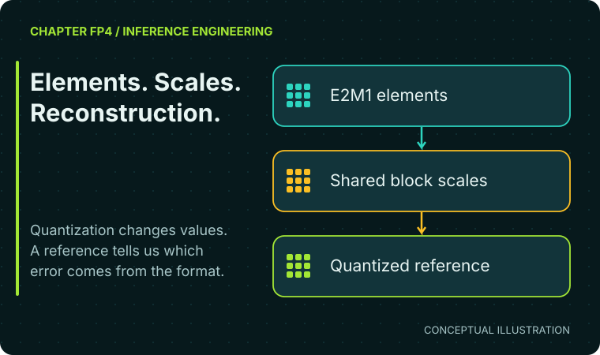
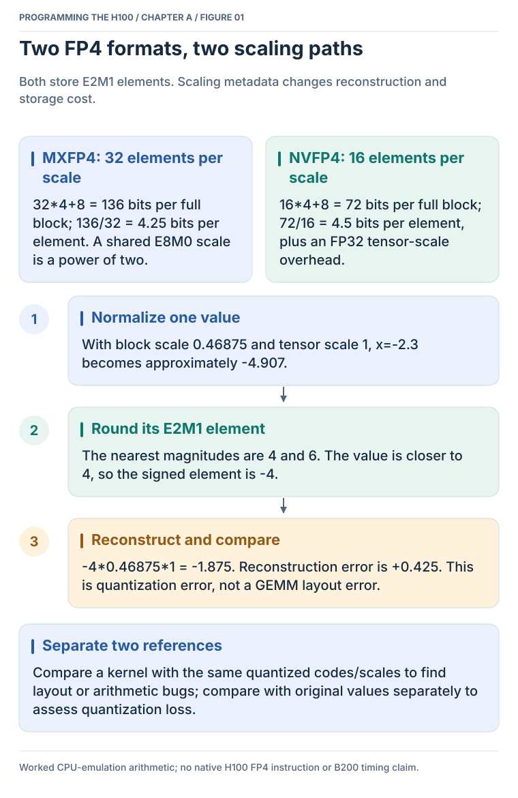

# Appendix: Native FP4 on Blackwell: NVFP4 and MXFP4

[](images/chapter-openers/appendix-fp4.svg)

!!! abstract "Goal and prerequisites"

    Understand exactly what the two Blackwell 4-bit formats store, how much accuracy each gives up against block-scaled INT4 at the same storage cost, where each one breaks, and how to test a real B200 kernel against a CPU reference you trust. Read the [native B200 appendix](appendix-blackwell-b200.md) for the build environment and the Triton book's INT4 chapter for the weight-only quantization that H100 *can* run.

!!! warning "Evidence level: read this first"

    - **Verified here (CPU):** a pure-Python emulation of the value sets and scaling rules of E2M1 elements with MXFP4 and NVFP4 scaling, compared with block-scaled INT4. 21 self-tests pass; the tables below are that program's output.
    - **Not run on a B200:** no FP4 tensor-core instruction, kernel, scale-factor layout or throughput was executed for this page. The preceding appendix explicitly does *not* establish NVFP4 on hardware, and this page does not change that.
    - **Not an H100 feature:** Hopper has no FP4 tensor cores. On an H100 these formats can be stored and dequantized in software before a BF16 or FP8 multiply, or emulated as here; they cannot be *computed* natively.
    - **Synthetic data:** the error study uses Gaussian, Laplace and outlier-injected random vectors, not real model tensors. Treat the ranking as a hypothesis to test on your own weights and activations.

## Worked format map

[](images/worked/appendix-fp4.svg)

The [November 25 CPU rerun](validation-inference-2026-11-25.md) executes this emulation again; it does not add native B200 validation. The emulation uses simplified scale selection: positive E4M3 midpoint ties choose the lower value, while the zero/minimum-subnormal midpoint chooses the minimum subnormal. Do not treat it as a bit-exact reproduction of every native conversion mode. Also, FP4 encoding and a particular quantizer’s calibration recipe are separate contracts; a per-tensor scale is part of the recipe described here, not proof that every FP4 API exposes that same tensor field.

## A.1 Why 4 bits: the decode floor

Under the batch-1, dense HBM-streaming model used here, decoding a 70B-parameter model reads every weight once per step. The modeled memory time is bytes moved divided by the assumed bandwidth. Using the H100's 3.35 TB/s purely as a yardstick (a B200 differs) and ignoring the KV cache:

| Weight format | Bits per weight (incl. scales) | 70B weights | Floor at 3.35 TB/s |
|---|---|---|---|
| BF16 | 16 | 140.0 GB | 41.8 ms |
| FP8 | 8 | 70.0 GB | 20.9 ms |
| NVFP4 | 4.5 | 39.4 GB | 11.8 ms |
| MXFP4 | 4.25 | 37.2 GB | 11.1 ms |

The 4-bit rows leave about 40 GB of an 80 GB GPU for a KV cache, while BF16 does not fit on one GPU and FP8 leaves only a few GB (compare the memory budget in [Chapter 37](37-speculative-decoding-70b.md)). The price is accuracy, which is the rest of this page.

## A.2 The formats

Both formats store each element as a 4-bit floating-point value with 1 sign bit, 2 exponent bits and 1 mantissa bit (**E2M1**). The representable magnitudes are exactly `{0, 0.5, 1, 1.5, 2, 3, 4, 6}`; the code index parity is the mantissa bit, which is what makes round-to-nearest-even well defined (the tests check all seven ties: 0.25 rounds to 0, 0.75 to 1, 1.25 to 1, 1.75 to 2, 2.5 to 2, 3.5 to 4, 5 to 4).

What differs is the scaling. A group of elements shares a scale so the group's largest value lands near the top of the E2M1 range:

| | MXFP4 (OCP microscaling) | NVFP4 (NVIDIA) |
|---|---|---|
| Elements per scale block | 32 | 16 |
| Block scale format | E8M0: a pure power of two, range 2^-127 to 2^127 | FP8 E4M3: 3 mantissa bits, range about 2^-9 to 448 |
| Second-level scale | none | one FP32 scale per tensor |
| Bits per element including scales | 4 + 8/32 = 4.25 | 4 + 8/16 = 4.5 (per-tensor scale negligible) |

These parameters come from NVIDIA's NVFP4 introduction, the NVFP4 pretraining paper and a numeric-format catalogue: NVFP4 uses a shared FP8 scale per 16-value block with a second-level FP32 scale at the per-tensor level, MXFP4 uses blocks of 32 elements sharing a single 8-bit UE8M0 scale, a power of two from 2^-127 to 2^127, and the catalogue lists 4.25 bits per element for MXFP4 and 4.50 for NVFP4.

The consequences follow directly from the two columns:

- **E8M0 snaps the block scale to a power of two**, so the block maximum can land anywhere in a factor-of-two window of the element range, and the elements near the top are coarsely resolved or clipped. NVIDIA's description notes that snapping the scale to the nearest power of two can create a large quantization error for the block maximum.
- **E4M3 scales have 8 mantissa codes per binade**, so the scale can be chosen almost exactly, but its range is far narrower, which is why the tensor-level FP32 scale exists: it re-centres the range of block scales into what E4M3 can represent.
- **Smaller blocks isolate outliers**: one large value only distorts the 16 elements around it, not 32.

### The OCP rounding choice for MXFP4 scales

The shared exponent is usually `floor(log2(amax)) - 2` (the exponent of E2M1's largest value is 2), which puts the block maximum in `[4, 8)` times the scale. Values in `[6, 8)` times the scale then **saturate to 6**. A variant rounds the exponent up (`ceil(log2(amax/6))`) so nothing saturates, at the cost of coarser element resolution; the pretraining paper reports that rounding scale factors up to the next representable UE8M0 value avoids saturations. The emulation implements both.

## A.3 What the hardware does (documented, not executed here)

NVIDIA's CUTLASS documentation for SM100 lists the block-scaled tensor-core instructions: `tcgen05.mma ... kind::mxf4.block_scale` is listed at 4x Hopper FP8 tensor-core throughput in the instruction comparison, rather than an end-to-end application speedup, and `kind::mxf4nvf4.block_scale.scale_vec_size::[2X|4X]` covers both MXFP4 and NVFP4 operands. The scale factors are applied along the K dimension: every 16 or 32 elements of A and B in K have an associated scale factor, and the accumulation is `D = C + sum_k (A x SFA)(B x SFB)`. Two practical points follow that this page does not test:

1. **Scale factors are separate tensors** with their own shape (`M x ceil(K/block)` for A) and a hardware-specific memory layout. A kernel that quantizes correctly but writes scales in the wrong layout produces wrong results with no error.
2. **Throughput claims are instruction-level peaks.** Whether a real GEMM reaches them depends on the epilogue, scale loading and the shapes, and must be measured with the Chapter 36 method.

## A.4 The emulation

The file `fp4_formats.py` ([download](examples/inference-systems/fp4_formats.py)) uses only the Python standard library. Its core pieces:

```python
E2M1_POS = [0.0, 0.5, 1.0, 1.5, 2.0, 3.0, 4.0, 6.0]       # index parity = mantissa bit

def quant_mxfp4(xs, block=32, scale_round="floor"):        # E8M0: scale = 2**e per block
    ...
def quant_nvfp4(xs, block=16, tensor_scale=None):           # FP32 tensor scale x E4M3 block scale
    st = tensor_scale or amax(xs) / (6.0 * 448.0)
    sb = round_e4m3(block_amax / 6.0 / st)
    ...                                                      # elements: round_e2m1(x / (sb * st))
```

`round_e4m3` builds the 126 finite positive E4M3 values (bias 7, subnormals down to 2^-9, maximum 448, one NaN code excluded) and rounds to nearest. The equal-storage INT4 baselines store a block-absmax scale in E4M3 with a tensor scale, so they cost exactly the same bits as MXFP4 (block 32) and NVFP4 (block 16).

### Tests (21 pass)

```
  [PASS] E2M1 has exactly 15 distinct signed values
  [PASS] E2M1 round-to-nearest-even on all seven ties
  [PASS] E4M3: 126 finite positive values, max 448, min 2^-9
  [PASS] E4M3 has 8 codes per binade (3 mantissa bits)
  [PASS] each quantizer is idempotent (quantizing already-quantized data changes nothing), 5 formats
  [PASS] MXFP4: every element is an E2M1 code times a power of two (shared per 32)
  [PASS] NVFP4: every element is an E2M1 code times (E4M3 block scale x FP32 tensor scale)
  [PASS] zero blocks stay exactly zero in every format
  [PASS] MXFP4 floor clips the block maximum (7.0 -> 6.0); the ceil variant rounds it to 8.0
  [PASS] NVFP4 block 16 is at least as accurate as block 64 on Gaussian data (20.43 dB vs 19.57 dB)
  [PASS] NVFP4 per-tensor outlier (1e6): blocks of ordinary values flush to exactly zero
  [PASS] MXFP4 with the same outlier: ordinary blocks survive
  [PASS] NVFP4 block-scale range: largest/smallest nonzero E4M3 scale = 448 / 2^-9 = 229,376
```

## A.5 Results: accuracy at equal storage

Signal-to-quantization-noise ratio in dB (higher is better) on 65,536 values, mean of three seeds. "Outliers" means 0.5 percent of values are 20 times larger.

```
  format                          bits   gaussian   laplace  outliers
  INT4 b32, E4M3 scale            4.25      20.25     18.21     16.27
  MXFP4 (floor)                   4.25      18.78     17.95     15.95
  MXFP4 (ceil)                    4.25      18.74     17.56     15.59
  INT4 b16, E4M3 scale            4.50      21.30     19.74     18.86
  NVFP4                           4.50      20.44     20.64     20.73
  (reference, not equal storage)
  INT4 b32, FP32 scale            5.00      20.30     18.27     16.36
  INT4 b16, FP32 scale            6.00      21.41     19.86     19.04
```

Dot-product relative error `|dot_q - dot| / (||a|| ||b||)`, K=4096, activation-like (outlier) vector against a Gaussian vector, mean of 128 random pairs (lower is better):

```
  INT4 b32, E4M3 scale   (4.25 bits)   0.00219
  MXFP4 floor            (4.25 bits)   0.00231
  MXFP4 ceil             (4.25 bits)   0.00254
  INT4 b16, E4M3 scale   (4.50 bits)   0.00176
  NVFP4                  (4.50 bits)   0.00153
```

Reading it honestly:

1. **Against equal-storage INT4, NVFP4 wins on heavy-tailed data and loses on Gaussian data.** On outlier-injected data NVFP4 is 1.9 dB better than INT4 with 16-element blocks (20.73 against 18.86) and has the lowest dot-product error (0.00153 against 0.00176). On pure Gaussian data INT4 is 0.9 dB better (21.30 against 20.44), because INT4's uniform grid is finer near the block maximum than E2M1's. A floating-point 4-bit grid buys dynamic range, which only matters if the data has it.
2. **MXFP4 does not beat equal-storage INT4 in this experiment** on any of the three distributions (for example 18.78 against 20.25 on Gaussian), and its dot-product error is slightly worse (0.00231 against 0.00219). The coarse power-of-two scale costs about 1.7 dB of Gaussian SQNR against NVFP4 (18.78 against 20.44) even though the elements are identical. These numbers are consistent with, but do not prove, the common observation that MXFP4 needs care in practice.
3. **The MXFP4 rounding choice is a small effect** (floor ahead of ceil by 0.04 to 0.4 dB here).
4. **Plain INT4 here uses absmax scaling and round to nearest.** The Triton book's INT4 chapter shows clip-range search lowering the error further; applying that to every row of this table would change the INT4 numbers. FP4 formats can also be calibrated and clipped.
5. **Quantization error is not task accuracy.** SQNR on random vectors predicts model quality only loosely. The decisive test is end-to-end on your model and evaluation set (Section A.8).

### Worked Example A.5.1: one block by hand

Take the 16 values below, an assumed tensor amax of 2,688 (so the FP32 tensor scale `2688 / (6 x 448)` is exactly 1.0), and block maximum 2.9.

**NVFP4.** Ideal block scale `2.9 / 6 = 0.4833`. Round to E4M3: values in `[0.25, 0.5)` are `0.25 x (1 + m/8)`, so the neighbours are 0.46875 (m=7) and 0.5; 0.4833 is 0.0146 above the lower one and 0.0167 below the upper, so the scale is **0.46875**. Each element is divided by 0.46875, rounded to E2M1 and multiplied back.

**MXFP4.** `floor(log2 2.9) = 1`, so the exponent is `1 - 2 = -1` and the scale is **0.5**. (The block is padded to 32 elements with zeros.)

```
        x     NVFP4     err  |  MXFP4     err
    0.900    0.9375  +0.0375 |  1.0000  +0.1000
   -2.300   -1.8750  +0.4250 | -2.0000  +0.3000
    0.100    0.0000  -0.1000 |  0.0000  -0.1000
    1.700    1.8750  +0.1750 |  1.5000  -0.2000
   -0.400   -0.4688  -0.0687 | -0.5000  -0.1000
    2.900    2.8125  -0.0875 |  3.0000  +0.1000
    0.020    0.0000  -0.0200 |  0.0000  -0.0200
   -1.200   -1.4062  -0.2063 | -1.0000  +0.2000
    2.200    1.8750  -0.3250 |  2.0000  -0.2000
    0.600    0.7031  +0.1031 |  0.5000  -0.1000
   -2.800   -2.8125  -0.0125 | -3.0000  -0.2000
    0.000    0.0000   0.0000 |  0.0000   0.0000
    1.100    0.9375  -0.1625 |  1.0000  -0.1000
   -0.700   -0.7031  -0.0031 | -0.7500  -0.0500
    2.600    2.8125  +0.2125 |  3.0000  +0.4000
    0.350    0.2344  -0.1156 |  0.2500  -0.1000
  SQNR:             19.28 dB |           19.25 dB
```

Check one row: `-2.3 / 0.46875 = -4.907`, which lies between 4 and 6, closer to 4 (0.907 against 1.093), so the element is -4 and the value is `-4 x 0.46875 = -1.875`; MXFP4 gives `-2.3 / 0.5 = -4.6`, also rounds to -4, value -2.0. On one block the formats are indistinguishable (19.28 against 19.25 dB); the difference appears in aggregate and with outliers (Section A.5, Example A.5.2).

### Worked Example A.5.2: one outlier among small values

A 16-element block holds values near 0.05 and a single 3.7:

```
  MXFP4 floor (block padded with 16 zeros)   outlier ->  3.0000   max |err| on the others = 0.0500
  NVFP4                                      outlier ->  3.7000   max |err| on the others = 0.0500
  INT4 b16, FP32 scale                       outlier ->  3.7000   max |err| on the others = 0.0500
```

MXFP4's scale is `2^(floor(log2 3.7) - 2) = 0.5`; `3.7 / 0.5 = 7.4` saturates to 6, so the outlier comes back as 3.0, an error of 19 percent on the largest value (and the small values quantize to zero in every format, error 0.05). That one value often matters most, because outliers in activations carry disproportionate signal. NVFP4's finer scale reproduces it exactly in this case.

## A.6 Failure modes and edge cases

| Situation | What happens | Mitigation |
|---|---|---|
| **Per-tensor outlier** with NVFP4 | A value of 1e6 sets the tensor scale so large that ordinary blocks (amax about 1) have a block scale below half the smallest E4M3 subnormal and **flush to exactly zero** (tested). The 229,376x range between the largest and smallest E4M3 scale is the limit | Clip or separate extreme outliers before computing the tensor scale; use per-channel or per-row tensor scales; check for blocks quantized entirely to zero |
| MXFP4 block maximum in `[6, 8) x scale` | Saturates to 6 (floor rounding) | Round the exponent up, or accept the clipping and measure it |
| All-zero block | Scale 0; elements stay exactly 0 (tested) | Ensure the hardware layout encodes it without division by zero |
| NaN or Inf in the input | Not handled by the emulation; real kernels propagate or saturate by format rules | Check inputs; define the policy before quantizing |
| Tensor all zeros | Tensor scale undefined (the emulation uses 1.0) | Same |
| Scale tensors in the wrong layout | Silently wrong results on hardware | Compare against a CPU reference on a small shape first |
| Quantizing already-quantized data | Idempotent for these formats (tested), so repeated passes do not accumulate error | Still prefer one quantization from the original BF16 weights |
| Different tensor scale for weights and activations | Weights use a static scale (known at conversion); activations need a calibrated or dynamic scale | Decide and document which; test on out-of-distribution inputs |
| Using SQNR as an accuracy proxy | Misleading for tasks sensitive to a few channels | End-to-end evaluation |

## A.7 Choosing between them (hypotheses to test)

- If your target is a **B200** and weights and activations both fit NVFP4 accuracy on your evaluation, NVFP4 is the natural choice: finer blocks, a precise scale, and hardware support in the same tensor-core instruction family as MXFP4.
- MXFP4 is an **open standard** with a simple scale, which matters for portability across vendors, but expect to spend accuracy for it (Section A.5, point 2).
- On an **H100**, neither is computed natively. If you want 4-bit weights there, use **weight-only INT4** with in-kernel dequantization (Triton book, Part 8) and measure the memory-bound speedup; the equal-storage comparison above says INT4 with a good block size is competitive on accuracy.

## A.8 Runbook on a B200 (untested)

!!! warning "UNTESTED ON B200"

    Nothing below was executed. CUTLASS example names and flags change between versions; use the pinned CUTLASS version of the native B200 appendix (v4.3.6) and confirm every name in your checkout.

```bash
# environment, as in the native B200 appendix
nvidia-smi --query-gpu=name,compute_cap,driver_version --format=csv
export CUTLASS_ROOT=/full/path/to/external/cutlass

# locate the narrow-precision (block-scaled) examples in your checkout
ls "$CUTLASS_ROOT/examples" | grep -i -E "narrow|nvfp4|mxfp|blockscaled|block_scaled"

# build one with SM100a code generation (names come from the listing above)
cmake -S "$CUTLASS_ROOT" -B /full/path/build/cutlass-nv -DCUTLASS_NVCC_ARCHS=100a
cmake --build /full/path/build/cutlass-nv --target help | grep -i -E "nvfp4|mxf"
```

Then validate before measuring speed:

1. **Reference.** Quantize a small random matrix pair on the CPU with `fp4_formats.py`, multiply them exactly in float64 from the *dequantized* values, and compare with the kernel's output on the same quantized codes and scales. The two should agree to accumulation-order rounding (with a tolerance chosen for the output dtype, reduction length and accumulation path; use both absolute and relative tolerances because near-zero cancellation can make relative error misleading), because both compute the same products of the same representable numbers.
2. **Quantization accuracy.** Separately compare the kernel's result against the unquantized BF16 GEMM. The relative error should be of the order of the dot-product errors in Section A.5 (about 0.0015 to 0.0025 times the vector norms for K=4096); a result an order of magnitude worse points to a scale-layout or clipping bug.
3. **End-to-end accuracy.** Run your evaluation set in BF16, FP8 and the 4-bit format; report the difference with confidence intervals (the Chapter 36 method).
4. **Speed.** Only then measure throughput, with the open-loop methodology, against FP8 on the same GPU, and report where the 4x instruction peak is and is not reached.

## A.9 Exercises

1. Compute the weight memory of a 70B model in BF16, FP8, NVFP4 and MXFP4, and the memory-bound decode floor on a GPU with 3.35 TB/s.
2. Quantize the value 2.3 in a block whose maximum is 2.9 with NVFP4 (tensor scale 1.0) and with MXFP4, and give the relative error of each.
3. Why does NVFP4 need a per-tensor FP32 scale, while MXFP4 does not?
4. A tensor has one value of 100,000 and the rest near 1. Predict the behaviour of NVFP4 with a single per-tensor scale, and give two fixes.
5. In Section A.5, INT4 beats NVFP4 on Gaussian data at equal storage. Explain why, and say when you would still pick NVFP4.
6. Design a test that distinguishes a kernel bug in the scale-factor layout from an inherent quantization error.
7. How many E4M3 values lie in the binade `[1, 2)`, and what does that say about the resolution of NVFP4 block scales?

## A.10 Solutions

1. BF16: 140.0 GB, floor 41.8 ms. FP8: 70.0 GB, 20.9 ms. NVFP4 at 4.5 bits: 39.4 GB, 11.8 ms. MXFP4 at 4.25 bits: 37.2 GB, 11.1 ms (weights only, no KV cache).
2. NVFP4: scale 0.46875 (Example A.5.1); `2.3 / 0.46875 = 4.907`, nearest E2M1 value 4, dequantized 1.875, relative error `0.425 / 2.3 = 18.5 percent`. MXFP4: scale 0.5; `2.3 / 0.5 = 4.6`, nearest 4, dequantized 2.0, relative error 13.0 percent. Neither wins on a single value; in this block MXFP4 happens to be closer for this element.
3. E4M3 can only represent scales from about 2^-9 to 448, so block scales for a tensor whose values are very large or very small would saturate or underflow. The FP32 tensor scale shifts the whole distribution into the E4M3 range. E8M0 spans 2^-127 to 2^127 by itself.
4. The tensor scale becomes `100000 / 2688 = 37.2`. A block with amax 1 has an ideal block scale `1 / 6 / 37.2 = 0.0045`, which lies among the E4M3 subnormals (spacing 2^-9 = 0.00195), so it rounds to 0.0039: the scale is off by about 13 percent and the block maximum comes back at 0.87 after clipping. Blocks with amax below `6 x 37.2 x 2^-10 = 0.22` flush entirely to zero. With a 1e6 outlier even amax-1 blocks flush to zero (tested). Fixes: clip or isolate the outlier before computing the tensor scale; use a per-row or per-channel tensor scale; keep the outlier channels in higher precision.
5. INT4's 15 levels are uniform, so near the block maximum the spacing is `amax / 7`, finer than E2M1's top spacing (4 to 6 is a step of 2 on a range of 6). On Gaussian data most blocks have no extreme outlier and the uniform grid wins by 0.9 dB. FP4's non-uniform grid concentrates levels near zero and spreads them at the top, which helps when the data has heavy tails (the outlier column), and NVFP4 is also the format the 4x instruction path implements natively on B200, which INT4 does not use.
6. Quantize on the CPU, then multiply the dequantized values exactly. A layout bug makes the kernel disagree with this reference by much more than accumulation rounding, while inherent quantization error shows up only against the unquantized BF16 result. If the kernel matches the quantized reference but not BF16, it is quantization; if it fails to match the quantized reference, it is the kernel or the layout.
7. Eight (1.0, 1.125, ..., 1.875), since there are 3 mantissa bits. Within a binade the scale can be chosen to within about 6 percent of the ideal value (half of a 1/8 step relative to 1), against up to a factor of two for a power-of-two scale.

## Chapter Summary

NVFP4 and MXFP4 store the same 4-bit E2M1 elements, whose values are 0, 0.5, 1, 1.5, 2, 3, 4 and 6, and differ in scaling: MXFP4 shares a power-of-two scale across 32 elements (4.25 bits per element), while NVFP4 shares an E4M3 scale across 16 elements plus an FP32 per-tensor scale (4.5 bits). Streaming 70B weights once per token, 4-bit storage cuts the decode memory floor from 20.9 ms (FP8) to about 11.8 ms, under a third of the BF16 figure, and leaves about 40 GB of an 80 GB GPU for the KV cache. A pure-Python emulation with 21 passing tests shows that at equal storage NVFP4 is best on heavy-tailed data (1.9 dB better than INT4 with 16-element blocks, and the lowest dot-product error), INT4 is better on Gaussian data, and MXFP4 trails equal-storage INT4 on all three distributions. NVFP4 fails when one huge outlier sets the tensor scale, flushing ordinary blocks to zero, while MXFP4's power-of-two scale saturates the block maximum when it lands in the top quarter of its window. On Blackwell the block-scaled tensor-core instructions apply the scales along K every 16 or 32 elements; none of that was run for this page, and H100 cannot compute FP4 natively. The runbook validates a B200 kernel in three steps (quantized reference, unquantized reference, end-to-end evaluation) before any speed claim.

## Sources

- NVIDIA developer blog, Introducing NVFP4: <https://developer.nvidia.com/blog/introducing-nvfp4-for-efficient-and-accurate-low-precision-inference>
- Pretraining Large Language Models with NVFP4: <https://arxiv.org/pdf/2509.25149>
- Golden Ruler, a numeric format catalogue (MXFP4 and NVFP4 block parameters): <https://arxiv.org/pdf/2606.09686>
- CUTLASS Blackwell SM100 GEMMs (block-scaled `tcgen05.mma` kinds and scale factor layout): <https://docs.nvidia.com/cutlass/media/docs/cpp/blackwell_functionality.html>

- NVIDIA Transformer Engine NVFP4 recipe and scale definitions: <https://docs.nvidia.com/deeplearning/transformer-engine-releases/release-2.16/user-guide/features/low_precision_training/nvfp4/nvfp4.html>
