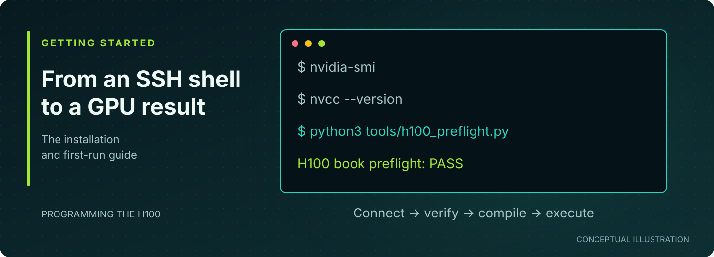

# Getting Started & Installation

[](images/chapter-openers/00-getting-started.svg)


This guide takes you from a terminal to the book's first verified GPU result. You can read and preview the website on a machine without an NVIDIA GPU. Run the Hopper-specific programs on a compatible NVIDIA GPU host, locally or over SSH.

!!! success "What was actually tested"

    The recorded revisions of all **27 complete CUDA programs compiled and executed successfully across the recorded hosts**. On November 17, 2026, the original validation used **one H100 PCIe**: all 27 complete programs compiled and 24 single-GPU workloads passed. The [follow-up audit](final-audit.md) used **two H100 80GB HBM3 GPUs connected through NV18**, compiling all 27 programs and executing 26 workloads, including peer transfer and NCCL AllReduce. Both hosts used **Ubuntu 24.04.5 LTS**, driver **580.105.08**, CUDA Toolkit **12.8.93**, GCC **13.3.0**, C++17, `-O2`, and `sm_90a`. On November 18 (UTC), the revised portable training program passed on [eight A100 GPUs](eight-gpu-validation.md), targeting `sm_80`, with full final-weight and per-step loss comparisons against a CPU reference. This was not an eight-H100 run.

    The SSH client instructions describe standard usage; the linked system records identify the exact execution configurations. [System record](validation/2026-11-17/system-information.txt) · [Execution manifest](validation/2026-11-17/results.json) · [Preflight JSON](validation/2026-11-17/preflight.json).

The four barrier-ordering corrections in Chapters 3–5 passed the November 18 two-H100 rerun and memory checks. **All 27 current revisions have verified workload records** across the H100 and eight-A100 hosts. The [additional H100 record](revalidation-2026-11-18.md) includes fresh compilation dates, execution times, system information and sample outputs.

Select a diagram to open its full-size SVG.

## 1 — Choose the right machine

| What you have | What you can do | Where the GPU commands run |
| --- | --- | --- |
| Any ordinary laptop or desktop with Python | Read the book, build the website, inspect sources and check evidence hashes | No GPU required for these activities |
| Apple Silicon Mac or a computer without a suitable NVIDIA GPU | Use the machine as an SSH client to a Linux GPU host | In the remote Linux shell, not the local terminal |
| One H100 PCIe or H100 SXM | Run the single-GPU examples; H100 PCIe is the tested SKU | On that GPU host |
| Another Hopper GPU, such as H200 | The `sm_90a` architecture target is relevant, but this is a different hardware configuration | Re-run the checks and record your own results |
| Two or more suitable NVIDIA GPUs | Attempt the relevant Chapter 11 P2P/NCCL examples after checking topology | On the multi-GPU host; count alone does not establish peer access |
| Eight suitable GPUs | Attempt the TP=2 × PP=2 × DP=2 teaching workload | Completed separately on eight A100 GPUs with `sm_80`; see [the supplement](eight-gpu-validation.md) |
| A100 or Blackwell | Read the material, but do not assume the Hopper WGMMA programs will run | A100 lacks WGMMA; Blackwell needs a different Tensor Core implementation |

The `a` in `sm_90a` enables architecture-specific features. It does not mean “this GPU and every later GPU.” Use a provider image with a suitable CUDA toolkit already installed when possible. No GPU rental is required just to read or preview the book.

## 2 — Connect from your computer

If you are already logged into the GPU machine, skip to Step 3. Otherwise use the host address and private key supplied for your instance. Keep the key on your own machine; it does not belong in the book repository.

On Linux or macOS:

```bash
chmod 400 /path/to/your-key.pem
ssh -i /path/to/your-key.pem ubuntu@YOUR_INSTANCE_IP
```

Windows users can run the same `ssh -i ...` command in a terminal with OpenSSH installed, using the Windows path to the key. The POSIX `chmod` command above is for Linux/macOS; Windows key-file permissions use Windows access controls. See [Microsoft's OpenSSH client documentation](https://learn.microsoft.com/en-us/windows-server/administration/openssh/openssh-overview).

On the first connection, compare the server's host-key fingerprint with your provider's trusted information before accepting it. Once connected, the prompt should refer to the **remote Linux host**. All remaining GPU commands in this guide belong there. CPU-only website commands can also run locally.

## 3 — Check the driver and toolkit separately


### Choose the installation path

The commands below target **Ubuntu 22.04 or 24.04, x86-64, on a Linux GPU host**, with CUDA **12.8**. Ubuntu 24.04 is the book's recorded host family. Run them in Bash on that host, not on an Apple Silicon laptop. For ARM/Grace, WSL, containers or another distribution, use the corresponding [NVIDIA CUDA installation instructions](https://docs.nvidia.com/cuda/archive/12.8.1/cuda-installation-guide-linux/index.html); the repository and driver steps differ.

| Starting point | Follow this path |
| --- | --- |
| Provider image already runs `nvidia-smi` and `nvcc --version` reports a suitable toolkit | Keep the provider's driver; install only missing libraries/tools and select the intended toolkit. |
| Working driver, missing compiler | Install the CUDA toolkit below; a toolkit-only package does not replace the driver. |
| Fresh Ubuntu GPU host without a driver | Install prerequisites, register the repository, install the driver, reboot, then install CUDA and libraries. |
| Container | Install the driver on the host; use the provider's GPU-enabled container runtime and a CUDA **development** image. Do not install kernel drivers inside the container. |

Record the starting environment:

```bash
cat /etc/os-release
uname -m
uname -r
nvidia-smi
command -v nvcc
nvcc --version
```

On a fresh host, missing `nvidia-smi` or `nvcc` at this stage is the reason to continue installation. On a managed image, first check its documented environment modules/toolkit paths. Conda activation is not a universal CUDA installation step.

### Install Ubuntu prerequisites

On a fresh Ubuntu host:

```bash
sudo apt-get update
sudo apt-get install -y build-essential python3 python3-venv python3-pip \
    git wget ca-certificates pciutils
```

`build-essential` supplies GCC/G++, Make and the basic linker toolchain. CUDA also constrains supported host-compiler versions: use the selected toolkit's [host compiler support table](https://docs.nvidia.com/cuda/archive/12.8.1/cuda-installation-guide-linux/index.html#host-compiler-support-policy). The captured Ubuntu 24.04 runs used GCC 13.3. A generic Python CUDA wheel is not a replacement for this C++ build environment.

### Register the matching NVIDIA repository

Use this only if the matching NVIDIA APT repository is not already configured. It selects Ubuntu 22.04 versus 24.04 from the actual OS; it stops for other systems. The subshell keeps its temporary variables local.

```bash
(
    set -eu
    . /etc/os-release
    case "$ID:$VERSION_ID:$(uname -m)" in
        ubuntu:22.04:x86_64) cuda_repo=ubuntu2204 ;;
        ubuntu:24.04:x86_64) cuda_repo=ubuntu2404 ;;
        *) echo "Use NVIDIA's instructions for this OS/CPU." >&2; exit 1 ;;
    esac
    keyring_dir=$(mktemp -d)
    trap 'rm -rf "$keyring_dir"' EXIT
    wget -O "$keyring_dir/cuda-keyring.deb" \
        "https://developer.download.nvidia.com/compute/cuda/repos/$cuda_repo/x86_64/cuda-keyring_1.1-1_all.deb"
    sudo dpkg -i "$keyring_dir/cuda-keyring.deb"
    sudo apt-get update
)
```

Stop if this block fails. Do not continue with a repository for a different Ubuntu release, or mix a runfile driver installation with unrelated package-manager driver packages. NVIDIA documents the [keyring and repository setup](https://docs.nvidia.com/datacenter/tesla/driver-installation-guide/latest/ubuntu.html#network-repository-enablement-amd64).

### Install a driver only when needed

**Preconfigured cloud image:** retain its working, compatible driver. If it needs an upgrade, use the provider's supported procedure. The recorded driver was 580.105.08. For CUDA 12.8 Update 1, this guide selects the release's corresponding **570.124.06 or newer** driver baseline. CUDA 12.x minor-version compatibility permits some applications on older drivers, with feature and PTX/JIT limitations; it is a different compatibility path, not the setup baseline used here. See [NVIDIA's release compatibility tables](https://docs.nvidia.com/cuda/archive/12.8.1/cuda-toolkit-release-notes/index.html#cuda-driver).

**Fresh Ubuntu host you administer:** if Secure Boot requires module-key enrollment, arrange the distribution/provider console access before rebooting. After repository setup, install kernel headers and NVIDIA's open-module driver package. H100 and A100 are supported by the open-module driver family. These commands are for the host, not a container:

```bash
sudo apt-get install -y "linux-headers-$(uname -r)"
sudo apt-get install -y nvidia-open
sudo reboot
```

The reboot disconnects SSH. Reconnect with your original SSH command, then run:

```bash
nvidia-smi
nvidia-smi --query-gpu=name,driver_version --format=csv
```

Continue only when the driver sees the intended GPU(s). A custom cloud kernel may need provider-specific headers. With Secure Boot, follow the distribution's module-signing/key-enrollment prompts, which can require console access; do not bypass a failed module load by blindly reinstalling CUDA. The `nvidia-open` package follows the repository's selected driver branch; it does not pin the recorded 580.105.08 patch. See [NVIDIA's driver installation and reboot steps](https://docs.nvidia.com/datacenter/tesla/driver-installation-guide/latest/ubuntu.html#driver-installation).

### Install CUDA 12.8 and cuBLAS

Skip installation if this toolkit and its development libraries already work. Otherwise:

```bash
sudo apt-get install -y cuda-toolkit-12-8
```

This versioned **toolkit-only** package supplies `nvcc`, CUDA Runtime development files, the Driver API headers/link stubs, cuBLAS headers/libraries, Compute Sanitizer and CUDA tools. It does not install a kernel driver. NCCL is separate. Avoid the unversioned `cuda` meta-package when you intend to keep the 12.8 toolkit and the provider's driver. The distribution package `nvidia-cuda-toolkit` can be a different CUDA release; it is not this recipe.

APT may install newer patches within the 12.8 line; inspect actual versions rather than expecting an exact historical environment. NVIDIA's [toolkit package definitions](https://docs.nvidia.com/cuda/archive/12.8.1/cuda-installation-guide-linux/index.html#meta-packages) distinguish toolkit, runtime and driver bundles.

### Select the toolkit and library paths

Choose **one** layout; these are alternatives, not consecutive export blocks.

=== "NVIDIA APT toolkit"

    ```bash
    export CUDA_HOME=/usr/local/cuda-12.8
    export CUDA_INCDIR="$CUDA_HOME/include"
    export CUDA_LIBDIR="$CUDA_HOME/lib64"
    export PATH="$CUDA_HOME/bin:$PATH"
    export LD_LIBRARY_PATH="$CUDA_LIBDIR${LD_LIBRARY_PATH:+:$LD_LIBRARY_PATH}"
    hash -r
    command -v nvcc
    nvcc --version
    ```

=== "Provider toolkit under /usr"

    Use this layout when the provider's working `nvcc` is `/usr/bin/nvcc` and its CUDA headers/libraries are under `/usr/include` and `/usr/lib/x86_64-linux-gnu`, as on the recorded Lambda image.

    ```bash
    export CUDA_HOME=/usr
    export CUDA_INCDIR=/usr/include
    export CUDA_LIBDIR=/usr/lib/x86_64-linux-gnu
    export PATH="$CUDA_HOME/bin:$PATH"
    export LD_LIBRARY_PATH="$CUDA_LIBDIR${LD_LIBRARY_PATH:+:$LD_LIBRARY_PATH}"
    hash -r
    command -v nvcc
    nvcc --version
    ```

For another layout, use the site's module or its real install prefix. Confirm the selected headers and libraries belong to the intended compiler; the multi-GPU collector accepts `CUDA_HOME`, `CUDA_INCDIR` and `CUDA_LIBDIR` explicitly.

APT normally registers its shared libraries with the loader; the explicit toolkit path above also makes the intended 12.8 libraries visible for this shell. For a custom install, substitute its real path. **Never add `$CUDA_HOME/lib64/stubs` to the runtime library path**: `libcuda.so.1` at execution time must come from the installed host driver, not a link-time stub.

To persist this selection in interactive Bash sessions, add these exports once to `~/.bashrc`, then run `source ~/.bashrc` or open a new shell. In scheduler jobs and noninteractive SSH sessions, load the site's module or set these exports explicitly in the job script; those sessions may not read `~/.bashrc`. The conditional expansion avoids an empty trailing library-path entry.

### Install NCCL runtime and development files

NCCL is needed by the collective examples. Install **both** the runtime and development package with the same CUDA-compatible version. For the recorded NCCL 2.26.2/CUDA 12.8 combination, first confirm package availability:

```bash
apt-cache madison libnccl2 libnccl-dev
```

When both list `2.26.2-1+cuda12.8`:

```bash
sudo apt-get install -y \
    libnccl2=2.26.2-1+cuda12.8 \
    libnccl-dev=2.26.2-1+cuda12.8
```

These versions were present in NVIDIA's Ubuntu 22.04 and 24.04 x86-64 repositories when this guide was checked on **November 18, 2026**. If unavailable, select a matching pair built for CUDA 12.x from NVIDIA's repository/archive and record the actual version. Do not silently install the default CUDA 13 build or pass `--allow-downgrades` over a provider-managed stack. An existing compatible NCCL installation can be retained; its headers and runtime must resolve consistently. NVIDIA's [NCCL installation guide](https://docs.nvidia.com/deeplearning/nccl/install-guide/index.html#ubuntu) explains explicit package-version selection.

### Check fabric setup on NVSwitch servers

On a **native HGX/DGX NVSwitch server**, the GPU driver and CUDA toolkit alone are not the entire fabric setup. DGX OS normally supplies Fabric Manager; a fresh HGX installation needs the compatible Fabric Manager components for its platform and driver. Use [NVIDIA's bare-metal Fabric Manager procedure](https://docs.nvidia.com/datacenter/tesla/fabric-manager-user-guide/index.html#installing-fabric-manager) to choose the packages. Package/version rules differ by NVSwitch generation, and Fabric Manager versioning changed with driver release 620; do not copy a branch number from an unrelated server.

After installing the matching components on the **host that owns the fabric**, enable/start the service and inspect its state:

```bash
sudo systemctl enable nvidia-fabricmanager
sudo systemctl start nvidia-fabricmanager
systemctl is-active nvidia-fabricmanager
nvidia-smi -q -i 0 | grep -i -A 3 Fabric
```

For Hopper NVSwitch systems, check that fabric registration completes successfully before relying on NVLink peer paths. On a managed cloud instance or guest/container, the provider/host administrator may own this service; its absence inside the guest is not an instruction to install or restart it there. PCIe-only and direct-NVLink setups do not universally need Fabric Manager. Do not restart an active fabric service as a routine troubleshooting step.

### Verify files, versions and topology

```bash
nvcc --version
gcc --version
python3 --version
nvidia-smi
nvidia-smi topo -m
ls "$CUDA_INCDIR/cuda_runtime.h" "$CUDA_INCDIR/cuda.h"
ls "$CUDA_INCDIR/cublas_v2.h"
dpkg-query -W libnccl2 libnccl-dev
dpkg -L libnccl-dev | grep '/nccl.h$'
```

The driver supplies GPU access; the toolkit supplies compilation; cuBLAS and NCCL supply libraries. `nvidia-smi`'s “CUDA Version” is driver compatibility, not the installed `nvcc` version. A topology listing describes connectivity, not a measured bandwidth or a successful peer-transfer test. Finish with the book's actual compile, launch and numerical checks below.

## 4 — Download the source and run preflight

```bash
git clone --branch main https://github.com/MaximumBeings/programming-the-h100.git
cd programming-the-h100
python3 tools/h100_preflight.py
python3 tools/h100_preflight.py --json > preflight.json
```

The clone explicitly selects the source branch. If already cloned, check `git branch --show-current`: `gh-pages` contains generated HTML rather than the source/build tools.

The checker uses the CUDA Driver API to count CUDA-visible devices, including the effect of `CUDA_VISIBLE_DEVICES`. It checks Hopper capability, the compiler, and the availability of optional inspection tools. It needs Python's standard library, not PyTorch. It **does not** prove that a kernel is correct or that multiple GPUs have a suitable interconnect.

Selected lines captured on the validation host:

```text
H100 book preflight: PASS
Visible GPUs: 1; nvcc: 12.8.93
  NVIDIA H100 PCIe; CC 9.0; 81079.1 MiB
```

CUDA-visible memory can be lower than the board's nominal capacity or the management tool's physical-memory report because of reserved resources. Use the actual runtime capacity when allocating buffers.

For a particular distributed exercise, require its actual device count:

```bash
python3 tools/h100_preflight.py --minimum-gpus 2
python3 tools/h100_preflight.py --minimum-gpus 8
```

The eight-GPU training program passed on eight A100 GPUs, including comparisons of every final weight and per-step loss against an independent CPU reference. See the [captured execution and system record](eight-gpu-validation.md).

For Chapter 4/11 development-library linkage, this optional check compiles the relevant current programs without launching their GPU workloads:

```bash
python3 tools/validate_examples.py --compile-only 04-cutensormap 11-multi-gpu
```

It checks Driver API, NCCL and cuBLAS links through the examples' complete commands. A successful compile/link is not an execution result. The eight-GPU training workload still requires eight suitable GPUs for its full run. MPI, NVSHMEM, PyTorch and cuDNN are not required to build the 27 named CUDA programs; the separate attention-reference script uses PyTorch.

If you downloaded only the website, the [standalone preflight utility](assets/tools/h100_preflight.py) is also available. Save it, inspect it, then run it on your Linux GPU host.

## 5 — Compile and execute your first verified program

From the repository root, copy the exact tested source to a scratch build directory:

```bash
mkdir -p build/first-run
cp docs/validation/2026-11-17/02-clusters-inline-ptx/ex01_cluster_inspect/ex01_cluster_inspect.cu build/first-run/
cd build/first-run
nvcc -std=c++17 -arch=sm_90a -O2 ex01_cluster_inspect.cu -o ex01_cluster_inspect
./ex01_cluster_inspect
echo $?
```

This is the complete cluster-inspection program from [Chapter 2](02-clusters-inline-ptx.md), not a placeholder fragment. In the captured H100 PCIe run it reported:

```text
DSMEM Exchange Tests: 4/4 passed

Cluster Metadata Verification:
  ✓ All cluster metadata correct

ALL TESTS PASSED — Clusters working correctly!
```

The program's exit status was **0**. GPU `printf` ordering and the device name may differ on another host. Compare the checks and final pass status, not incidental line ordering. [Exact tested source](validation/2026-11-17/02-clusters-inline-ptx/ex01_cluster_inspect/ex01_cluster_inspect.cu) · [Full captured output](validation/2026-11-17/02-clusters-inline-ptx/ex01_cluster_inspect/run.log).

**Learning checkpoint:** For a one-dimensional cluster of two blocks, predict the local rank of global block 3 and its partner block. Check the cluster/rank fields in the program output. The prediction is rank 1 with partner global block 2: global numbering and rank-within-cluster are different quantities. This is a reasoning exercise, not an additional recorded GPU run.

Return to the repository root after this example:

```bash
cd ../..
```

For later examples, use the full command beside that example. Some need `-lcuda`, `-lnccl`, `-lcublas` or additional compilation options; the baseline `nvcc` command is not a universal link command.

## 6 — Install optional profiling tools

Check what the image already provides:

```bash
ncu --version
nsys --version
compute-sanitizer --version
cuobjdump --version
```

For the CUDA 12.8 toolkit installed through the repository above, missing inspection tools can be installed with:

```bash
sudo apt-get install -y cuda-nsight-compute-12-8 cuda-nsight-systems-12-8 cuda-sanitizer-12-8
ncu --version
```

The earlier captured Lambda session installed the image's `nsight-compute` package and reported **2025.1.1.0**; the versioned toolkit package above can supply a newer 2025.1.x patch. Record `ncu --version` on your host. If `ncu` is outside `PATH`, inspect `dpkg -L cuda-nsight-compute-12-8` and its `nsight-compute-2025.1.1` dependency for the installed executable, then use its full path or add that directory to `PATH`. The first ordinary-user profile reported `ERR_NVGPUCTRPERM`; profiling with elevated permissions succeeded on the instance we administered. [Chapter 13](13-nsight-compute.md) shows both logs and the exact successful invocation. Do not change system-wide counter permissions merely to imitate a screenshot.

### Optional Systems and CUTLASS extension

[Chapter 14](14-nsight-systems.md) adds Nsight Systems CLI capture and timeline analysis; record `nsys --version` separately from `ncu --version`. [Chapter 24](24-cutlass-gemm.md) pins CUTLASS v4.3.6 and supplies a separate collector for the new layout, GEMM and overlap exercises. Follow those chapters for their additional setup and current validation scope.

### CUTLASS fused-attention extension

[Chapter 30](30-cutlass-attention-foundations.md) adds a standard-library CPU attention walkthrough. [Chapter 31](31-cutlass-hopper-fmha.md) builds the pinned CUTLASS Hopper FMHA example with CMake and supplies a separate, opt-in evidence collector. Its published H100 GPU results are separate from the existing 27-program and CuTe/CUTLASS workshop records. The CUDA reference passed seven cases and memcheck; the pinned FMHA target passed six forward/two backward invocations, with 17 verified variants and additional clean D=64 memory checks. Use a new output directory for your own execution record.

### Optional attention-reference dependency

The 27 named CUDA programs do not require PyTorch. To reproduce the separate Chapter 12 recurrence check from the repository root, use an isolated environment and the recorded CUDA-enabled PyTorch version:

```bash
python3 -m venv .venv-attention
.venv-attention/bin/python -m pip install torch==2.7.0 --index-url https://download.pytorch.org/whl/cu128
.venv-attention/bin/python tools/validate_attention.py
```

This script runs 12 GPU reference cases; it is not the FA3 skeleton or a performance benchmark. PyTorch's CUDA wheel does not replace the system compiler or driver. See the [official PyTorch 2.7 installation commands](https://pytorch.org/get-started/previous-versions/#v270).

## 7 — Build and read the website locally

These steps need Python, not a GPU. From the repository root:

```bash
python3 -m venv .venv
source .venv/bin/activate
python3 -m pip install -r requirements.txt
python3 tools/verify_validation_records.py
mkdocs build --strict
python3 tools/verify_site_links.py
mkdocs serve
```

Open <http://127.0.0.1:8000> on the same machine. Stop the server with `Ctrl+C`. On Windows, virtual-environment activation has a different path; you can instead invoke the environment's Python directly to install packages and run MkDocs.

If the preview server is on a remote host, keep it bound to localhost and forward it from your own computer:

```bash
ssh -L 8000:127.0.0.1:8000 -i /path/to/your-key.pem ubuntu@YOUR_INSTANCE_IP
```

Start `mkdocs serve` in that remote shell, then open the local address above in your own browser. Alternatively, clone and preview on your laptop so the GPU instance is not needed for documentation work.

The evidence checker compares chapter sources, downloadable sources and recorded hashes. It can detect stale execution records after a code edit, but it does not execute CUDA on a CPU-only CI runner. A strict MkDocs build checks site construction and treats build warnings as errors; `tools/verify_site_links.py` separately checks built internal links and anchors. These checks do not replace the GPU reference checks.

## 8 — Troubleshoot the first failing step

Work through the rows for the first error you actually see. Preserve the full compiler/runtime message and the exact command before changing the environment.

| What happens | What to check next |
| --- | --- |
| `nvidia-smi` is missing or finds no devices | Confirm you are in the GPU host's shell. Check the provider's driver setup and, inside a container or scheduler job, its GPU allocation/exposure. A missing management command alone does not prove CUDA is unavailable; use the preflight's Driver API diagnostic too. |
| `nvidia-smi` lists GPUs but preflight sees fewer or none | Check `CUDA_VISIBLE_DEVICES`, the job/container allocation and CUDA driver-library access in the same shell that will run the example. Management-tool visibility and CUDA-process visibility can differ. |
| `nvcc: command not found` | Check the selected toolkit, environment module and `PATH`; the driver alone is not a compiler. Run `nvcc --version` after selecting the toolkit. |
| Unsupported `sm_90a` target | Check which `nvcc` your shell selects and its version. Use a toolkit supporting the example's architecture and instructions; CUDA 12.8.93 is the recorded compiler. Do not remove the `a` to silence a WGMMA assembly error. |
| `no kernel image is available` or architecture mismatch | Check the CUDA-visible GPU and rebuild the intended source with its full command. Rule out a stale executable or shared library. Hopper-specific `sm_90a`/`compute_90a` code is not forward- or backward-compatible with other architectures. |
| Undefined `cuTensorMap...`, NCCL or cuBLAS symbols while linking | Use the example's complete link command: driver API calls need `-lcuda`, NCCL needs `-lnccl`, and cuBLAS needs `-lcublas`. Check matching headers and libraries from the selected installation. |
| The executable cannot load `libnccl.so`, `libcublas.so` or another shared library | This is runtime library discovery, distinct from compilation. On Linux, inspect `ldd ./your_example` and use the library-path setup documented for the installed toolkit/library. |
| Preflight says `BLOCKED` | Read its specific error: driver discovery, visible count, Hopper capability or compiler availability/version. Preflight does **not** test topology, peer access or NCCL; check those separately for multi-GPU work. Its Hopper requirement also means an A100 can fail this checker while still being suitable for the separately documented portable training example. |
| Illegal memory access | Keep the first CUDA error and reproduce in a fresh process. Use the current corrected listing, then run Compute Sanitizer memcheck before performance tuning. An earlier dated source is useful for reproducing that exact record, not for undoing a documented correction. |
| Wrong numerical results | Compare the exact problem shape, data type, input initialization, layout and numerical tolerance with the example's reference check. A clean memory-check report does not establish numerical correctness. |
| Timeout or stalled barrier | Check required GPU/rank counts, launch dimensions, participant arrival counts, expected transfer bytes and buffer ownership. Use the chapter's synchronization protocol and stop a hung test rather than treating it as a performance measurement. Sanitizer coverage depends on the tool, version and instructions; a clean report does not prove every asynchronous ordering rule. |
| `ERR_NVGPUCTRPERM` | Read [Chapter 13](13-nsight-compute.md) and the administrator's profiling policy. This is a performance-counter permission problem, not evidence that the kernel is incorrect. |
| Your times differ from the captured output | Compare shape, SKU, clocks, timing scope, warmup, interconnect and profiler settings. A single-CTA correctness demo is not a peak-throughput benchmark. |

For the unchanged first program from Step 5, run this **from the repository root**, after compiling it:

```bash
compute-sanitizer --tool memcheck --error-exitcode 1 ./build/first-run/ex01_cluster_inspect
```

`--error-exitcode 1` makes detected sanitizer errors produce a nonzero status even if the application itself exits successfully. Instrumented runtime is not ordinary benchmark timing. For the four barrier-ordering corrections in Chapters 3–5, use the current chapter listings and read their [revision-specific validation status](final-audit.md); their earlier logs cover the archived revisions.

References: [NVIDIA's Hopper compatibility guide](https://docs.nvidia.com/cuda/archive/12.8.0/hopper-compatibility-guide/index.html), [Compute Sanitizer guide](https://docs.nvidia.com/compute-sanitizer/ComputeSanitizer/index.html), and [performance-counter permission guidance](https://developer.nvidia.com/ERR_NVGPUCTRPERM).

## Where to go next

Choose a [learning path](index.md#how-to-read-this). For the first pass, work through [Chapter 1](01-h100-architecture.md), then the complete examples in [Chapter 2](02-clusters-inline-ptx.md). Each chapter now has learning goals and self-checks with worked answers. Keep your own environment report with every result you want to reproduce.
