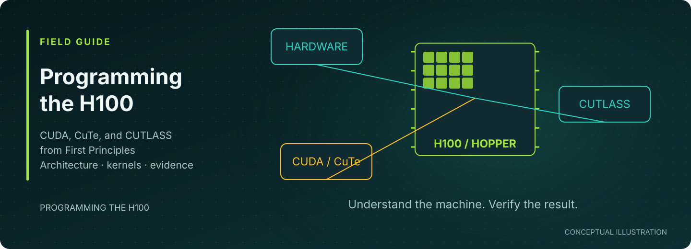

# Programming the H100

[](images/chapter-openers/00-cover.svg)


> **Validation — November 17, 2026.** 27 complete CUDA programs compiled; 24 single-GPU workloads passed. Three multi-GPU workloads require additional hardware.
> **Execution system:** 1× H100 PCIe, 114 SMs, 80 GB class; Ubuntu 24.04.5 LTS; driver 580.105.08; CUDA Toolkit 12.8.93; `sm_90a`, C++17, `-O2`.
> [Full system information](validation/2026-11-17/system-information.txt) · [CUDA result manifest](validation/2026-11-17/results.json). Each tested source and captured output is linked beside its example. Diagrams open as original SVGs for zooming.


## A hardware-level companion guide to NVIDIA Hopper

<p class="hero-tagline">
The gap between "my kernel runs" and "my kernel saturates the tensor cores" is
exactly the size of this book. Thirteen chapters that start at the H100 die and
end with a profiler telling you which of your assumptions was wrong — every one
with ASCII diagrams, worked examples with concrete numbers, and code you can
read line by line.
</p>

> **Compile CUDA examples with:** `nvcc -std=c++17 -arch=sm_90a -O2 <file>.cu -o <out>`
> **Run with:** `./<out>` on Hopper hardware matching the compiled target. Use the complete per-example command, including any driver, NCCL or cuBLAS linker flags.

## How to read this

**CUDA prerequisites:** Be comfortable with thread/block indexing, launch dimensions, shared-memory lifetime, block synchronisation and CUDA error checking. If these are new, first work through [NVIDIA’s CUDA programming introduction](https://docs.nvidia.com/cuda/cuda-programming-guide/index.html), then follow this book’s [first verified run](getting-started.md#5-compile-and-execute-your-first-verified-program).

The chapters build on each other. Chapter 1 is pure architecture — no code,
just the machine. Chapters 2–3 give you the instruction-level vocabulary
(clusters, inline PTX, state spaces, `mbarrier`). Chapters 4–5 are about
getting bytes into shared memory efficiently. Chapters 6–7 are the tensor
cores. Chapters 8–10 put it together into real warp-specialized kernels.
Chapter 11 leaves the single GPU behind. Chapters 12–13 are the payoff: an
annotated FA3 design with a tested numerical reference, and the tool that measures real kernels.

If you already write CUDA and want the Hopper-specific parts, start at
Chapter 2. If you are here for GEMM, read 4 → 5 → 6 → 7 → 8 → 9 in order. If you
have a slow kernel in front of you right now, start at Chapter 13.

**Start here:** [Getting Started & Installation](getting-started.md) takes you from choosing a machine to a real verified CUDA result. You can read the book and build its website on a computer without an NVIDIA GPU; the hardware-facing examples require a compatible execution host.

| Your goal | Suggested route | Finish by producing |
| --- | --- | --- |
| First successful GPU run | Getting Started → 1 → 2 | A passing output and a saved preflight report |
| Understand Hopper data movement | 2 → 3 → 4 → 5 | A valid descriptor, a byte count and a completion/ownership explanation |
| Write and diagnose GEMM kernels | 3 → 4 → 5 → 6 → 7 → 8 → 9 → 10 → 13 | Full-output reference checks and a profile tied to the right roofline |
| Understand fast attention | 3 → 4 → 6 → 7 → 9 → 12 → 13 | A recurrence check and a clear account of what the skeleton still omits |
| Study distributed GPU workloads | 1 → 2 → 11 → 13 | A topology record and a collective result checked on the required hardware |

**Read an example in three passes.** First trace where each value lives and which thread owns it. Then identify what makes it safe to read and safe to overwrite. Finally predict the reference output before looking at the captured result. Performance tuning comes after those three agree.

??? info "What the evidence labels mean"

    **Compiled** means the complete listed translation unit built with the recorded command. **Executed and passed** means its actual workload ran and passed its stated checks. **Hardware-blocked** means only prerequisite/error handling was exercised; it is not a successful distributed test. **Reference/skeleton** means surrounding implementation is missing. A passing recurrence test does not validate a different handwritten kernel or reproduce a paper benchmark.

    Every chapter includes learning goals and two self-checks with expandable worked answers. These exercises are reasoning aids, not extra claims of measured hardware behavior.

??? info "A compact glossary — use it while reading"

    | Term | Meaning in this book | Read more |
    | --- | --- | --- |
    | SM | Streaming multiprocessor: a block of GPU execution resources | [1](01-h100-architecture.md) |
    | CTA / thread block | Cooperating CUDA threads with a block-local shared-memory lifetime | [2](02-clusters-inline-ptx.md) |
    | Warp / warpgroup | 32 threads / four consecutive warps participating in Hopper WGMMA | [2](02-clusters-inline-ptx.md), [6](06-wgmma-part-1.md) |
    | Cluster / DSMEM | Co-scheduled blocks and their distributed shared-memory access | [2](02-clusters-inline-ptx.md) |
    | Generic / async proxy | Distinct memory-access mechanisms that need the right ordering protocol | [3](03-asynchronicity-mbarrier.md) |
    | RAW / WAR | Read-after-write readiness / write-after-read reuse hazards | [3](03-asynchronicity-mbarrier.md) |
    | mbarrier / phase | Completion state and the generation being waited on | [3](03-asynchronicity-mbarrier.md), [9](09-kernel-design-part-2.md) |
    | Tensor map / TMA | A multidimensional transfer description / Hopper transfer machinery | [4](04-cutensormap-tma-swizzling.md), [5](05-cp-async-bulk-l2-hinting.md) |
    | Swizzle | A mapping between logical element coordinates and shared-memory byte locations | [4](04-cutensormap-tma-swizzling.md) |
    | WGMMA / descriptor | Hopper warpgroup matrix arithmetic / its shared-memory operand description | [6](06-wgmma-part-1.md) |
    | Commit / wait group | Submission of asynchronous arithmetic and waiting for its completion | [7](07-wgmma-part-2.md) |
    | Epilogue | Processing after the reduction: conversion, scaling, activation and output storage | [7](07-wgmma-part-2.md), [9](09-kernel-design-part-2.md) |
    | Stage / empty / full | A reusable storage slot and the two directions of its ownership handshake | [8](08-kernel-design-part-1.md), [9](09-kernel-design-part-2.md) |
    | Arithmetic intensity | Defined work divided by defined traffic at a stated memory level | [8](08-kernel-design-part-1.md) |
    | Stream-K | Scheduling based on reduction work, potentially combining partial output tiles | [10](10-stream-k-scheduling.md) |
    | TP / PP / DP | Tensor, pipeline and data parallelism | [11](11-multi-gpu-nccl.md) |
    | Online softmax | Combining tiles using a running maximum, normalizer and output numerator | [12](12-flashattention-3.md) |
    | Replay / occupancy | Profiler re-execution / resident execution-resource use; neither alone proves speed | [13](13-nsight-compute.md) |

## Contents

<div class="grid cards" markdown>

-   :material-chip:{ .lg .middle } __Part I — The Machine__

    ---

    **[1. NVIDIA H100 GPU Architecture](01-h100-architecture.md)**

    The TMA unit, asynchronous execution, 4th-gen Tensor Cores, the memory
    hierarchy from HBM3 through L2/L1 to registers, SM microarchitecture
    (quadrants, warp schedulers, dispatch units, SFUs, LSUs), NVLink 4.0,
    shared memory banking and swizzling, and how thread blocks are
    distributed across SMs.

-   :material-code-braces:{ .lg .middle } __Part II — The Instruction Layer__

    ---

    **[2. Clusters, Inline PTX, Data Types & Pointers](02-clusters-inline-ptx.md)**

    Thread block clusters, distributed shared memory, TMA multicast, the PTX
    ISA, inline `asm()` syntax with operands/constraints/clobbers, state
    spaces, deep-learning data types, byte addressing, shared memory banks,
    `cvta` and `mapa`.

    **[3. Asynchronicity, Barriers & the mbarrier Pipeline](03-asynchronicity-mbarrier.md)**

    Latency hiding, blocking vs non-blocking operations, the Generic vs Async
    proxy memory model, RAW/WAR hazards, fences, the `mbarrier` primitive end
    to end, phase flipping, `barrier.cluster`, commit/wait groups, and named
    barriers.

-   :material-transfer:{ .lg .middle } __Part III — Moving Data__

    ---

    **[4. cuTensorMap, TMA & Swizzling](04-cutensormap-tma-swizzling.md)**

    What TMA is and why it exists, how descriptors replace manual address
    math, all 12 parameters of `cuTensorMapEncodeTiled()`, tensor rank,
    strides and box dimensions, 32B/64B/128B swizzling with the XOR formula,
    interleaving, L2 promotion, and out-of-bounds fill.

    **[5. cp.async.bulk, TMA Transfers & L2 Cache Hinting](05-cp-async-bulk-l2-hinting.md)**

    The `cp.async.bulk` family vs Ampere's `cp.async`, tensor-aware vs raw
    copies, every state-space combination, mbarrier vs bulk-group completion,
    L2 eviction hints and `createpolicy`, TMA multicast and the `ctaMask`,
    prefetching, and `cp.reduce.async`.

-   :material-matrix:{ .lg .middle } __Part IV — Tensor Cores__

    ---

    **[6. WGMMA — Warp Group Matrix Multiply-Accumulate](06-wgmma-part-1.md)**

    The shift from warp to warp group, why `wgmma.mma_async` is non-blocking,
    the fence → load → compute → collect pipeline, every qualifier, operand
    location rules, `ldmatrix` and swizzle addressing, the 64-bit WGMMA
    descriptor field by field, and all supported tile shapes.

    **[7. WGMMA Part 2 — Groups, stmatrix, FP8 & Sparse](07-wgmma-part-2.md)**

    Commit/wait group mechanics and what actually overlaps, the dual role of
    `wgmma.fence`, `stmatrix` writeback, the FP8 paradigm shift (E4M3 vs
    E5M2, scaling, `cvt.satfinite`, K-major layout, precision pitfalls), and
    sparse WGMMA with 2:4 structured sparsity.

-   :material-cog-play:{ .lg .middle } __Part V — Kernel Design__

    ---

    **[8. Kernel Design, Warp Specialization & Pipelining](08-kernel-design-part-1.md)**

    The roofline model and arithmetic intensity, classifying compute-bound vs
    memory-bound kernels, producer/consumer warp specialization,
    `setmaxnreg` dynamic register allocation, warp group count selection, and
    circular multi-stage buffering.

    **[9. Pipelines, Epilogues & Persistent Scheduling](09-kernel-design-part-2.md)**

    The two-barrier handshake, ABA ambiguity and phase bits, full producer and
    consumer flows, cooperative vs ping-pong pipeline architectures, the
    six-stage epilogue fusion lifecycle, persistent scheduling, and
    rasterization for L2 locality.

    **[10. Stream-K Scheduling & Multi-Kernel Launch](10-stream-k-scheduling.md)**

    Stream-K work units and splits, the first/middle/final triplet, the lock
    array, deterministic vs non-deterministic reduction, HyTiS, the stream
    serialization utilization gap, GDC hardware grid handoff, programmatic
    dependent launch, and tuning the overlap window.

-   :material-lan:{ .lg .middle } __Part VI — Scaling Out__

    ---

    **[11. Multi-GPU Systems, NCCL & Distributed Training](11-multi-gpu-nccl.md)**

    NVLink and NVSwitch topology, the DGX H100 node, ConnectX-7 and the
    inter-node bottleneck, the SuperPOD, rail networks and SHARP, InfiniBand
    leaf/spine/core, UVA and peer access, SLURM and PMIx, NCCL and the big six
    collectives, and data / tensor / pipeline / expert parallelism.

-   :material-rocket-launch:{ .lg .middle } __Part VII — Putting It to Work__

    ---

    **[12. FlashAttention-3 on the H100](12-flashattention-3.md)**

    How tiling avoids quadratic attention intermediates, and how to build a traffic-aware roofline model;
    the online softmax recurrence worked by hand; then the three Hopper
    techniques — producer/consumer warp specialization, ping-pong scheduling,
    and 2-stage intra-warpgroup pipelining — behind the cited FA3 paper’s reported increase from about 35% to 75% of peak. Those paper benchmarks are separate from this book’s executed numerical reference. Causal masking and load balance, and the FP8 path: block
    quantization, the K-major transpose of V, and Hadamard incoherent
    processing.

    **[13. Profiling with Nsight Compute](13-nsight-compute.md)**

    Getting `ncu` to run, including the permission error that stops most
    first attempts; replay and what it does to your program; Speed of Light
    triage; the roofline chart and which ceiling actually applies on Hopper;
    sectors per request and bank conflicts; every warp stall reason mapped to
    the chapter that explains it; occupancy and why chasing it is wrong; the
    metric naming scheme; SASS and stall sampling; and four worked diagnoses
    from symptom to fix.

</div>

## Running this book locally

```bash
pip install -r requirements.txt
mkdocs serve
```

Then open <http://127.0.0.1:8000>.

To publish it to GitHub Pages, push to `main` — the workflow in
`.github/workflows/ci.yml` builds the site and deploys it for you. Edit the
`site_url` and `repo_url` lines at the top of `mkdocs.yml` to point at your own
repository first.

---

Built with [Material for MkDocs](https://squidfunk.github.io/mkdocs-material/).
