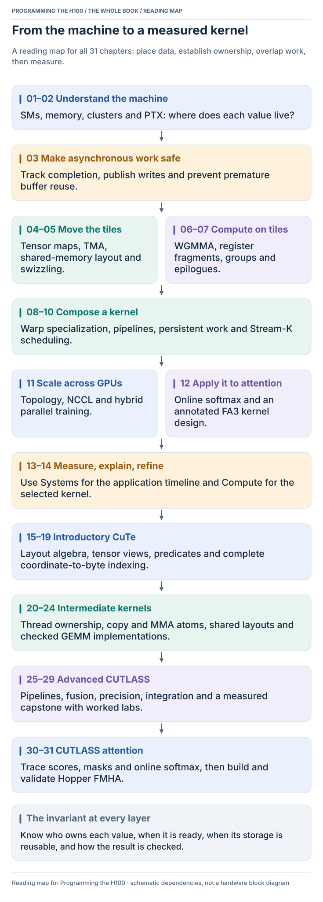

# Programming the H100: CUDA, CuTe, and CUTLASS from First Principles
## A Hardware-Level Companion Guide to NVIDIA Hopper

[](images/chapter-openers/00-cover.svg)

Understand the machine, prove the mapping, build the kernel, then measure the useful result. This book connects Hopper architecture and PTX to safe asynchronous pipelines, Tensor Core programming, application profiling and a complete CuTe/CUTLASS learning sequence.

The thirty-one chapters combine explanatory diagrams, worked calculations, downloadable programs and dated execution records. Follow the foundations in order, or choose a focused route below when a particular kernel or application needs attention.

<div class="grid cards" markdown>

-   :material-play-circle:{ .lg .middle } **Set up and run**

    ---

    [Getting Started & Installation](getting-started.md) covers a fresh Ubuntu host, a preconfigured GPU instance and the first verified CUDA program. Reading and website previews need no GPU.

-   :material-chip:{ .lg .middle } **Understand Hopper**

    ---

    Begin with [the architecture](01-h100-architecture.md), then connect data movement, completion, ownership and matrix instructions before assembling a kernel.

-   :material-matrix:{ .lg .middle } **Learn CuTe and CUTLASS**

    ---

    Start with [CuTe foundations](15-cute-layouts.md). Progress from coordinate proofs through checked kernels to pipelines, fusion, precision and a capstone.

-   :material-check-decagram:{ .lg .middle } **Inspect the actual results**

    ---

    Read the [original-program audit](final-audit.md) and [expanded workshop results](cutlass-workshop-validation.md). Every result retains its source revision, commands, system and execution scope.

</div>

## How to read this

[](images/book/overview.svg)

*Build the dependencies from the machine upward. When a profile exposes a bottleneck, return to the layer that explains it.*

**Prerequisites.** Be comfortable with thread/block indexing, launch dimensions, shared-memory lifetime, block synchronization and CUDA error checking. If those are new, begin with [NVIDIA's CUDA programming introduction](https://docs.nvidia.com/cuda/cuda-programming-guide/index.html), then follow [the first verified run](getting-started.md#5-compile-and-execute-your-first-verified-program).

| Your goal | Suggested route | What to produce |
| --- | --- | --- |
| First successful GPU run | Getting Started → 1 → 2 | A checked result and saved preflight information |
| Understand Hopper data movement | 2 → 3 → 4 → 5 | Valid descriptors, byte counts and an ownership/completion explanation |
| Design and diagnose a GEMM | 3 → 4 → 5 → 6 → 7 → 8 → 9 → 10 → 13 | Full-output reference checks and a profile tied to the right bottleneck |
| Understand fast attention | 3 → 4 → 6 → 7 → 9 → 12 → 30 → 31 → 13 | A checked recurrence and a clear account of the design's remaining kernel work |
| Find application stalls | 11 → 13 → 14 | A bounded timeline and consistently timed useful-result comparison |
| Learn CuTe/CUTLASS progressively | 15–19 foundations → 20–24 implementations → 25–29 advanced work → 30–31 attention | Coordinate proofs, checked kernels and a reproducible capstone |
| Study distributed GPU work | 1 → 2 → 11 → 13 | A topology record and a result checked on the required participants |

**Read each example in three passes.** Trace where values live and who owns them. Identify what makes them safe to read and safe to overwrite. Predict the reference result, then compare it with the captured output. Tune performance after those agree.

The CPU coordinate exercises in Chapters 15–19 provide an entry into CuTe without requiring a Hopper instance. Later copy, MMA and pipeline labs reconnect those mappings to the hardware and synchronization chapters. Keep the two routes distinct: calculating an offset on a laptop is useful preparation for a GPU run, not a substitute for it.

The CuTe/CUTLASS chapters use a common learning sequence: define the symbols, read a small worked illustration, follow the matching API call, calculate the intermediate coordinates or values, and check the result before extending the example. Keep the illustration beside the calculation; its labels distinguish logical coordinates, stored values, element offsets and byte addresses.

The companion guides state a goal, explain the mechanisms, provide worked checks and finish with a summary. Open a linked SVG for its full-resolution vector view. Code snippets explain local ideas; complete programs and execution records identify what was actually compiled and run. Use each example's complete command, including its architecture target and required driver, NCCL or cuBLAS linker flags.

## Contents

### The machine and instruction foundations

| Chapter | What you learn |
| --- | --- |
| [1. NVIDIA H100 GPU Architecture](01-h100-architecture.md) | SM organization, memory hierarchy, Tensor Cores and interconnect specifications |
| [2. Clusters, Inline PTX, Data Types & Pointers](02-clusters-inline-ptx.md) | Cluster cooperation, state spaces, PTX operands and byte addressing |
| [3. Asynchronicity, Barriers & the mbarrier Pipeline](03-asynchronicity-mbarrier.md) | Generic/async proxies, readiness, reuse and generation-aware completion |
| [4. cuTensorMap, TMA & Swizzling](04-cutensormap-tma-swizzling.md) | Tensor-map descriptors, transfer shapes, physical layouts and bounds |
| [5. cp.async.bulk, TMA Transfers & L2 Cache Hinting](05-cp-async-bulk-l2-hinting.md) | Transfer mechanisms, completion scopes, multicast and cache policies |
| [6. WGMMA — Warp Group Matrix Multiply-Accumulate](06-wgmma-part-1.md) | Warpgroup cooperation, supported operands, descriptors and asynchronous arithmetic |
| [7. WGMMA Part 2 — Groups, stmatrix, FP8 & Sparse](07-wgmma-part-2.md) | Commit/wait groups, fragment stores, precision and structured sparsity |

### Kernel design, applications and profiling

| Chapter | What you learn |
| --- | --- |
| [8. Kernel Design, Warp Specialization & Pipelining](08-kernel-design-part-1.md) | Rooflines, producer/consumer roles, resource allocation and staged buffers |
| [9. Pipelines, Epilogues & Persistent Scheduling](09-kernel-design-part-2.md) | Bidirectional ownership handshakes, epilogues and persistent tile scheduling |
| [10. Stream-K Scheduling & Multi-Kernel Launch](10-stream-k-scheduling.md) | Reduction-work scheduling, partial results and dependent launches |
| [11. Multi-GPU Systems, NCCL & Distributed Training](11-multi-gpu-nccl.md) | Topology, peer access, collectives and parallelism across devices |
| [12. FlashAttention-3 on the H100](12-flashattention-3.md) | Online softmax, traffic-aware attention and Hopper design techniques |
| [13. Profiling with Nsight Compute](13-nsight-compute.md) | Kernel counters, replay, rooflines, stalls and measured diagnoses |
| [14. Profiling with Nsight Systems](14-nsight-systems.md) | Application timelines, dependencies, transfers and useful overlap |

### CuTe and CUTLASS — increasing depth

Each level builds on the previous one. Introductory chapters establish mappings; intermediate chapters connect those mappings to complete implementations; advanced chapters change execution and numerical contracts deliberately.

| Level | Chapter | What you learn |
| --- | --- | --- |
| Introductory | [15. CuTe Foundations](15-cute-layouts.md) | Layout conventions, explicit formulas and the pinned workspace |
| Introductory | [16. Strides, Storage & Addresses](16-cute-strides.md) | Contiguous, padded, transposed, batched and broadcast storage with explicit units |
| Introductory | [17. Hierarchical Layout Algebra](17-cute-layout-algebra.md) | Static/dynamic hierarchy, composition, division and storage bounds |
| Introductory | [18. Tensors, Slicing & Predication](18-cute-tensors-tiling.md) | Engines, slices, tile views and coordinate-derived predicates |
| Introductory | [19. CTA and Byte-Address Indexing](19-cta-indexing.md) | Batch, CTA and K-tile origins through element offsets to byte addresses |
| Intermediate | [20. Thread Ownership & Tiled Copy](20-tiled-copy.md) | Real CuTe copy partitions and complete ownership/value checks |
| Intermediate | [21. MMA Atoms & Register Fragments](21-mma-atoms.md) | Pinned instruction traits, register packing and fragment coordinates |
| Intermediate | [22. Shared Layouts, Banks & Swizzles](22-shared-layouts.md) | Bank arithmetic, XOR mappings and descriptor agreement |
| Intermediate | [23. Build a Complete Tiled GEMM](23-gemm-construction.md) | A padded, batched SIMT baseline with boundary and empty-reduction cases |
| Intermediate | [24. CUTLASS Collective-Builder GEMM](24-cutlass-gemm.md) | Compatible builders, launch lifecycle and independent numerical checks |
| Advanced | [25. Hopper Pipelines & Scheduling](25-cutlass-pipelines.md) | Stage generations, prologue/drain and resource budgets |
| Advanced | [26. Epilogue Fusion](26-epilogue-fusion.md) | A fused ReLU variant, visitor-tree dataflow and operation order |
| Advanced | [27. Precision & Block Scaling](27-precision-block-scaling.md) | E2M1, scale axes, packed storage and architecture boundaries |
| Advanced | [28. Benchmarking & Framework Integration](28-benchmarking-integration.md) | Fair timing, concurrency, current streams and allocation lifetimes |
| Advanced | [29. Worked Labs & Capstone](29-workbook-capstone.md) | Progressive exercises, worked solutions and an evidence-driven comparison |
| Attention | [30. Attention from Layouts to Online Softmax](30-cutlass-attention-foundations.md) | Hand-calculated QK scores, masking, online state and output layouts |
| Attention | [31. Hopper CUTLASS FMHA](31-cutlass-hopper-fmha.md) | Trace and build the pinned fused-attention implementation, then validate and profile |

## Execution records and tested scope

!!! success "Original suite — November 17–18, 2026"

    The recorded current revisions of all **27 original complete CUDA programs compiled and executed successfully** across the recorded hosts: 26 workloads on H100 and the revised training workload on eight A100 GPUs. The [complete audit](final-audit.md) links the successful program records, stronger Chapter 7 coordinate test and twelve attention-reference cases. The [training supplement](eight-gpu-validation.md) uses `sm_80` and independently checks final weights and per-step losses; it is not an eight-H100 result.

    The four barrier-ordering corrections in Chapters 3–5 passed the [November 18 two-H100 rerun](revalidation-2026-11-18.md) and memory checks. That host had **2× H100 80GB HBM3, 132 SMs each, NV18 peer topology**, Ubuntu 24.04.5 LTS, driver 580.105.08 and CUDA compiler 12.8.93; the recorded builds used `sm_90a`, C++17 and `-O2`.

!!! success "Expanded workshop — H100, November 18, 2026"

    The [CuTe/CUTLASS workshop record](cutlass-workshop-validation.md) captures **eight CUDA compilations, two Python byte-compilations and eleven passing workload invocations**, plus two real Nsight Systems reports. CPU-only layout, ownership and format checks retain their stated scope. These additions have their own source identities and records; the original suite is preserved.

The attention extension adds a [dated CPU walkthrough](30-cutlass-attention-foundations.md#12-run-the-cpu-oracle-and-read-its-evidence) and a separate [Hopper FMHA collection lab](31-cutlass-hopper-fmha.md). The CPU record checks the equations; the new FMHA build/run commands need their own Hopper capture and do not inherit the earlier workshop's GPU results.

The [original single-GPU manifest](validation/2026-11-17/results.json) remains available as historical evidence. Current chapters link exact tested sources, commands, compile/run timestamps, system information and captured outputs beside the relevant examples. Derived arithmetic, architecture specifications and cited paper benchmarks are identified separately from this book's measured results.

??? info "What the evidence labels mean"

    **Compiled** means the listed complete translation unit built with the recorded command. **Executed and passed** means the actual workload ran and passed its stated checks. **Reference/skeleton** means surrounding implementation is still required. A CPU coordinate model, an attention recurrence check and a real GPU kernel validate different scopes; passing one does not establish the others or reproduce a paper benchmark.

    Exercises and their worked answers are reasoning aids. A hypothetical timing used to check TFLOP/s arithmetic is not a captured hardware measurement.

??? info "A compact glossary — use it while reading"

    | Term | Meaning in this book | Read more |
    | --- | --- | --- |
    | SM | Streaming multiprocessor: a block of GPU execution resources | [1](01-h100-architecture.md) |
    | CTA / thread block | Cooperating CUDA threads with a block-local shared-memory lifetime | [2](02-clusters-inline-ptx.md) |
    | Warp / warpgroup | 32 threads / four consecutive warps participating in Hopper WGMMA | [2](02-clusters-inline-ptx.md), [6](06-wgmma-part-1.md) |
    | Cluster / DSMEM | Co-scheduled blocks and their distributed shared-memory access | [2](02-clusters-inline-ptx.md) |
    | Generic / async proxy | Distinct memory-access mechanisms that need the right ordering protocol | [3](03-asynchronicity-mbarrier.md) |
    | RAW / WAR | Read-after-write readiness / write-after-read reuse hazards | [3](03-asynchronicity-mbarrier.md) |
    | mbarrier / phase | Completion state and the generation being waited on | [3](03-asynchronicity-mbarrier.md), [9](09-kernel-design-part-2.md) |
    | Tensor map / TMA | A multidimensional transfer description / Hopper transfer machinery | [4](04-cutensormap-tma-swizzling.md), [5](05-cp-async-bulk-l2-hinting.md) |
    | Swizzle | A mapping between logical element coordinates and shared-memory byte locations | [4](04-cutensormap-tma-swizzling.md) |
    | WGMMA / descriptor | Hopper warpgroup matrix arithmetic / its shared-memory operand description | [6](06-wgmma-part-1.md) |
    | Commit / wait group | Submission of asynchronous arithmetic and waiting for its completion | [7](07-wgmma-part-2.md) |
    | Epilogue | Processing after the reduction: conversion, scaling, activation and output storage | [7](07-wgmma-part-2.md), [9](09-kernel-design-part-2.md) |
    | Stage / empty / full | A reusable storage slot and the two directions of its ownership handshake | [8](08-kernel-design-part-1.md), [9](09-kernel-design-part-2.md) |
    | Arithmetic intensity | Defined work divided by defined traffic at a stated memory level | [8](08-kernel-design-part-1.md) |
    | Stream-K | Scheduling based on reduction work, potentially combining partial output tiles | [10](10-stream-k-scheduling.md) |
    | TP / PP / DP | Tensor, pipeline and data parallelism | [11](11-multi-gpu-nccl.md) |
    | Online softmax | Combining tiles using a running maximum, normalizer and output numerator | [12](12-flashattention-3.md) |
    | Replay / occupancy | Profiler re-execution / resident execution-resource use; neither alone proves speed | [13](13-nsight-compute.md) |
    | CuTe / CUTLASS | Tensor/layout and instruction abstractions / the larger CUDA kernel and operator ecosystem | [15](15-cute-layouts.md), [24](24-cutlass-gemm.md) |
    | Layout / engine / tensor | Coordinate-to-offset map / data-access or storage mechanism / their combination | [17](17-cute-layout-algebra.md), [18](18-cute-tensors-tiling.md) |
    | size / cosize | Logical coordinate count / the layout's codomain extent used for supported storage-sizing calculations | [17](17-cute-layout-algebra.md) |
    | Leading dimension / stride | Physical spacing in declared units; typed-pointer element offsets and descriptor byte offsets differ | [19](19-cta-indexing.md) |
    | Thread/value partition | Assignment of logical values to participating threads and per-thread slots | [20](20-tiled-copy.md) |
    | Copy / MMA atom | An instruction-specific transfer or matrix-operation contract with its participation and value mapping | [20](20-tiled-copy.md), [21](21-mma-atoms.md) |
    | Identity tensor / predicate | Coordinate-valued reference view / a validity condition actually applied to the operation | [18](18-cute-tensors-tiling.md), [20](20-tiled-copy.md) |
    | Collective / adapter | Coordinated mainloop or epilogue / host interface for arguments, workspace and kernel launch | [24](24-cutlass-gemm.md) |
    | Generation | Which reuse of a storage slot a readiness/empty event belongs to | [25](25-cutlass-pipelines.md) |
    | EVT | Epilogue visitor tree: a dataflow expression whose nesting fixes operation order | [26](26-epilogue-fusion.md) |
    | E2M1 / block scale | A floating-point nibble codebook / a scale shared by a specified group along a declared axis | [27](27-precision-block-scaling.md) |
    | Makespan / latency / throughput | Joined batch duration / time for a defined request / completed work per stated interval | [28](28-benchmarking-integration.md) |


## Read and build locally

From a source checkout, create the documentation environment:

```bash
python3 -m venv .venv
source .venv/bin/activate
python3 -m pip install -r requirements.txt
mkdocs serve
```

Open <http://127.0.0.1:8000> on the same machine. [Getting Started](getting-started.md) covers source checkout, Windows activation, remote preview, strict-build checks and the separate GPU prerequisites.

For your own fork, set `site_url` and `repo_url` in `mkdocs.yml` to that repository before publishing. This repository's `.github/workflows/ci.yml` verifies and deploys changes pushed to `main`.

Built with [Material for MkDocs](https://squidfunk.github.io/mkdocs-material/).
