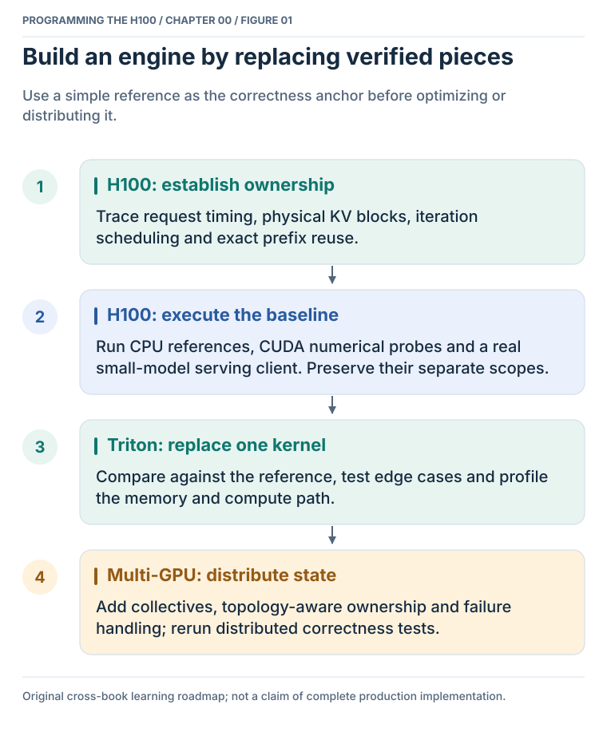

# Part XII: Inference Systems on Hopper

!!! abstract "What this part is"

    Chapters 1 to 31 teach the machine: how a Hopper GPU moves and multiplies data. Part XII asks what happens when those kernels become a **serving system**: many users, long contexts, several GPUs, and a bill. Each chapter is one buildable project that ends in a number you can publish.

The project list comes from a public LinkedIn post by Ravi A Samy listing twelve inference-engineering portfolio projects. The descriptions, numbers and code in this book are original to it.

!!! warning "How to read the evidence in this part"

    The original Part XII programs use CPU references and simulations. Their [November 25 rerun](validation-inference-2026-11-25.md) is separate from the new [Chapter 47 GPU/serving lab](47-vllm-tuning-lab.md). That validates logic (routing, accounting, queueing, correctness of a communication pattern) and arithmetic (byte counts, bandwidth floors). It does **not** validate GPU speed, NCCL or InfiniBand throughput, or real-model quality. Each chapter separates "checked on CPU" from "untested on H100", and where a number is a datasheet value rather than a measurement it says so. Keep real measurements alongside the simulated tables with separate labels; hardware results do not retroactively validate assumed simulation constants.

## The twelve projects and where they live

| # | Project | Where |
|---|---|---|
| 1 | Custom Triton kernel optimizer | Triton from First Principles, Part 8 |
| 2 | Disaggregated prefill/decode cluster | [Chapter 35](35-disaggregated-prefill-decode.md) |
| 3 | Hierarchical KV-cache offloader | [Chapter 34](34-kv-cache-offloading.md) |
| 4 | Grammar-constrained decoding engine | Triton from First Principles, Part 8 |
| 5 | MoE expert-parallel router | [Chapter 33](33-moe-expert-parallel.md) |
| 6 | FP4/INT4 quantization and calibration pipeline | Triton from First Principles, Part 8; [native FP4 in the Blackwell appendix](appendix-blackwell-fp4.md) |
| 7 | Speculative decoding harness | Triton Part 8 (verify kernel); [Chapter 37](37-speculative-decoding-70b.md) (70B cost model) |
| 8 | Queue-based GPU autoscaler | [Chapter 40](40-gpu-autoscaler.md) |
| 9 | Semantic AI gateway and cache | [Chapter 38](38-semantic-cache.md) |
| 10 | Multi-model complexity router | [Chapter 39](39-complexity-router.md) |
| 11 | WebGPU / MLX edge fallback | [Chapter 41](41-edge-fallback-resilience.md); combined with projects 8–10 in the [Chapter 42](42-gateway-capstone.md) capstone |
| 12 | Public inference benchmark teardown | [Chapter 36](36-benchmark-teardown.md) |

Part XIV goes one level down: it builds the core of an engine in the style of vLLM and SGLang (paged KV cache, continuous-batching scheduler, radix prefix cache), starting with [Chapter 43](43-paged-kv-cache.md) and [Chapter 44](44-continuous-batching.md) and [Chapter 45](45-radix-prefix-cache.md), closing with the capstone engine of [Chapter 46](46-mini-engine-capstone.md). Its chapters are numbered from 43 because Chapters 41 and 42 belong to Part XIII.

The Triton book is at <https://maximumbeings.github.io/triton-from-first-principles/>.

## The shared harness

Every project is judged with the same instruments, introduced in [Chapter 32](32-inference-engine-and-harness.md): a fixed workload with Poisson arrivals, time to first token (TTFT), time per output token (TPOT), percentile latencies, goodput under a service-level objective (SLO), and dollars per million tokens. Report a number only alongside the workload, software versions and hardware that produced it.

## The destination: an inference engine

Use Chapters 43–46 as the correctness reference, then [Chapter 47](47-vllm-tuning-lab.md) to connect block-walk attention and the client to real CUDA execution and vLLM serving. The Triton book supplies the next kernel implementations; the multi-GPU book supplies distributed ownership and collectives. Validate each replacement before integrating it. A small single-GPU serving test does not establish MoE, RDMA, KEDA or edge-fallback performance.

The [follow-up agent audit and complete-code guide](inference-adversarial-review-2026-11-25.md) records the subsequent corrections and fresh CPU reruns. Every chapter in this path now prints its complete implementation, with a matching downloadable source bundle.
